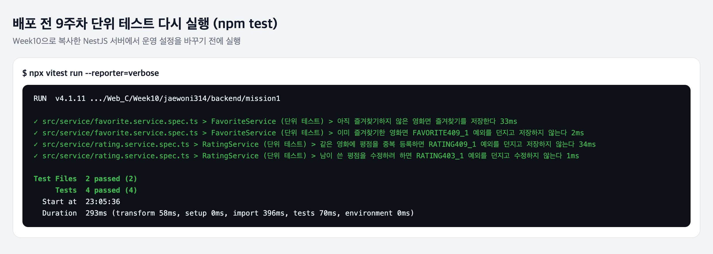
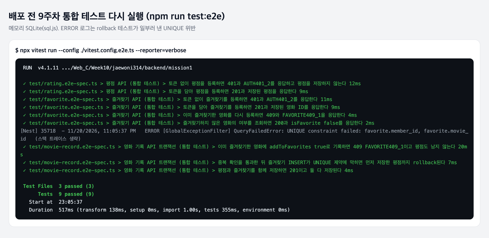
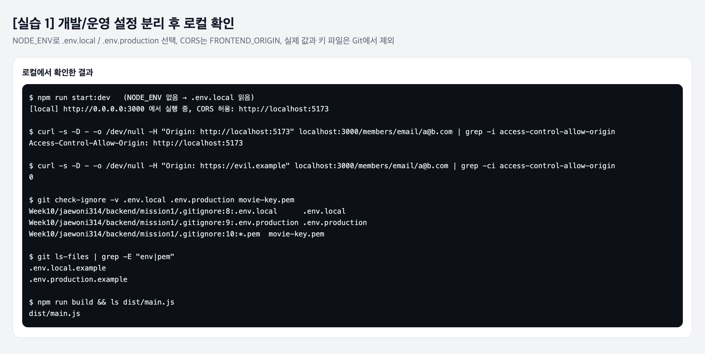

# 10주차 백엔드 미션 기록 - 배포하고 결과물 완성하기 (NestJS)

9주차 서버를 EC2 + RDS에 배포하기 위한 **개발/운영 설정 분리(실습 1)** 와 **배포 전 테스트, 빌드 산출물 확인**까지 마쳤습니다.
**AWS(EC2, RDS) 리소스 생성과 실제 배포(실습 2~4, 필수 미션)는 아직 하지 않았습니다.** 이어서 진행할 순서를 아래 [남은 일](#-남은-일-aws-배포-절차)에 정리했습니다.

> 이 문서는 노션 "미션 기록" 토글에 옮겨 적기 쉽도록 워크북 목차 순서대로 정리했습니다.
> 🙋 표시는 **직접 해야 하는 일**(AWS 작업, 노션에 붙여 넣기, 본인 말로 다듬기, 제출)입니다.

---

## ✅ 제출 전 체크리스트

| | 할 일 | 상태 |
| --- | --- | --- |
| | 배포 전 9주차 단위/통합 테스트 다시 실행 | ✅ 단위 4, 통합 9 통과 (b01, b02) |
| | 실습 1: 개발/운영 설정 분리, 운영 스키마 자동 변경 끄기, Git 추적 확인 | ✅ (b03) |
| | 빌드 산출물(`dist/main.js`) 만들기 | ✅ (b03) |
| 🙋 | 실습 2: RDS(MySQL)와 EC2 준비, 보안 그룹 (비용 확인 후) | 나중에 |
| 🙋 | 실습 3: EC2에서 `dist` 실행 (`nohup`) | 나중에 |
| 🙋 | 실습 4: `FRONTEND_ORIGIN`에 Vercel 주소 등록, 핵심 API 점검 | 나중에 |
| 🙋 | 필수 미션 제출물: 배포된 API 주소, 핵심 요청/응답 캡처, 비용 확인과 리소스 정리 계획, 최종 회고 | 배포 후 |
| 🙋 | 선택 미션: 배포 환경에서 `POST /movie-records` 정상/실패 + 후속 조회 | 배포 후 |
| 🙋 | 핵심 키워드 정리: 아래 초안을 **본인 말로 다듬어** 노션에 옮기기 | 초안 ✅ |
| 🙋 | 노션 개인 미션 페이지 → 공유 → 링크 복사 → [PE 워크북 AI 피드백 시스템](https://umc.ai.kr/)에 제출 | 직접 |

---

## 1. 배포 전 9주차 테스트를 다시 실행

`Week10`으로 복사한 서버에서 설정을 바꾸기 전에 9주차 테스트를 다시 돌렸습니다.

```bash
npm test          # 단위 테스트 4개 통과
npm run test:e2e  # 통합 테스트 9개 통과 (메모리 SQLite)
```





---

## 2. [실습 1] 개발/운영 설정 분리

### 1) 환경별 .env 파일

| 파일 | 용도 | Git |
| --- | --- | --- |
| `.env.local` | 로컬 MySQL, `FRONTEND_ORIGIN=http://localhost:5173` | ❌ 올리지 않음 |
| `.env.production` | EC2에서 RDS를 가리키는 실제 값 (EC2에만 둠, 권한 600) | ❌ 올리지 않음 |
| `.env.local.example`, `.env.production.example` | 비밀 값을 비운 키 목록 | ✅ 공유 |

```ts
// src/app.module.ts
// 이 imports 배열은 위에서부터 평가되므로, 아래 TypeOrmModule.forRoot의 process.env를 읽기 전에 파일이 먼저 로드돼요.
ConfigModule.forRoot({
  isGlobal: true,
  envFilePath: process.env.NODE_ENV === "production" ? ".env.production" : ".env.local",
}),
TypeOrmModule.forRoot({
  type: "mysql",
  host: process.env.DB_HOST,
  // ...
  // 운영 RDS에는 실제 회원의 평점과 즐겨찾기가 쌓여요. 앱이 켜질 때 엔티티를 보고 테이블을 바꾸지 않도록 모든 환경에서 꺼 둬요.
  synchronize: false,
}),
```

EC2에서 `export`로 넘긴 값이 있으면 파일보다 실행 환경의 값이 우선입니다. (`ConfigModule`은 이미 있는 `process.env`를 덮어쓰지 않음) 그래서 워크북처럼 비밀번호를 `read -s`로 받아 `export`해도, `.env.production` 파일로 넘겨도 같은 코드로 동작합니다.

### 2) CORS 허용 주소와 바인딩

```ts
// src/main.ts
function getAllowedOrigins() {
  const origins = (process.env.FRONTEND_ORIGIN ?? "http://localhost:5173")
    .split(",")
    .map((origin) => origin.trim().replace(/\/+$/, "")) // Origin 끝에 /가 붙으면 브라우저의 Origin과 달라져 막혀요.
    .filter(Boolean);
  return origins.length > 0 ? origins : ["http://localhost:5173"];
}

const allowedOrigins = getAllowedOrigins();
app.enableCors({ origin: allowedOrigins, methods: ["GET", "POST", "PATCH", "DELETE"] });

// EC2 밖에서 들어오는 요청을 받도록 모든 네트워크 주소(0.0.0.0)에서 기다려요.
await app.listen(port, "0.0.0.0");
console.log(`[${process.env.NODE_ENV ?? "local"}] http://0.0.0.0:${port} 에서 실행 중, CORS 허용: ${allowedOrigins.join(", ")}`);
```

### 3) Git에 올라가는 파일 확인

레포 루트 `.gitignore`가 `.env.*`를 통째로 무시해서 `.env.production.example`까지 올라가지 않는 문제가 있었습니다. (트러블 슈팅 No.1) 프로젝트 `.gitignore`에 `!.env.*.example`을 더했습니다.

```gitignore
# 10주차: 환경별 실제 값과 EC2 키 페어는 올리지 않아요. (*.example만 공유)
.env
.env.local
.env.production
*.pem
!.env.*.example
```

### 확인 결과



- `NODE_ENV` 없이 실행하면 `.env.local`을 읽고 `[local] ... CORS 허용: http://localhost:5173`으로 시작
- 허용한 Origin(`http://localhost:5173`)에는 `Access-Control-Allow-Origin`이 붙고, 다른 Origin(`https://evil.example`)에는 붙지 않음
- `.env.local`, `.env.production`, `*.pem`은 무시되고, Git에는 `*.example` 두 개만 추적됨
- `npm run build` → `dist/main.js` 생성

---

## 🔜 남은 일: AWS 배포 절차

아래는 다음에 진행할 순서입니다. 값은 `{EC2_PUBLIC_IP}`, `{RDS_ENDPOINT}`처럼 표시했습니다.

### 0. 비용과 정리 계획 (먼저)

- 리전 하나(예: 서울 `ap-northeast-2`)에 EC2 `t3.micro`(또는 Free Tier 대상), RDS MySQL `db.t4g.micro` + 스토리지 20GB로 만들고, 생성 전 Free Tier·크레딧과 예상 비용을 확인합니다.
- **AWS Budgets**에 예산 알림(예: 월 $5)을 걸어 둡니다.
- 실습이 끝나면 EC2 종료, RDS 삭제(최종 스냅샷 생성 여부 선택), 남은 EBS 볼륨·스냅샷·탄력적 IP를 확인해 지웁니다.

### 1. RDS (실습 2)

- MySQL, 퍼블릭 액세스 **끔**, EC2와 같은 VPC. DB 이름은 코드와 같은 `umc_movie`
- RDS 보안 그룹 인바운드: MySQL 3306, 소스 = **EC2 보안 그룹** (0.0.0.0/0 금지)
- 스키마는 EC2 안에서 `sql/01_schema_seed.sql`로 준비 (앱이 테이블을 만들지 않음)

```bash
mysql -h {RDS_ENDPOINT} -P 3306 -u {DB_USER} -p < sql/01_schema_seed.sql
```

### 2. EC2 (실습 2)

- Amazon Linux, 퍼블릭 IPv4, 키 페어 `.pem`은 저장소 밖에 보관 (`chmod 400`)
- EC2 보안 그룹 인바운드: SSH 22 = **내 IP만**, TCP 3000 = 프론트 사용자가 접근할 범위
- 로컬과 같은 메이저 버전의 Node.js 설치 후 `node --version` 확인

### 3. 빌드와 실행 (실습 3)

```bash
# 로컬
npm ci && npm run build
scp -i {KEY_FILE}.pem -r dist package.json package-lock.json sql ec2-user@{EC2_PUBLIC_IP}:~/movie-app/

# EC2
cd ~/movie-app && npm ci --omit=dev
cp .env.production.example .env.production && chmod 600 .env.production   # DB_HOST, DB_PASSWORD, JWT_SECRET, FRONTEND_ORIGIN 입력
NODE_ENV=production nohup node dist/main.js > ~/movie-app.log 2>&1 &
tail -n 20 ~/movie-app.log   # [production] http://0.0.0.0:3000 ... CORS 허용: ... 확인
```

SSH 창을 닫은 뒤 로컬에서 `curl http://{EC2_PUBLIC_IP}:3000/swagger-ui`로 서버가 살아 있는지 확인합니다.

### 4. 프론트 연결과 점검 (실습 4)

- 백엔드 `.env.production`: `FRONTEND_ORIGIN=https://umcine-jaewoni314.vercel.app,http://localhost:5173`
- 프론트(Vercel)는 HTTPS라 HTTP API를 직접 부르면 혼합 콘텐츠로 막히므로, Vercel 환경변수 `UMC_API_ORIGIN=http://{EC2_PUBLIC_IP}:3000`을 등록하고 Redeploy합니다. (프론트의 `/api/umc` rewrite가 서버에서 대신 호출)
- Swagger로 점검: `POST /members` 201 → `POST /auth/login` 200 → `GET /members/me` 토큰 없이 401 / 토큰 200 → `POST /ratings` 201 + `GET /members/{memberId}/ratings` → `POST /favorites` 201 + `GET /favorites/{movieId}`, `GET /favorites` → 중복 등록 409
- 선택 미션: 이미 즐겨찾기한 영화로 `POST /movie-records` → 409 `FAVORITE409_1` 후 `GET /members/{memberId}/ratings`에 평점이 남지 않았는지 확인 (테스트 계정·영화 ID를 따로 사용)

---

## 🎯 핵심 키워드 (초안 🙋 본인 말로 다듬기)

<details>
<summary>개발 환경 / 운영 환경</summary>

- **개발(로컬)**: 내 컴퓨터의 MySQL, 기능을 만들고 확인하는 곳. 데이터를 지워도 됨
- **테스트**: 9주차의 메모리 SQLite(sql.js). 테스트마다 새로 만들고 지움 (`synchronize: true`)
- **운영**: RDS에 실제 회원 데이터가 쌓이는 곳. 스키마를 앱이 바꾸면 안 되고(`synchronize: false`), 비밀 값은 코드가 아닌 실행 환경에서 받음
- 같은 코드를 쓰되 **DB 주소, 허용할 프론트 Origin, 비밀 값, 스키마 정책**만 환경마다 다르게 주입합니다. 이번에 `NODE_ENV`로 `.env.local`/`.env.production`을 고르게 한 이유입니다.

</details>

<details>
<summary>빌드 산출물 (JAR, dist)</summary>

- 빌드는 소스 코드를 실행할 수 있는 형태로 바꾸는 과정입니다. NestJS는 TypeScript를 JavaScript로 컴파일해 `dist/`를 만들고(`dist/main.js`), Spring은 실행 가능한 JAR을 만듭니다.
- `dist`에는 `node_modules`가 없어서 EC2에서 `npm ci --omit=dev`로 운영 의존성만 설치해야 합니다. 코드와 실행 환경은 별개라 EC2에도 같은 메이저 버전의 Node.js가 필요합니다.
- 서버에서 직접 빌드하지 않고 산출물만 올리면, 테스트를 통과한 바로 그 결과물을 배포한다는 장점이 있습니다.

</details>

<details>
<summary>EC2와 RDS</summary>

- **EC2**: AWS의 가상 서버. 우리 NestJS 앱(`node dist/main.js`)이 실행되는 곳이고, 퍼블릭 IP로 외부 요청을 받습니다.
- **RDS**: AWS가 관리해 주는 데이터베이스(MySQL). 백업, 패치, 장애 복구를 AWS가 맡고, 우리는 엔드포인트로 접속만 합니다.
- 요청 흐름: 브라우저 → (Vercel의 `/api/umc` 프록시) → EC2:3000 → RDS:3306. RDS는 인터넷에 열지 않고 EC2에서만 접속하게 둡니다.

</details>

<details>
<summary>VPC와 보안 그룹</summary>

- **VPC**: AWS 안의 나만의 가상 네트워크. EC2와 RDS를 같은 VPC에 두면 비공개 주소로 서로 통신합니다.
- **보안 그룹**: 리소스 앞의 방화벽. 어떤 출발지에서 어떤 포트로 들어오는 것을 허용할지 정합니다.
  - EC2: SSH 22는 내 IP만, 앱 3000은 프론트 사용자 범위
  - RDS: 3306은 **EC2 보안 그룹에서 오는 연결만** (IP가 아니라 보안 그룹을 소스로 지정하면 EC2 IP가 바뀌어도 유지)
- 0.0.0.0/0(인터넷 전체)을 DB 소스로 쓰지 않는 것이 핵심입니다.

</details>

<details>
<summary>환경변수와 비밀 값</summary>

- DB 비밀번호, JWT 서명 키처럼 노출되면 안 되는 값은 코드와 Git에 넣지 않고 실행 환경에서 받습니다. (`.env.production`은 EC2에만, 권한 600)
- Git에는 `*.example`처럼 **키 이름만** 올려 다른 사람이 무엇을 채워야 하는지 알게 합니다.
- 이미 커밋된 비밀 값은 `.gitignore`에 추가해도 기록에 남으므로, 추적을 해제하고 값 자체를 바꿔야 합니다.
- 프론트(10주차 Vercel)에서도 같은 원칙: TMDB 토큰은 서버 전용 변수, 브라우저에 필요한 값만 `NEXT_PUBLIC_`.

</details>

<details>
<summary>CORS와 Origin</summary>

- **Origin**은 `스킴://호스트:포트`입니다. (`https://umcine-jaewoni314.vercel.app`, `http://localhost:5173`) 경로와 끝의 `/`는 포함하지 않습니다.
- **CORS**는 브라우저가 다른 Origin의 응답을 읽어도 되는지 서버에 묻는 규칙입니다. 서버가 `Access-Control-Allow-Origin`으로 허용해야 브라우저가 응답을 읽습니다. Postman이나 서버끼리의 요청에는 적용되지 않습니다.
- 이번에 허용 목록을 `FRONTEND_ORIGIN` 환경변수로 받아, 로컬(`http://localhost:5173`)과 운영(Vercel 주소)을 같은 코드로 처리하게 했습니다.
- 참고로 Vercel 프론트는 `/api/umc` rewrite로 **서버가 대신 호출**하므로, 브라우저 입장에서는 같은 Origin 요청이라 CORS도 혼합 콘텐츠도 생기지 않습니다.

</details>

---

## 📢 학습 후기 (초안 🙋 배포 후 다시 작성)

**내 컴퓨터에서 성공한 테스트와 외부 주소에서 성공한 요청은 어떤 점이 달랐나요?**
> (배포 후 작성) 테스트는 메모리 DB와 테스트용 비밀 값으로 "코드가 맞는지"를 확인하지만, 외부 주소의 요청은 네트워크(보안 그룹, 0.0.0.0 바인딩), 운영 DB 연결, CORS까지 모두 맞아야 성공한다는 점이 다를 것 같다.

**배포 중 가장 오래 막혔던 문제는 무엇이었고, 어떤 확인으로 원인을 찾았나요?**
> (배포 후 작성)

---

## ⚡ 트러블 슈팅

### ⚡ 이슈 No.1 `.env.production.example`이 Git에 올라가지 않음

**이슈**
👉 운영 키 목록 예시 파일 `.env.production.example`을 만들었는데 `git status`에 나타나지 않았다.

**문제**
👉 `git check-ignore -v`로 확인하니 프로젝트 `.gitignore`가 아니라 **레포 루트 `.gitignore`의 `.env.*` 규칙**에 걸려 있었다. 루트에는 `!.env.example` 예외만 있어서 `.env.local.example`(기존 `.env.example`에서 이름만 바꿔 이미 추적 중이던 파일)은 보였지만, 새로 만든 `.env.production.example`은 무시됐다.

```
$ git check-ignore -v .env.production.example
../../../../.gitignore:12:.env.*	.env.production.example
```

**해결**
👉 프로젝트 `.gitignore`에 `!.env.*.example` 예외를 추가했다. 실제 값이 든 `.env.local`, `.env.production`, `*.pem`은 계속 무시되는 것을 `git check-ignore`로 다시 확인했다.

**배운 점**
👉 하위 폴더의 `.gitignore`만 보면 안 되고, 상위 폴더 규칙까지 함께 적용된다. 파일이 왜 무시되는지는 `git check-ignore -v`가 어느 파일의 몇 번째 줄인지 알려 준다.

**참고레퍼런스**
- [Git - gitignore](https://git-scm.com/docs/gitignore)
- [NestJS - Configuration](https://docs.nestjs.com/techniques/configuration)
