# 10주차 프론트엔드 미션 기록 - Vercel 배포를 통해 사용자들에게 제공하기

9주차에 Next.js로 옮긴 UMCine를 Vercel에 배포했습니다.

- **최종 배포 주소: https://umcine-jaewoni314.vercel.app**
- Vercel 프로젝트: `umcine-jaewoni314` (Hobby), 연결 저장소: `jaewoni314/Web_C` (조직 저장소의 개인 fork), 운영 브랜치 `main`, Root Directory `Week10/jaewoni314/frontend/mission1`
- 백엔드(EC2 + RDS)는 아직 배포 전이라 로그인, 즐겨찾기, 평점은 배포 주소에서 동작하지 않습니다. (아래 [남은 일](#-남은-일-백엔드-배포-후))

> 이 문서는 노션 "미션 기록" 토글에 옮겨 적기 쉽도록 워크북 목차 순서대로 정리했습니다.
> 🙋 표시는 **직접 해야 하는 일**(노션에 붙여 넣기, 본인 말로 다듬기, 제출)입니다.

---

## ✅ 제출 전 체크리스트

| | 할 일 | 상태 |
| --- | --- | --- |
| 🙋 | 스터디 인증샷 (스터디 리더가 대표로 한 장) | 직접 |
| | 학습 내용 3: Vercel 프로젝트 생성, 저장소 연결, 환경변수 등록, 배포, 새 내용 자동 배포 | ✅ 아래 [학습 내용 실습](#-학습-내용-실습-기록) |
| | 필수 미션: 배포 주소 최종 점검 | ✅ 아래 [필수 미션](#-필수-미션-배포한-umcine-최종-점검하기) (백엔드 기능은 백엔드 배포 후 다시 점검) |
| | 선택 미션: Preview 배포, Instant Rollback, Web Analytics | ✅ 아래 [선택 미션](#-선택-미션) |
| | 선택 미션: 도메인 연결 | ⏭ 하지 않음 (도메인 구매/등록 필요) |
| 🙋 | 핵심 키워드 정리: 아래 초안을 **본인 말로 다듬어** 노션에 옮기기 | 초안 ✅ |
| 🙋 | 학습 후기 작성: 아래 초안 참고 | 초안 ✅ |
| 🙋 | 백엔드(EC2) 배포 후 Vercel에 `UMC_API_ORIGIN` 등록 → Redeploy → 로그인/즐겨찾기/평점 점검 | 나중에 |
| 🙋 | 노션 개인 미션 페이지 → 공유 → 링크 복사 → [PE 워크북 AI 피드백 시스템](https://umc.ai.kr/)에 제출 | 직접 |
| 🙋 | (선택) 기술 블로그 / 지식in 상점 | 직접 |

---

## ✨ 학습 내용 실습 기록

### 3.1~3.2 프로젝트 생성과 GitHub 저장소 연결

Vercel에 GitHub(jaewoni314)로 로그인하고 **Create New → Project**에서 저장소를 가져왔습니다.

- UMCine가 있는 `HSU-Makeus-Challenge-11th/Web_C`는 **조직(Organization) 저장소**입니다. Vercel의 계정 선택 목록에 조직이 없었고, Vercel GitHub 앱을 조직에 설치하려면 조직 소유자 권한이 필요했습니다. (저는 멤버)
- 그래서 저장소를 개인 계정으로 **fork**(`jaewoni314/Web_C`, 공개)해서 연결했습니다. 개인 계정의 저장소는 Hobby 플랜에서도 바로 연결됩니다.
- 조직 저장소의 `main`에는 아직 `Week10` 폴더가 없어서(PR 머지 전), **fork의 `main`을 운영 브랜치**로 쓰고 `jaewoni314/week10` 브랜치 내용을 올렸습니다.

```bash
gh repo fork HSU-Makeus-Challenge-11th/Web_C --clone=false
git remote add fork https://github.com/jaewoni314/Web_C.git
git push fork jaewoni314/week10:main     # fork의 main = 운영 브랜치
```

### 3.3 빌드 설정과 환경 변수 등록

| 항목 | 값 |
| --- | --- |
| Project Name | `umcine-jaewoni314` |
| Root Directory | `Week10/jaewoni314/frontend/mission1` (저장소 최상위가 아니라 주차별 폴더 안에 프로젝트가 있음) |
| Application Preset | Next.js (자동 인식) |
| Build / Install | 기본값 (`pnpm-lock.yaml`을 보고 pnpm 사용) |

| Key | 값 | Environments |
| --- | --- | --- |
| `TMDB_API_BASE_URL` | `https://api.themoviedb.org/3` | Production and Preview |
| `TMDB_ACCESS_TOKEN` | TMDB API 읽기 액세스 토큰 | Production and Preview |
| `NEXT_PUBLIC_API_BASE_URL` | `/api/umc` | Production and Preview |

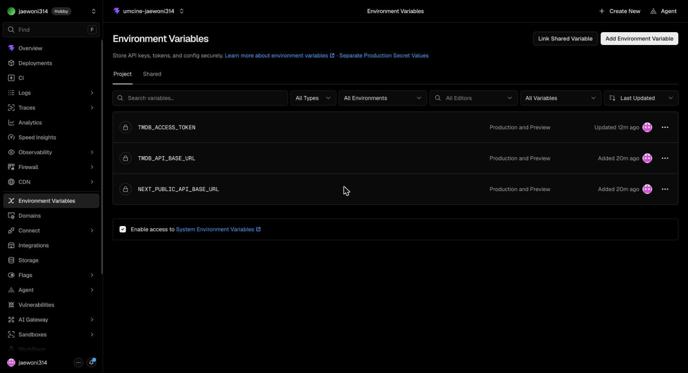

로컬의 `.env.local`은 Git에 올라가지 않으므로 Vercel에 자동으로 등록되지 않습니다. 첫 배포는 `TMDB_ACCESS_TOKEN` 값이 비어 있어 빌드가 실패했습니다. (아래 트러블 슈팅 No.1)

#### 배포 전에 바꾼 코드: HTTPS 페이지에서 HTTP 백엔드 부르기

Vercel 주소는 HTTPS인데, 백엔드 워크북의 EC2 API는 HTTP(`http://{EC2_PUBLIC_IP}:3000`)입니다. HTTPS 페이지에서 HTTP API를 직접 부르면 브라우저가 **혼합 콘텐츠(Mixed Content)** 로 막습니다. 그래서 브라우저는 같은 사이트의 `/api/umc/...`로 요청하고, Next.js 서버가 백엔드로 대신 전달하도록 `rewrites`를 추가했습니다.

```ts
// next.config.ts
// 서버에서만 쓰는 값이라 NEXT_PUBLIC_을 붙이지 않아요. 예) http://{EC2_PUBLIC_IP}:3000
const umcApiOrigin = process.env.UMC_API_ORIGIN?.replace(/\/+$/, "");

const nextConfig: NextConfig = {
  async rewrites() {
    if (!umcApiOrigin) return []; // 로컬 개발: rewrite 없이 http://localhost:3000을 직접 호출
    return [{ source: "/api/umc/:path*", destination: `${umcApiOrigin}/:path*` }];
  },
  // ...
};
```

로컬에서 `UMC_API_ORIGIN=http://localhost:3000`, `NEXT_PUBLIC_API_BASE_URL=/api/umc`로 프로덕션 빌드를 띄워 확인했습니다. 로그인, 내 정보, 즐겨찾기 요청이 모두 같은 출처의 `/api/umc/...`로 나가 200을 받았습니다. 같은 출처 요청이라 CORS 설정도 필요 없어집니다.

### 3.4 배포된 서비스 확인

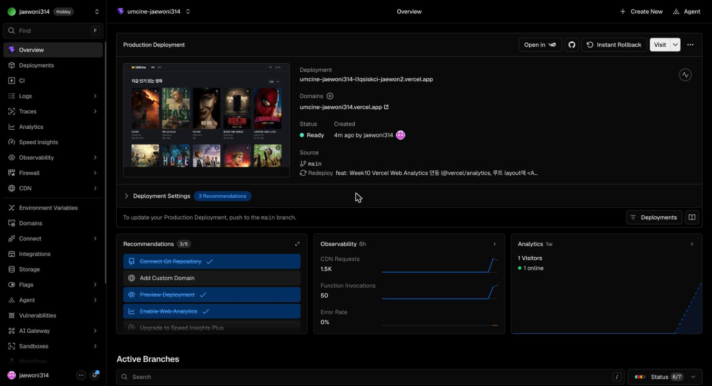

### 3.5 새로운 내용 배포하기

홈 영화 목록 제목을 "인기 영화" → **"지금 인기 있는 영화"** 로 바꿔 운영 브랜치(fork `main`)에 푸시했습니다. Deployments에 커밋 `6ac5977`의 새 배포가 자동으로 생기고, Ready가 된 뒤 기존 주소를 새로고침하자 바뀐 제목이 보였습니다.

```bash
git commit -m "feat: Week10 홈 영화 목록 제목을 '지금 인기 있는 영화'로 변경 (운영 브랜치 자동 배포 확인)"
git push fork jaewoni314/week10:main
```

| 변경 전 | 변경 후 |
| --- | --- |
|  |  |

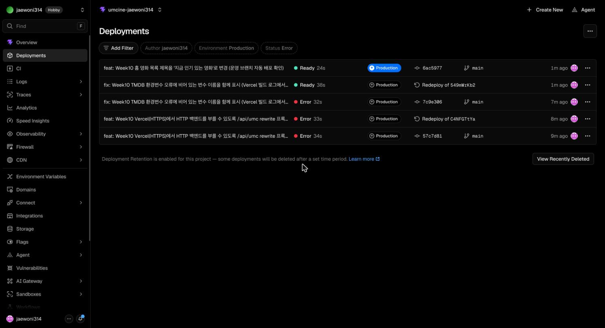

---

## 🔥 필수 미션: 배포한 UMCine 최종 점검하기

배포 주소에서 지금까지 구현한 기능을 로컬과 같은 순서로 확인했습니다. (Playwright로 실제 브라우저를 띄워 확인하고 캡처)

| 기능 | 배포 주소 결과 |
| --- | --- |
| 홈 영화 목록 | ✅ 20개 카드, 제목 "지금 인기 있는 영화" |
| 페이지 이동 | ✅ 2페이지 버튼 → `?page=2`, 현재 페이지 2 |
| 카드 크기 저장 | ✅ "작게" 선택 후 새로고침해도 유지 (localStorage) |
| 검색 (한글) | ✅ "매트릭스" 검색 결과 8편, 주소 `?query=매트릭스` |
| 영화 상세 + 메타데이터 | ✅ 탭 제목 "매트릭스 \| UMCine", `og:image` 있음, 배경/포스터 이미지 |
| 잘못된 영화 번호 `/movies/0` | ✅ "올바르지 않은 영화 번호예요." |
| 없는 주소 `/abc` | ✅ 404 "페이지를 찾을 수 없어요." |
| 로그인 전용 페이지 `/my` | ✅ "로그인이 필요한 페이지예요." 알림 후 `/login`으로 이동 |
| TMDB 프록시 | ✅ `/api/tmdb/movie/popular` 200, 허용하지 않은 경로 `/api/tmdb/account` 404 |
| 로그인, 즐겨찾기, 평점 | ⏸ 백엔드 미배포 → `POST /api/umc/auth/login` 404, "로그인에 실패했어요." 알림 |
| 모바일 너비 (390px) | ✅ |

| 화면 | 캡처 |
| --- | --- |
| 2페이지, 작은 카드 | 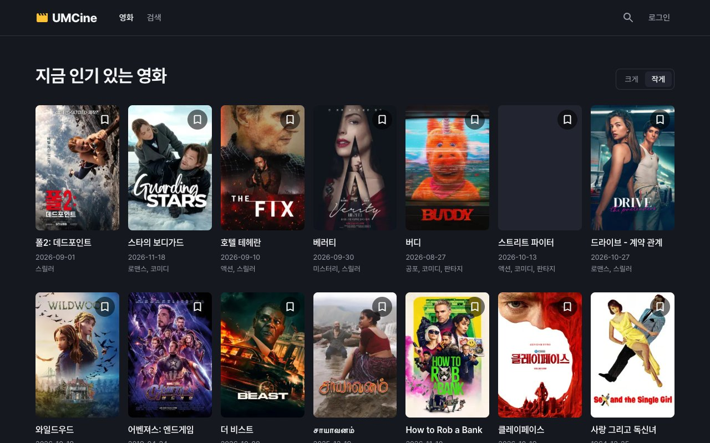 |
| 검색 | 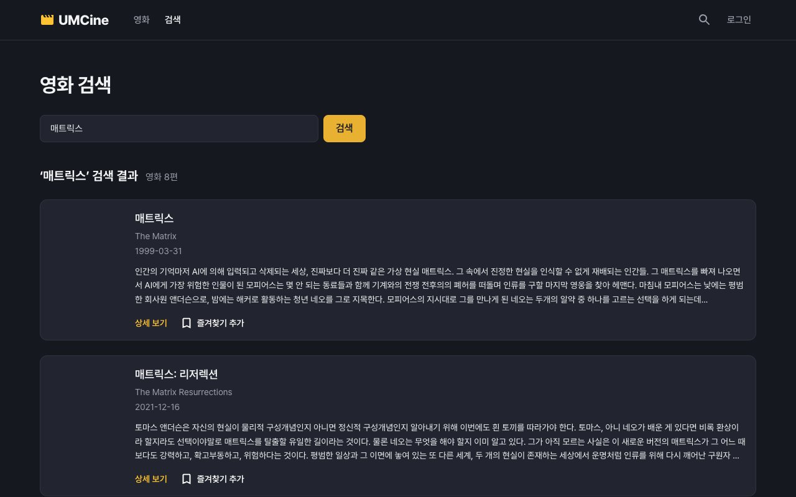 |
| 상세 | 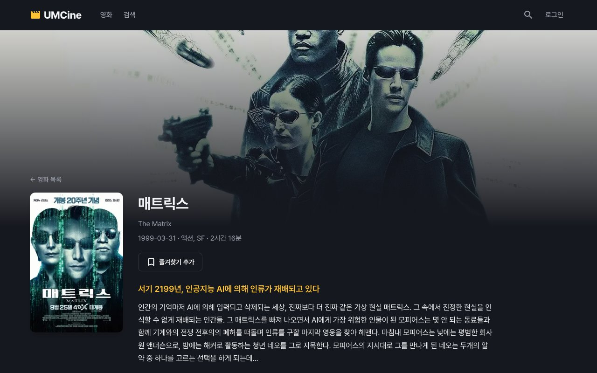 |
| 로그인 (백엔드 없음) | 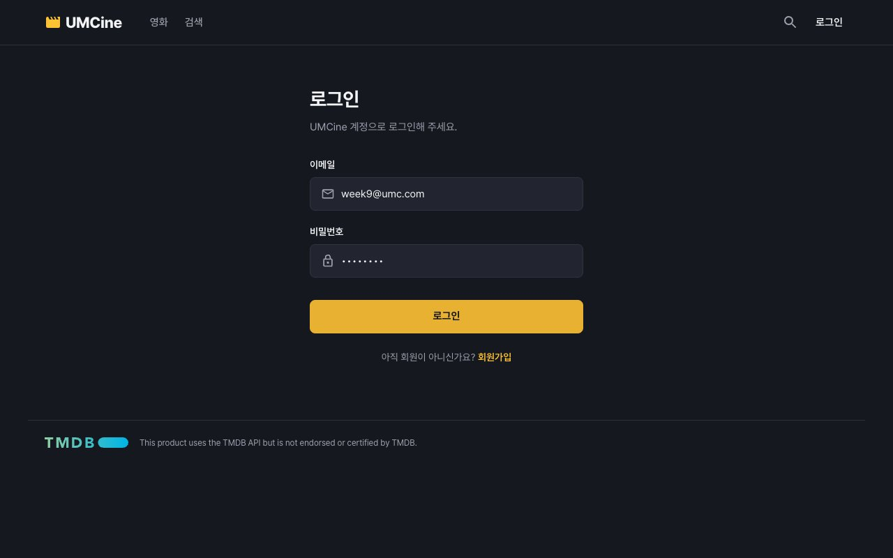 |
| 모바일 상세 |  |

문제가 있어 수정해 반영한 것: 첫 배포 빌드 실패(환경변수 누락, 트러블 슈팅 No.1).

### 🔜 남은 일 (백엔드 배포 후)

1. 백엔드를 EC2에 배포하고 `http://{EC2_PUBLIC_IP}:3000/swagger-ui`가 열리는지 확인
2. Vercel → Settings → Environment Variables에 `UMC_API_ORIGIN=http://{EC2_PUBLIC_IP}:3000` 추가
3. 환경변수는 다음 배포부터 적용되므로 **Redeploy**
4. 배포 주소에서 회원가입 → 로그인 → 즐겨찾기 → 평점 → 마이페이지 → 로그아웃 점검

---

## 🔬 선택 미션

### 1. Preview 배포

운영 브랜치(`main`)와 별도로 fork에 `preview/week10-title` 브랜치를 만들고, 제목을 "지금 인기 있는 영화 **(Preview 미리보기)**"로 바꿔 푸시했습니다. (이 브랜치는 비교용이라 조직 PR에는 넣지 않았습니다.)

- Deployments에 **Preview** 배포가 따로 생겼고, 브랜치 주소 `umcine-jaewoni314-git-preview-week10-title-jaewon2.vercel.app`에 바뀐 제목이 보였습니다.
- 같은 시각 운영 주소 `umcine-jaewoni314.vercel.app`은 "지금 인기 있는 영화" 그대로였습니다.

| Preview 주소 | 운영 주소 |
| --- | --- |
| 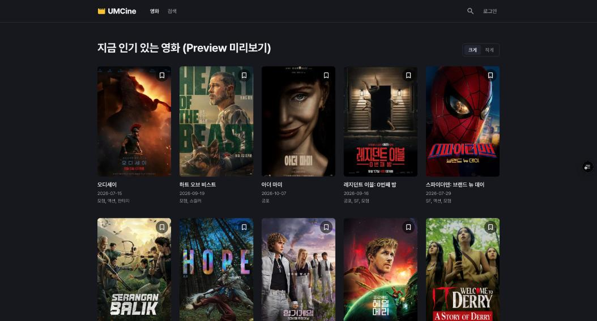 |  |

Preview 주소는 Vercel의 기본 **배포 보호(Vercel Authentication)** 때문에 Vercel에 로그인한 사람만 볼 수 있었습니다. (로그인하지 않은 `curl`은 302 → Vercel SSO)

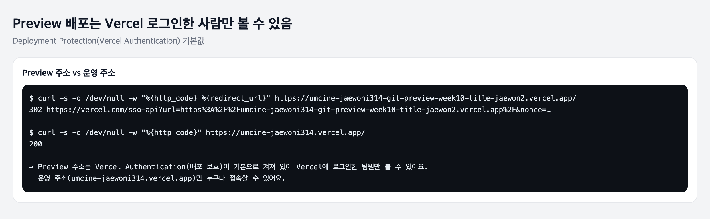

### 2. Instant Rollback

문구를 바꾼 버전(`6ac5977`, "지금 인기 있는 영화")이 운영 중일 때, 직전 운영 배포(`7c9e306`, "인기 영화")로 Instant Rollback 했습니다.

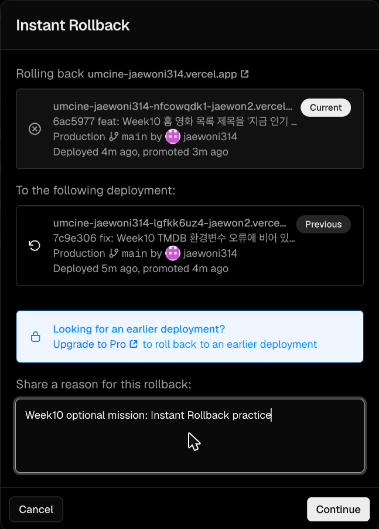

- 롤백 직후 기존 운영 주소를 새로고침하자 **"인기 영화"** 가 다시 보였습니다. 새 빌드 없이 도메인만 이전 배포로 옮겨서 바로 반영됐습니다.

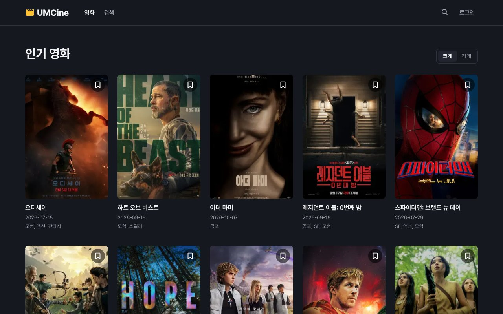

- 확인 창에 "롤백한 뒤에는 롤백을 해제할 때까지 운영 배포가 자동으로 승격되지 않는다"는 안내가 있어 직접 확인했습니다. 롤백 상태에서 새 커밋(`abd0a94`, Web Analytics)을 `main`에 푸시하자, 빌드는 Ready가 됐지만 **운영으로 승격되지 않았습니다**. (회색 Production 배지, 운영 주소는 롤백한 배포 그대로)

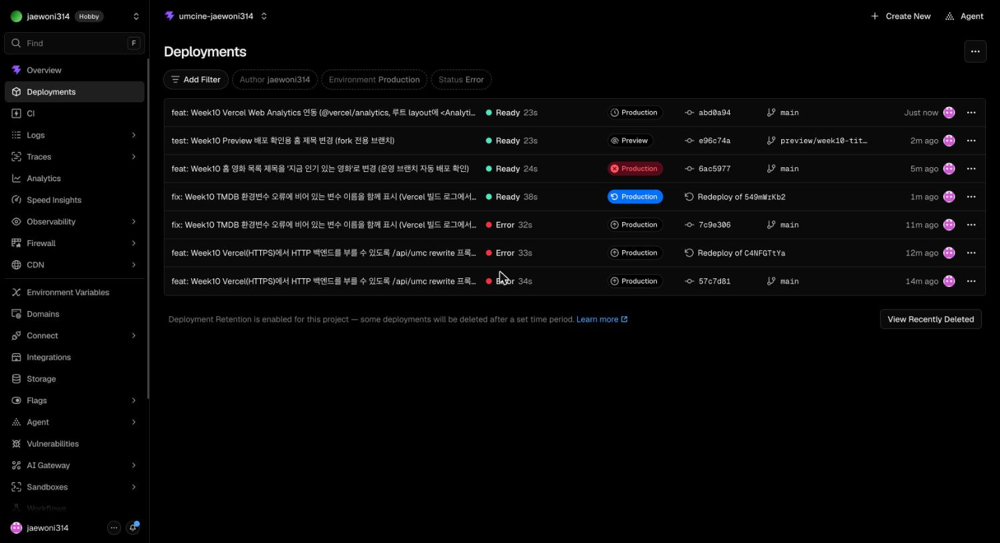

- 최신 배포 `abd0a94`를 **Promote**하자 "This action will undo the current Instant Rollback" 안내와 함께 롤백이 해제되고 운영 주소가 최신 배포로 바뀌었습니다.
- Hobby 플랜은 바로 이전 운영 배포로만 롤백할 수 있습니다. (더 이전 배포는 Pro)

### 3. Web Analytics

```bash
pnpm add @vercel/analytics
```

```tsx
// src/app/layout.tsx
import { Analytics } from "@vercel/analytics/next";
...
      </QueryProvider>
      <Analytics />
    </body>
```

Vercel 대시보드 **Analytics → Enable**에서 무료 **Web Analytics on Hobby**(월 50,000 이벤트, 30일 보관)를 선택하고, 켠 뒤 재배포했습니다. 실제 Chrome으로 여러 페이지(`/`, `/?page=2`, 검색, 상세 2개, 로그인)를 방문하고 앱 안의 링크로도 이동하자 대시보드에 **방문자 1명, 페이지 조회 7회**와 페이지별 목록이 나타났습니다.

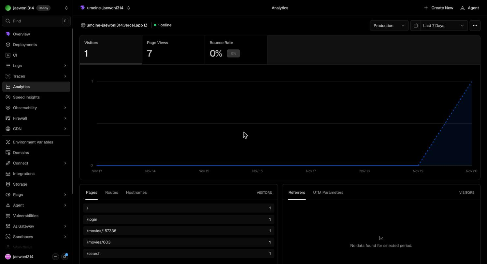

### 4. 도메인 연결

하지 않았습니다. 가비아에서 도메인을 구매하거나 내도메인.한국에 회원가입하고 개인정보를 입력해야 해서 이번에는 건너뛰었습니다. 🙋 진행하려면 도메인을 준비한 뒤 Vercel 프로젝트 **Domains → Add**에 입력하고, Vercel이 안내하는 A/CNAME 레코드를 도메인 관리 화면에 등록하면 됩니다.

---

## 🎯 핵심 키워드 (초안 🙋 본인 말로 다듬기)

<details>
<summary>배포 - 배포란 무엇이고, 다른 사람은 왜 내 컴퓨터의 localhost에 접속할 수 없나요?</summary>

- **배포**는 내가 만든 서비스를 다른 사람이 인터넷으로 접속할 수 있는 서버에 올려 실행하는 과정입니다. 이번 주에는 Next.js 앱을 Vercel 서버에서 빌드하고 실행해 `https://umcine-jaewoni314.vercel.app`으로 제공했습니다.
- `localhost`는 "지금 이 컴퓨터 자신"을 가리키는 이름입니다. 다른 사람이 `localhost:5173`에 접속하면 **그 사람의 컴퓨터**를 찾기 때문에 제 노트북의 개발 서버에는 닿지 않습니다.
- 같은 이유로, Vercel 서버 안에서 `localhost:3000`은 제 노트북의 NestJS가 아니라 Vercel 서버 자신입니다. 백엔드도 EC2처럼 인터넷에서 접근할 수 있는 곳에 따로 배포해야 연결됩니다.

</details>

<details>
<summary>배포 - 서비스를 배포하려면 어떤 설정이 필요할까요?</summary>

- **서버와 실행 환경**: 코드를 빌드하고 실행할 서버 (Vercel이 Node.js 환경을 제공)
- **IP와 네트워크 접근**: 외부에서 접근할 수 있는 주소, 방화벽/보안 그룹에서 포트 허용
- **도메인과 DNS**: 숫자 IP 대신 이름으로 접속 (Vercel은 `*.vercel.app` 기본 제공)
- **HTTPS 인증서**: 발급, 적용, 갱신 (Vercel이 자동 관리)
- **환경변수**: 로컬 `.env.local`은 Git에 없으므로 배포 환경에 따로 등록. 비밀 값(TMDB 토큰)은 서버 전용으로, 브라우저용은 `NEXT_PUBLIC_`
- **빌드 설정**: 어느 폴더(Root Directory)를, 어떤 명령으로 빌드할지
- 이번에 추가로 겪은 것: HTTPS 페이지에서 HTTP API를 부를 수 없어서(혼합 콘텐츠) 프록시가 필요했고, 조직 저장소 연결 권한이 없어 fork로 우회했습니다.

</details>

<details>
<summary>Vercel - Vercel을 사용하는 이유는 무엇인가요?</summary>

- 서버 준비, 네트워크, DNS, HTTPS 인증서를 직접 관리하지 않아도 저장소를 연결하고 환경변수만 넣으면 배포됩니다. 이번에 첫 배포까지 설정 화면 하나로 끝났습니다.
- Next.js를 만든 회사라서 Route Handler, `next/image`, `"use cache"`, Partial Prerendering 같은 기능을 별도 설정 없이 그대로 씁니다.
- 푸시마다 자동 배포, 브랜치마다 Preview 주소, 클릭 한 번 롤백처럼 "배포 후 운영"에 필요한 기능이 기본으로 들어 있습니다.
- 단점: 무료 플랜에서는 조직 비공개 저장소 연결, 오래된 배포로의 롤백 등이 제한되고, 실행 환경을 세밀하게 제어하기 어렵습니다. 서버 비용이 사용량에 따라 늘 수 있습니다.

</details>

<details>
<summary>Vercel - Vercel 외에 배포를 도와주는 서비스에는 무엇이 있나요?</summary>

| 서비스 | 특징 |
| --- | --- |
| Netlify | Vercel과 비슷한 Git 연동 정적/서버리스 배포 |
| Cloudflare Pages / Workers | 전 세계 엣지에서 실행, 정적 사이트와 서버 함수 |
| AWS Amplify | AWS 계정 안에서 프론트 배포, 다른 AWS 서비스와 연결 |
| Render, Railway, Fly.io | 프론트뿐 아니라 백엔드 서버와 DB까지 올리기 쉬운 PaaS |
| GitHub Pages | 정적 파일만 (서버 기능 없음) |
| AWS EC2 / S3 + CloudFront | 직접 구성 (백엔드 워크북 방식). 자유도는 높지만 관리할 것이 많음 |

</details>

<details>
<summary>Vercel - Vercel은 어떤 기능을 제공하나요?</summary>

이번에 직접 써 본 것 위주로 정리했습니다.

- **Git 연동 자동 배포**: `main`에 푸시할 때마다 새 운영 배포 (3.5에서 확인)
- **Preview 배포**: 운영 외 브랜치마다 별도 주소. 기본으로 배포 보호가 켜져 있어 팀원만 볼 수 있음
- **Instant Rollback / Promote**: 빌드 없이 도메인을 이전 배포로 옮김. 롤백 중에는 새 운영 배포가 자동 승격되지 않음
- **환경변수 관리**: Production / Preview / Development별 값, Sensitive(값 숨김). 변경은 다음 배포부터 적용
- **도메인과 HTTPS**: `*.vercel.app` 기본 도메인, 커스텀 도메인 연결, 인증서 자동 갱신
- **Web Analytics**: 방문자와 페이지 조회 집계 (쿠키 없이, 봇/자동화 브라우저 제외)
- **Build Logs, Observability**: 빌드 실패 원인과 요청/함수 호출 기록

</details>

---

## 📢 학습 후기 (초안 🙋 본인 말로 다듬기)

> 지금까지는 `localhost`에서만 확인했는데, 처음으로 다른 사람에게 보낼 수 있는 주소가 생겼다. 로컬에서 잘 되던 빌드가 Vercel에서 바로 실패하는 것을 보고, 내 컴퓨터에만 있던 `.env.local`처럼 "환경에 따라 달라지는 것"이 배포에서 가장 먼저 문제가 된다는 것을 체감했다. 오류 메시지에 비어 있는 변수 이름을 넣으니 원인을 바로 찾을 수 있었고, 그 수정 커밋을 푸시하자 자동으로 다시 배포되는 것까지 한 번에 확인할 수 있었다. Preview와 롤백을 써 보면서, 운영 주소를 건드리지 않고 미리 확인하고 문제가 생기면 몇 초 만에 되돌릴 수 있다는 점이 직접 서버를 관리할 때와 가장 다르다고 느꼈다. 백엔드까지 배포하면 HTTPS 프론트와 HTTP API를 연결하는 부분도 직접 확인해 보고 싶다.

---

## ⚡ 트러블 슈팅

### ⚡ 이슈 No.1 첫 배포 빌드 실패: `TMDB 환경 변수가 필요해요`

**이슈**
👉 Deploy를 누르자 빌드 중 `Collecting page data` 단계에서 실패했다. Redeploy해도 같았다.
```
Error: Failed to collect configuration for /api/tmdb/[...path]
  [cause]: Error: TMDB 환경 변수(TMDB_API_BASE_URL, TMDB_ACCESS_TOKEN)가 필요해요.
      at module evaluation (src/config/server-env.ts:9:9)
Error: [BUILD_UTILS_SPAWN_1] Command "pnpm run build" exited with 1
```

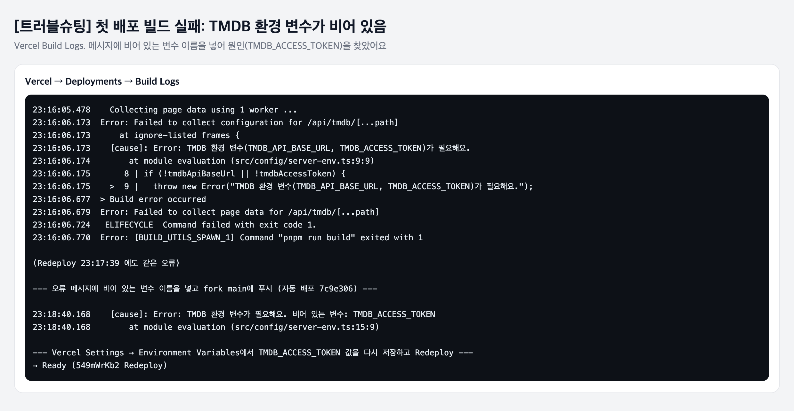

**원인**
👉 `config/server-env.ts`는 모듈을 불러올 때 TMDB 환경변수를 확인하고 없으면 오류를 던진다. Next.js는 빌드할 때 Route Handler(`/api/tmdb/[...path]`)의 설정을 모으려고 이 모듈을 실행하므로, 빌드 환경에 변수가 없으면 빌드가 실패한다. 로컬에서는 `.env.local`이 있어서 통과했다.
Vercel의 Environment Variables 목록에는 세 변수가 모두 있었는데, 기존 메시지로는 어느 쪽이 비었는지 알 수 없었다. 메시지에 **비어 있는 변수 이름**(값은 제외)을 넣어 푸시하자, 그 자동 배포의 로그에 `비어 있는 변수: TMDB_ACCESS_TOKEN`이 찍혔다. 새 프로젝트 화면에서 토큰 값을 붙여 넣었지만 실제로는 빈 값으로 저장된 것이었다.

**해결**
👉 Settings → Environment Variables에서 `TMDB_ACCESS_TOKEN`을 Edit해 값을 다시 저장하고 Redeploy → Ready.

```ts
// src/config/server-env.ts
const missing = [
  ["TMDB_API_BASE_URL", tmdbApiBaseUrl],
  ["TMDB_ACCESS_TOKEN", tmdbAccessToken],
].flatMap(([name, value]) => (value ? [] : [name]));

if (!tmdbApiBaseUrl || !tmdbAccessToken) {
  throw new Error(`TMDB 환경 변수가 필요해요. 비어 있는 변수: ${missing.join(", ")}`);
}
```

**배운 점**
👉 환경변수 목록에 이름이 있다고 값이 들어 있다는 뜻은 아니다. Sensitive 변수는 저장 후 값을 다시 볼 수 없으니, 오류 메시지가 "무엇이 비었는지"를 알려 주게 만들어 두면 빌드 로그만으로 원인을 찾을 수 있다. 그리고 환경변수는 수정한 뒤 **새 배포**를 해야 반영된다.

**참고 레퍼런스**
- [Vercel - Environment Variables](https://vercel.com/docs/environment-variables)
- [Vercel - Troubleshooting Build Errors](https://vercel.com/docs/deployments/troubleshoot-a-build)

### ⚡ 이슈 No.2 조직 저장소가 Vercel 가져오기 목록에 없음

**이슈**
👉 Import Git Repository의 계정 목록에 `jaewoni314`만 있고 `HSU-Makeus-Challenge-11th`가 없었다.

**원인**
👉 Vercel이 저장소에 접근하려면 그 계정(조직)에 Vercel GitHub 앱이 설치돼 있어야 한다. 조직에 앱을 설치하려면 조직 소유자 권한이 필요한데 나는 멤버였다. 워크북 안내대로 조직의 **비공개** 저장소라면 Pro 플랜도 필요하다. (이 저장소는 공개)

**해결**
👉 저장소를 개인 계정으로 fork(`jaewoni314/Web_C`)해서 연결했다. 조직 `main`에는 아직 `Week10`이 없으므로 fork의 `main`을 운영 브랜치로 쓰고, 작업 브랜치를 `git push fork jaewoni314/week10:main`으로 올린다. Root Directory는 `Week10/jaewoni314/frontend/mission1`로 지정했다.

**배운 점**
👉 배포 플랫폼 연결은 코드가 아니라 **저장소 권한** 문제로 막힐 수 있다. 팀 저장소라면 소유자에게 앱 설치를 요청하거나, 개인 fork/별도 저장소로 배포하는 방법을 정해 둬야 한다.

**참고 레퍼런스**
- [Vercel - Deploying GitHub Projects](https://vercel.com/docs/git/vercel-for-github)

### ⚡ 이슈 No.3 Web Analytics를 켰는데 데이터가 들어오지 않음

**이슈**
👉 `@vercel/analytics`를 넣고 대시보드에서 Enable했지만, Playwright로 여러 페이지를 방문해도 방문 수가 0이었다.

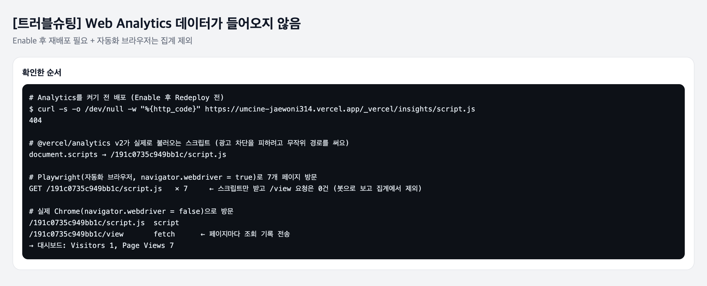

**원인**
👉 두 가지였다.
1. Analytics는 켠 **다음 배포부터** 수집 경로가 생긴다. Enable 직후에는 `/_vercel/insights/script.js`가 404였다.
2. 재배포 뒤 확인해 보니 `@vercel/analytics` v2는 광고 차단을 피하려고 `/_vercel/insights` 대신 무작위 경로(`/191c0735c949bb1c/script.js`)를 쓰고 있었다. 그 경로로 다시 보니 Playwright(자동화 브라우저, `navigator.webdriver = true`)에서는 스크립트만 받고 조회 기록(`/view`)은 **한 번도 보내지 않았다**. 자동화 브라우저를 봇으로 보고 집계에서 빼는 것으로 보인다.

**해결**
👉 Enable 후 Redeploy하고, 실제 Chrome(`navigator.webdriver = false`)으로 페이지를 방문했다. 페이지마다 `/191c0735c949bb1c/view` 요청이 나갔고, 대시보드에 방문자 1, 페이지 조회 7이 집계됐다.

**배운 점**
👉 분석 도구는 "켰다"와 "수집된다" 사이에 배포, 차단기, 봇 필터가 있다. 데이터가 안 보이면 스크립트가 로드되는지 → 수집 요청이 나가는지 → 대시보드 필터(Production/기간) 순서로 확인한다.

**참고 레퍼런스**
- [Vercel - Web Analytics Quickstart](https://vercel.com/docs/analytics/quickstart)
