# 8주차 백엔드 미션 기록 - 서비스의 핵심 기능 만들기 (NestJS)

7주차 로그인/JWT 서버에 **즐겨찾기 API 4개**와 평점과 즐겨찾기를 한 트랜잭션으로 저장하는 **영화 기록 API**를 더했습니다.
선택 미션으로 Swagger 문서(`http://localhost:3000/docs`)도 붙였습니다. API 명세와 오류 코드 전체는 [README](../README.md)에 있습니다.

> 이 문서는 노션 "미션 기록" 토글에 옮겨 적기 쉽도록 워크북 목차 순서대로 정리했습니다.
> 🙋 표시는 **직접 해야 하는 일**(노션에 붙여 넣기, 본인 말로 다듬기, 제출)입니다.

---

## ✅ 제출 전 체크리스트

| | 할 일 | 상태 |
| --- | --- | --- |
| | 실습 1~4: Favorite 엔티티/DTO, 즐겨찾기 등록·조회, 영화 기록 트랜잭션, 실패 상황 | ✅ 아래 [실습 체크리스트](#-실습-체크리스트) |
| | 실습 인증 캡처 4종 | ✅ 아래 [실습 인증](#️-실습-인증) |
| | 필수 미션: 즐겨찾기 4개 + 영화 기록 API, 캡처, 핵심 코드 링크 | ✅ 아래 [필수 미션](#필수-standard-mission-즐겨찾기와-영화-기록-기능-완성하기) |
| | 선택 미션: Swagger로 API 문서화 | ✅ 아래 [선택 미션](#선택-challenge-mission-swagger로-api-문서화) |
| 🙋 | 워크북은 **Postman 캡처**를 요구합니다. 여기 캡처는 Swagger UI의 "Try it out"으로 실제 요청을 보낸 화면이에요. Postman 화면이 꼭 필요하면 같은 요청을 Postman으로 다시 찍어 주세요. | 확인 필요 |
| 🙋 | 핵심 키워드 정리: 아래 초안을 **본인 말로 다듬어** 노션에 옮기기 | 초안 ✅ |
| 🙋 | 학습 후기 질문 2개 답하기: 아래 초안 참고 | 초안 ✅ |
| 🙋 | 노션 개인 미션 페이지 → 공유 → 링크 복사 → [PE 워크북 AI 피드백 시스템](https://umc.ai.kr/)에 제출 | 직접 |
| 🙋 | GitHub PR 올리고 CodeRabbit 리뷰 받기 (프론트와 함께 한 PR) | 직접 |
| 🙋 | 아래 "핵심 코드 링크"는 브랜치 `jaewoni314/week08`을 푸시해야 열립니다 | 푸시 후 |
| 🙋 | (선택) 기술 블로그 / 지식in 상점 | 직접 |

---

## ▶️ 실행 방법

```bash
# sql/01_schema_seed.sql 로 umc_movie DB 준비 (favorite 테이블 포함, 5주차와 같은 스키마)
cp .env.example .env   # DB 정보, JWT_SECRET(32자 이상) 입력
npm install
npm run start:dev      # http://localhost:3000, Swagger: http://localhost:3000/docs
```

---

## 📑 8주차에 만든 API

모든 API는 `Authorization: Bearer {accessToken}`이 필요하고, URL·바디 어디에도 `memberId`를 받지 않습니다.

| API | Method | URL | 요청 | 성공 |
| --- | --- | --- | --- | --- |
| 즐겨찾기 등록 | POST | `/favorites` | Body: `movieId` | 201 `{ favoriteId, movieId, createdAt }` |
| 내 즐겨찾기 조회 | GET | `/favorites` | - | 200 배열 (favoriteId 내림차순, 없으면 `[]`) |
| 즐겨찾기 여부 조회 | GET | `/favorites/{movieId}` | - | 200 `{ isFavorite }` |
| 즐겨찾기 해제 | DELETE | `/favorites/{movieId}` | - | 200 `result: null` |
| 영화 기록 저장 | POST | `/movie-records` | Body: `movieId, score, comment?, addToFavorites` | 201 `{ rating, favorite }` |

| 실패 | status | code |
| --- | --- | --- |
| 토큰 없음 / 위조 / 만료 | 401 | `AUTH401_2` / `AUTH401_3` / `AUTH401_4` |
| 같은 영화 즐겨찾기 중복 | 409 | `FAVORITE409_1` 이미 이 영화를 즐겨찾기하셨습니다. |
| 즐겨찾기하지 않은 영화 해제 | 404 | `FAVORITE404_1` 즐겨찾기한 영화를 찾을 수 없습니다. |
| 영화 기록: 이미 평점을 남긴 영화 | 409 | `RATING409_1` |
| `movieId`에 0, 빠진 필드, DTO에 없는 필드(`memberId` 등) | 400 | `COMMON400` |

---

## ✅ 실습 체크리스트

- [x] Favorite 엔티티가 `BaseTimeEntity`를 상속하고, `member`와 `movieId`를 저장하도록 만들었다. → [`favorite.entity.ts`](../src/entity/favorite.entity.ts)
- [x] `POST /favorites`에서 토큰의 회원 ID(`@LoginMember()`)를 사용하고 요청으로 `memberId`를 받지 않았다. 바디에 `memberId`를 넣으면 400.
- [x] 같은 영화의 즐겨찾기 중복 요청에 409 `FAVORITE409_1`이 오는 것을 확인했다. (캡처 b04)
- [x] `GET /favorites`에서 내 즐겨찾기만 최신 등록 순서로 조회되는 것을 확인했다. (캡처 b07: 27205 → 550 순)
- [x] `GET /favorites/{movieId}`에서 등록 전후의 `isFavorite` 값이 각각 false, true로 바뀌는 것을 확인했다. (캡처 b02, b05)
- [x] `DELETE /favorites/{movieId}`가 200과 공통 응답 형식으로 동작하는 것을 확인했다. (캡처 b08)
- [x] 평점과 즐겨찾기를 함께 저장하는 코드가 하나의 트랜잭션 안에서 동작하도록 만들었다. (캡처 b16, b17)

### [실습 4] 실패 상황을 서비스 규칙으로 만들기

| 상황 | 기대 결과 | 실제 | 캡처 |
| --- | --- | --- | --- |
| 토큰 없이 `POST /favorites` | 401, `AUTH401_2` | ✅ 401 `AUTH401_2` | b15 |
| 같은 movieId를 두 번 등록 | 409, `FAVORITE409_1` | ✅ | b04 |
| 즐겨찾기하지 않은 영화의 여부 조회 | 200, `isFavorite: false` | ✅ | b02 |
| 존재하지 않는 즐겨찾기 해제 | 404, `FAVORITE404_1` | ✅ | b09 |
| `movieId`에 0 전송 | 400 | ✅ 400 "영화 ID는 양수여야 합니다." | b14 |
| 빈 목록 조회 | 200, `[]` | ✅ | b01 |

`AuthGuard`와 공개 API 예외는 7주차 그대로이고, 새 컨트롤러에 `@UseGuards(AuthGuard)`를 클래스 단위로 붙였습니다.

---

## ☑️ 실습 인증

### 1. `POST /favorites` 성공과 같은 요청의 중복 오류

| 201 등록 성공 | 409 `FAVORITE409_1` |
| --- | --- |
| 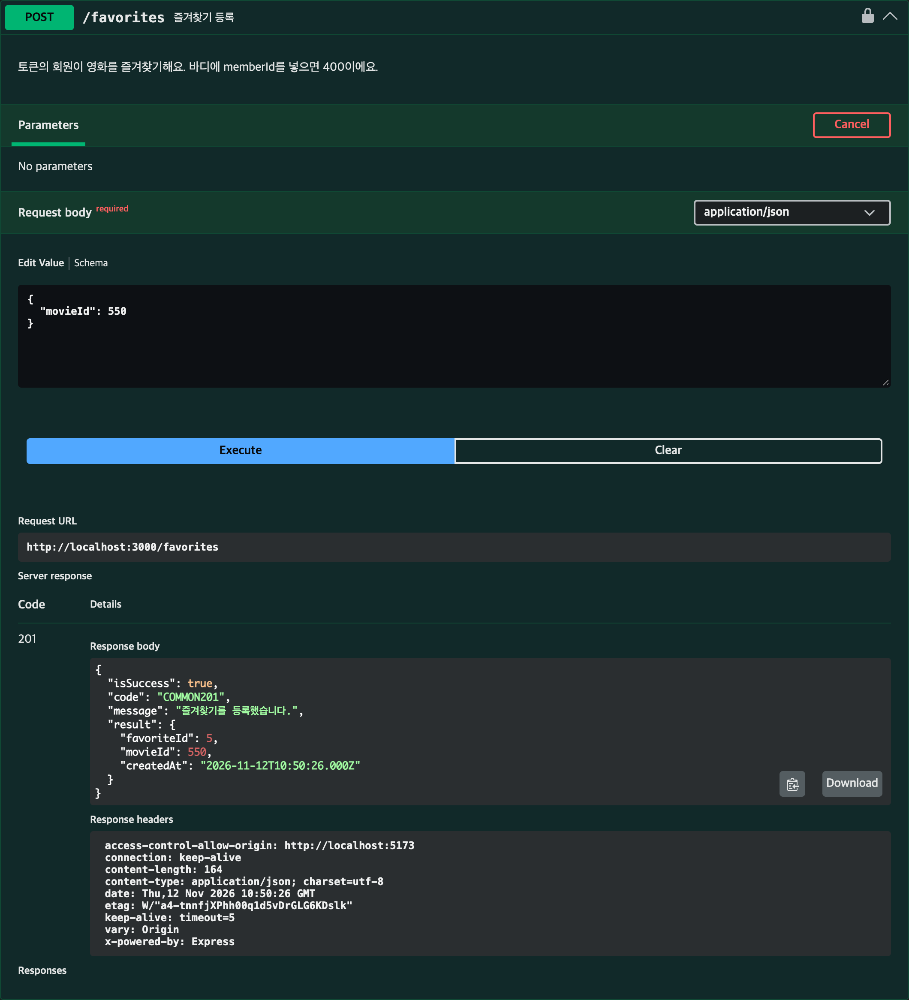 | 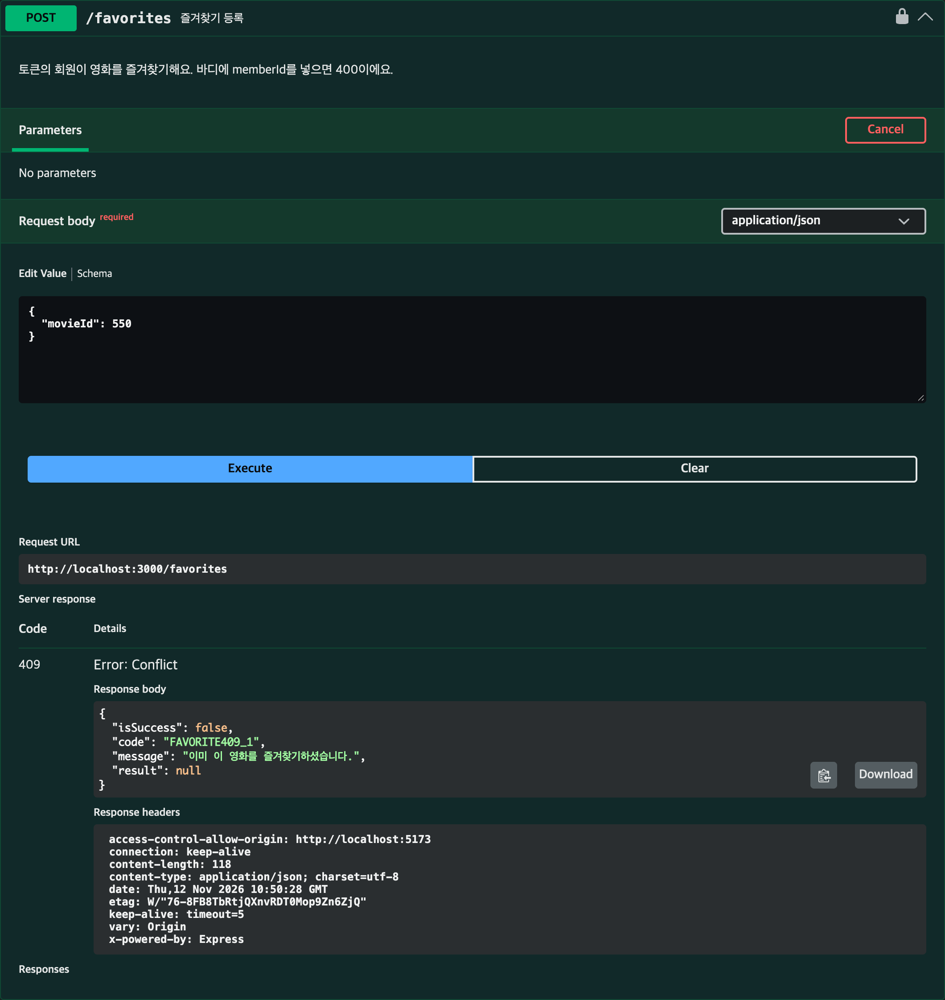 |

### 2. 목록 / 여부 / 해제

| `GET /favorites` 목록 (최신순) | `GET /favorites/550` 등록 전 false | 등록 후 true |
| --- | --- | --- |
| 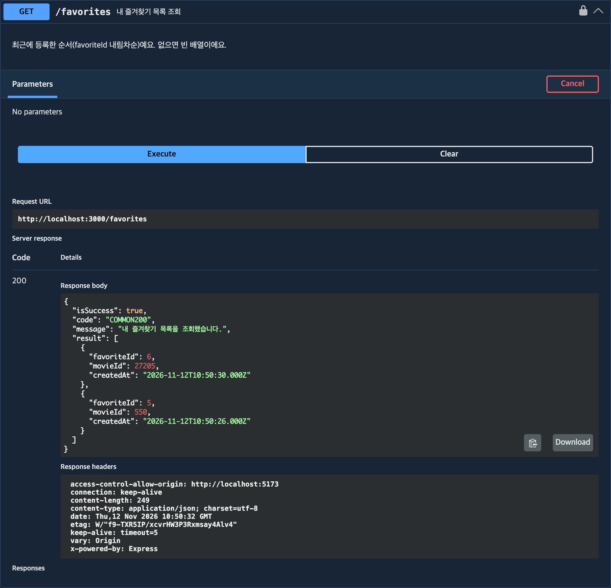 | 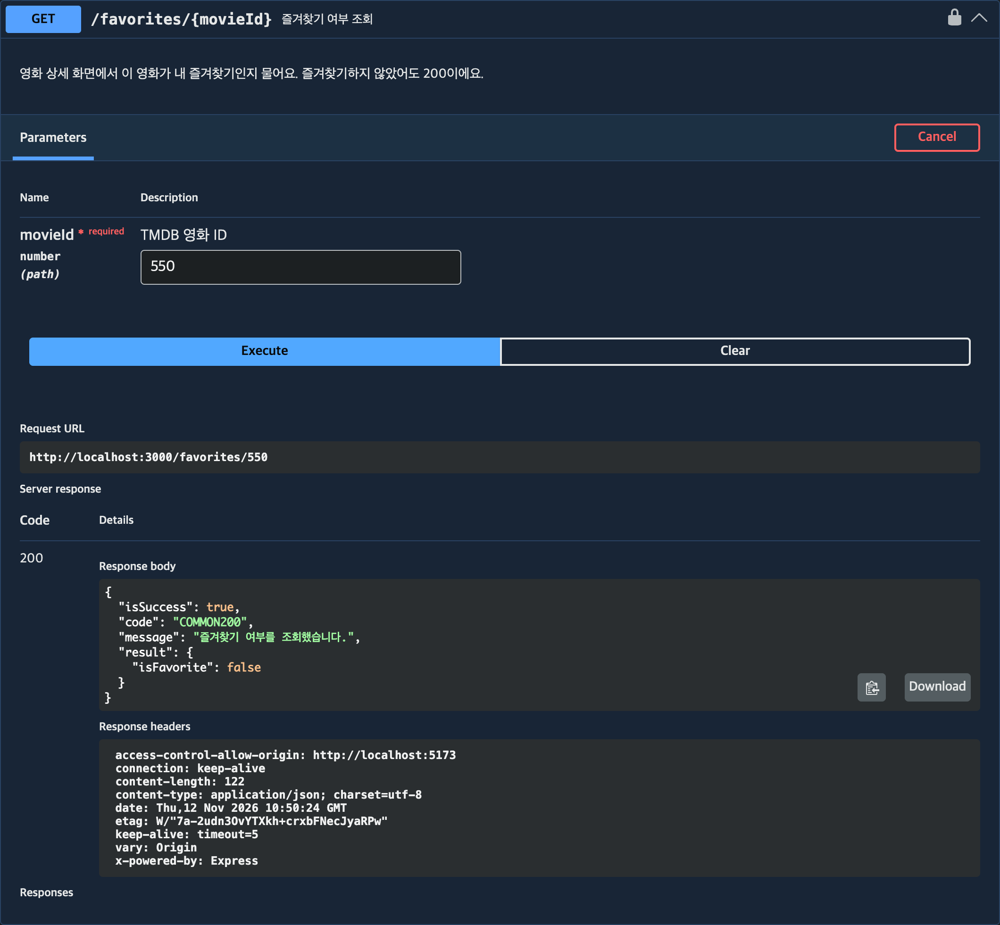 |  |

| `DELETE /favorites/550` 200 | 한 번 더 해제 → 404 `FAVORITE404_1` |
| --- | --- |
| 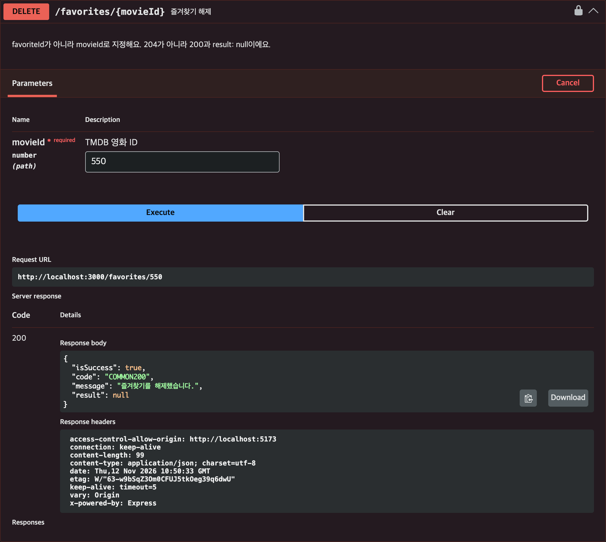 | 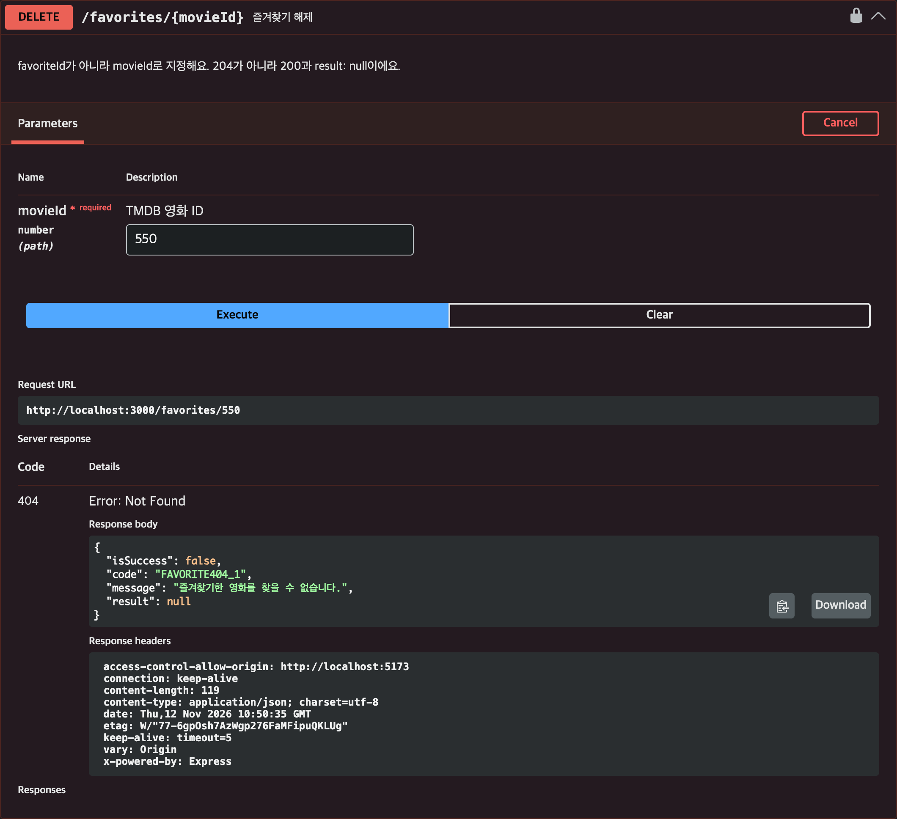 |

### 3. `POST /movie-records` 성공 (rating과 favorite이 함께)

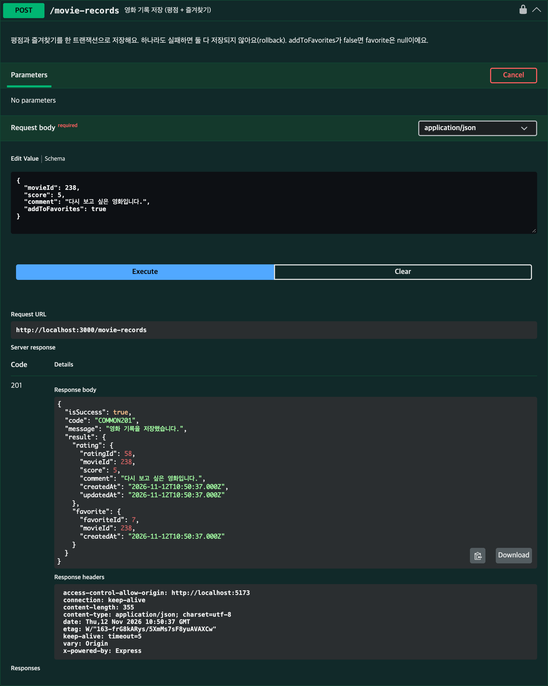

### 4. 트랜잭션 코드와 두 저장을 묶은 이유

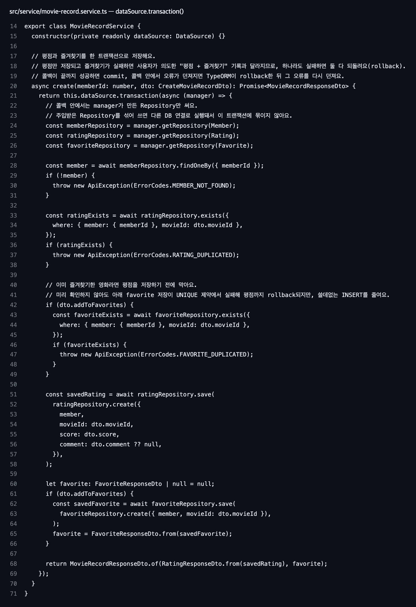

> **두 저장을 묶은 이유**: 사용자는 "평점을 남기면서 즐겨찾기에도 추가"를 하나의 행동으로 요청했으므로, 즐겨찾기 저장이 실패했는데 평점만 남으면 의도와 다른 기록이 되기 때문에 둘 다 성공하거나 둘 다 취소되도록 묶었습니다.

`dataSource.transaction()`의 콜백 안에서는 **`manager.getRepository()`로 꺼낸 Repository만** 씁니다. 주입받은 Repository를 섞어 쓰면 다른 DB 연결로 실행되어 트랜잭션에 묶이지 않습니다.

---

## 🔥 미션

### (필수) Standard Mission: 즐겨찾기와 영화 기록 기능 완성하기

**구현 파일 (Entity → DTO → Service → Controller)**

| 구분 | 파일 |
| --- | --- |
| Entity | [`src/entity/favorite.entity.ts`](../src/entity/favorite.entity.ts) |
| Repository | TypeORM `Repository<Favorite>`를 `@InjectRepository(Favorite)`로 주입 (7주차와 같은 방식, `TypeOrmModule.forFeature`에 등록) |
| DTO | [`create-favorite.dto.ts`](../src/dto/create-favorite.dto.ts), [`favorite-response.dto.ts`](../src/dto/favorite-response.dto.ts), [`favorite-status-response.dto.ts`](../src/dto/favorite-status-response.dto.ts), [`create-movie-record.dto.ts`](../src/dto/create-movie-record.dto.ts), [`movie-record-response.dto.ts`](../src/dto/movie-record-response.dto.ts) |
| Service | [`favorite.service.ts`](../src/service/favorite.service.ts), [`movie-record.service.ts`](../src/service/movie-record.service.ts) (트랜잭션) |
| Controller | [`favorite.controller.ts`](../src/controller/favorite.controller.ts), [`movie-record.controller.ts`](../src/controller/movie-record.controller.ts) |
| 오류 코드 | [`error-code.ts`](../src/common/error-code.ts) `FAVORITE404_1`, `FAVORITE409_1` + [`global-exception.filter.ts`](../src/filter/global-exception.filter.ts) UNIQUE 위반 → `FAVORITE409_1` |

**핵심 코드 링크 (🙋 브랜치 푸시 후 열림)**

- https://github.com/HSU-Makeus-Challenge-11th/Web_C/blob/jaewoni314/week08/Week8/jaewoni314/backend/mission1/src/service/favorite.service.ts
- https://github.com/HSU-Makeus-Challenge-11th/Web_C/blob/jaewoni314/week08/Week8/jaewoni314/backend/mission1/src/service/movie-record.service.ts
- https://github.com/HSU-Makeus-Challenge-11th/Web_C/blob/jaewoni314/week08/Week8/jaewoni314/backend/mission1/src/controller/favorite.controller.ts

**확인 포인트**

- 요청의 URL/바디/쿼리에 `memberId`가 없고 토큰에서 회원을 식별 → ✅ `@LoginMember()`, 바디에 `memberId`를 넣으면 400 `property memberId should not exist`
- 영화 기록 Service에서 두 저장이 하나의 트랜잭션 → ✅ 아래 동시 요청 실험으로 rollback까지 확인

**추가 캡처**

| 영화 기록을 다시 보내면 409 `RATING409_1` | 이미 즐겨찾기한 영화로 기록 → 409 `FAVORITE409_1` | `addToFavorites: false` → `favorite: null` |
| --- | --- | --- |
| 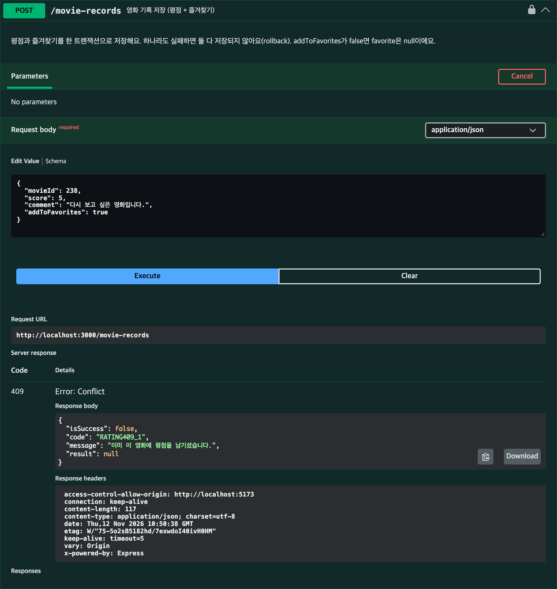 | 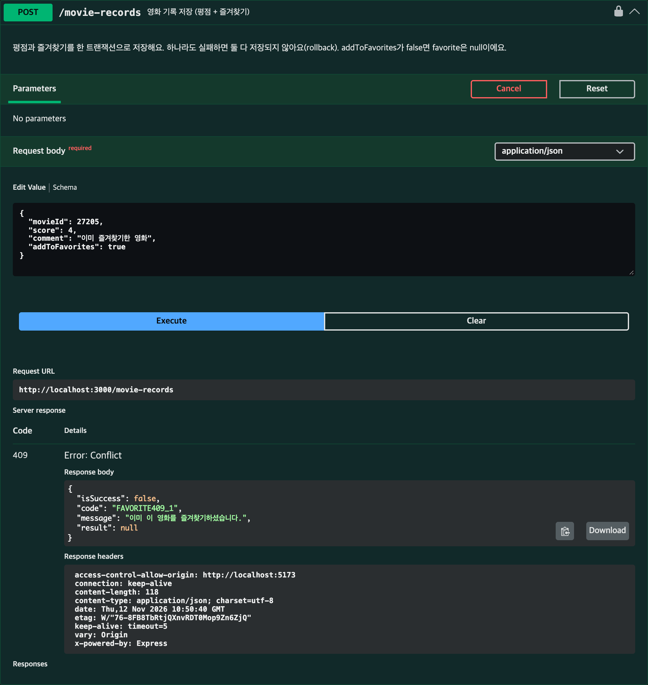 | 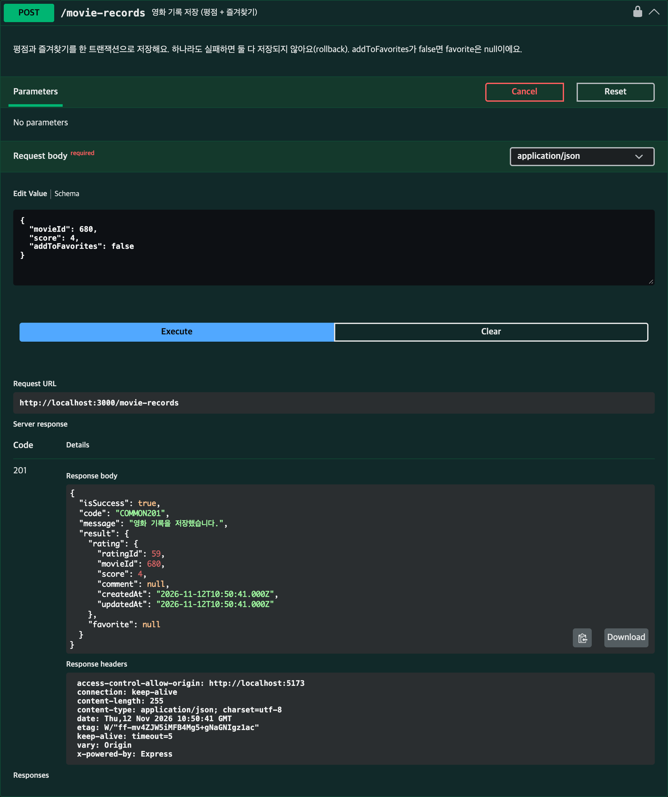 |

| `movieId: 0` → 400 | 토큰 없이 → 401 `AUTH401_2` | 빈 목록 → `[]` |
| --- | --- | --- |
| 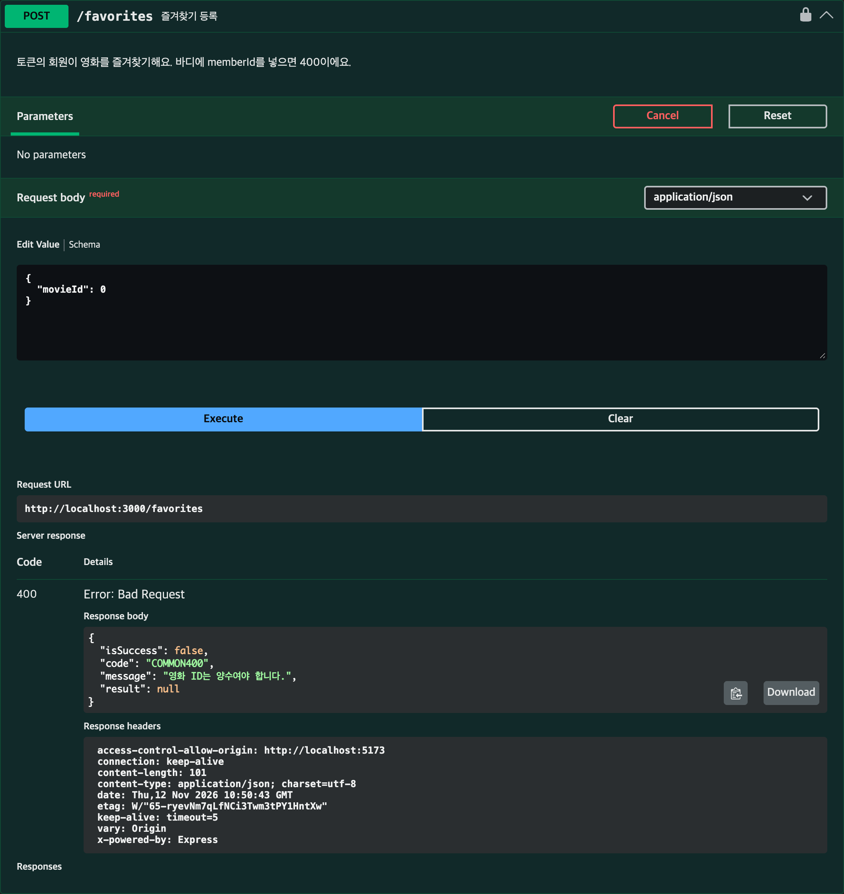 | 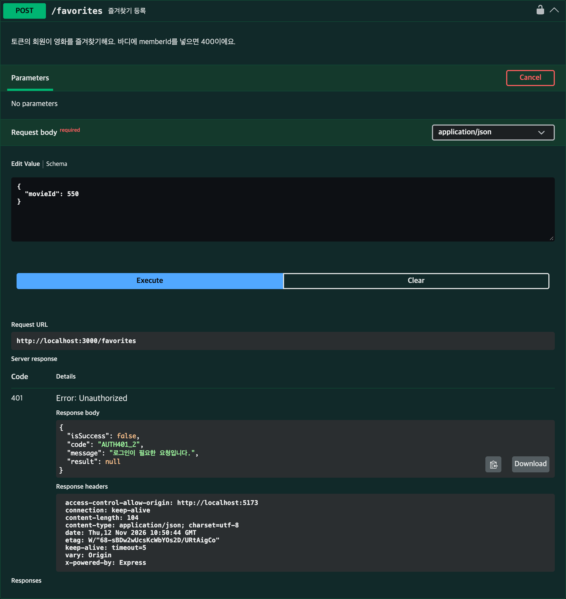 | 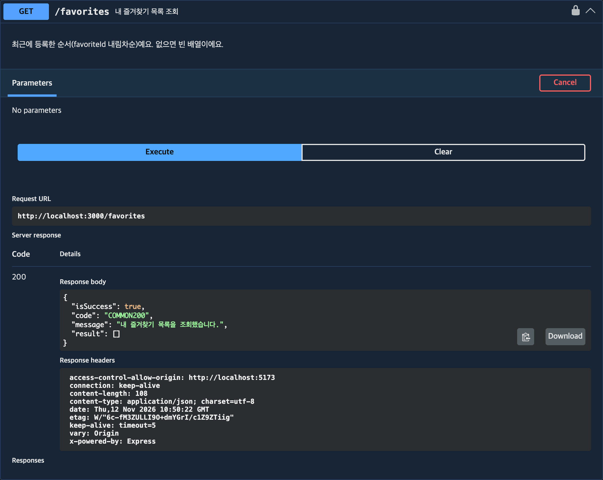 |

**트랜잭션 rollback 실험**

미리 하는 중복 확인 때문에 보통은 평점을 저장하기 전에 막힙니다. 그래서 "평점 INSERT 뒤에 즐겨찾기 INSERT가 실패하는" 상황을 일부러 만들려고, 같은 영화에 `POST /favorites`와 `POST /movie-records(addToFavorites: true)`를 **동시에 60번** 보냈습니다.
영화 기록의 즐겨찾기 INSERT가 DB UNIQUE 제약에서 실패한 로그가 찍혔고, 영화 기록 60건이 모두 409로 끝났는데 **평점은 0건**이 남았습니다. 이미 실행된 평점 INSERT까지 rollback된 것입니다.

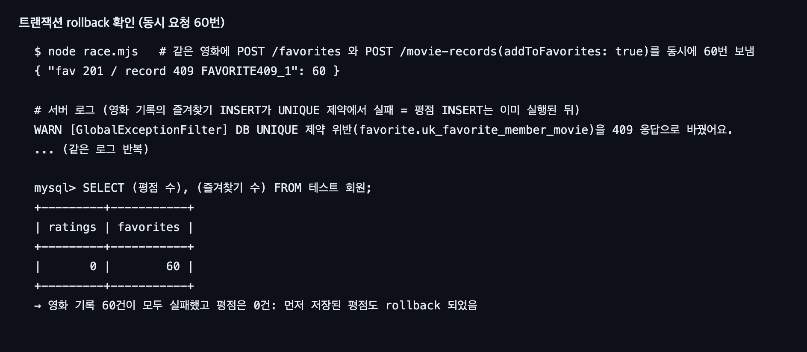

### (선택) Challenge Mission: Swagger로 API 문서화

`@nestjs/swagger`를 붙이고 `main.ts`에서 `/docs`로 열었습니다. ([`src/swagger/api-docs.ts`](../src/swagger/api-docs.ts), [`main.ts`](../src/main.ts))

- 토큰이 필요한 API에는 `@ApiAuth()`로 **자물쇠(Bearer)와 401 응답 3종**(`AUTH401_2/3/4`)을 함께 표시하고, 로그인·중복 체크·회원가입·유저별 평점 조회 같은 공개 API에는 붙이지 않았습니다. 요약에도 "(공개)"를 적었습니다.
- 성공 응답은 공통 형식 `{ isSuccess, code, message, result }` 예시로, 실패 응답은 **상태 코드별로 code와 message 예시**를 보여 줍니다 (같은 409라도 `RATING409_1`, `FAVORITE409_1`을 골라 볼 수 있음).
- DTO에 `@ApiProperty`로 필수 여부, 범위(1~5, 500자), 예시 값을 적었습니다.

| Swagger UI에서 8주차 API가 보이는 화면 |
| --- |
| 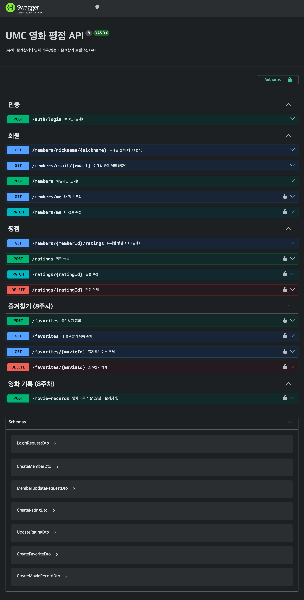 |

한 API의 요청과 응답 예시 화면은 위의 [실습 인증](#️-실습-인증) 캡처(모두 Swagger UI에서 실제로 보낸 요청)를 그대로 쓰면 됩니다. 예: `POST /favorites` → b03, b04.

---

## 🎯 핵심 키워드 (🙋 초안 — 본인 말로 다듬어 주세요)

- **트랜잭션(Transaction)**: 여러 DB 작업을 "전부 되거나 전부 안 되거나"인 하나의 단위로 묶은 것. 이번 주 영화 기록에서 평점 INSERT + 즐겨찾기 INSERT를 `dataSource.transaction()` 하나로 묶었다.
- **commit / rollback**: commit은 트랜잭션 안의 변경을 확정해 다른 연결에도 보이게 하는 것, rollback은 트랜잭션 시작 전 상태로 되돌리는 것. TypeORM은 콜백이 끝까지 성공하면 commit, 콜백에서 예외가 던져지면 rollback 후 그 예외를 다시 던진다. 그래서 서비스에서 `ApiException`을 던지면 응답은 409, DB는 원래대로.
- **원자성(Atomicity)**: 트랜잭션을 더 쪼갤 수 없는 하나로 다룬다는 성질. "평점만 저장된 중간 상태"가 남지 않는 것. 동시 요청 실험에서 평점 0건이 남은 게 원자성이 지켜진 증거.
- **ACID**: 트랜잭션이 보장해야 하는 네 가지. Atomicity(전부 아니면 전무), Consistency(제약 조건을 지킨 상태에서 시작해 지킨 상태로 끝남, 예: UNIQUE·FK), Isolation(동시에 실행돼도 서로의 중간 상태를 보지 않음, MySQL InnoDB 기본은 REPEATABLE READ), Durability(commit된 내용은 서버가 꺼져도 남음).
- **UNIQUE 제약 조건**: 컬럼(조합)의 값이 테이블 안에서 겹치지 않도록 DB가 보장하는 규칙. `favorite`의 `uk_favorite_member_movie (member_id, movie_id)`가 "한 회원은 한 영화를 한 번만"을 보장한다.
- **낙관적 잠금(Optimistic Locking)**: 충돌이 드물다고 보고 잠그지 않고 진행하되, 저장할 때 "내가 읽은 뒤 누가 바꿨는지"를 버전 컬럼으로 확인해 바뀌었으면 실패시키는 방식(TypeORM `@VersionColumn`). 반대로 비관적 잠금은 읽을 때부터 `SELECT ... FOR UPDATE`로 잠근다. 평점 수정처럼 같은 행을 여러 곳에서 고칠 수 있는 곳에 쓸 수 있다. (이번 주 코드에는 적용하지 않음)

---

## 📢 학습 후기 (🙋 초안)

**Q. 트랜잭션이 없을 때 평점만 저장되고 즐겨찾기가 저장되지 않는 상황은 왜 문제가 될까요?**
사용자는 "평점 + 즐겨찾기"를 한 번에 요청했는데 결과가 반쪽만 남는다. 응답은 실패(409/500)인데 DB에는 평점이 있으니, 사용자가 다시 시도하면 이번엔 `RATING409_1`로 막혀서 즐겨찾기를 영영 이 API로 추가할 수 없게 된다. 화면과 DB가 어긋나고, 그걸 고치려면 사람이 직접 데이터를 지워야 한다.

**Q. 서버의 중복 검사와 DB의 UNIQUE 제약을 둘 다 두는 이유는 무엇일까요?**
서버의 중복 검사는 `FAVORITE409_1`처럼 **사용자에게 명확한 오류**를 주기 위한 것이고, UNIQUE 제약은 **동시 요청에서도 깨지지 않는 마지막 안전장치**다. "확인 → 저장" 사이에 다른 요청이 끼어들면 둘 다 확인을 통과할 수 있는데(실제로 동시 요청 실험에서 재현됨), 이때 UNIQUE 제약이 두 번째 INSERT를 막는다. 막힌 DB 오류(`ER_DUP_ENTRY`)는 전역 예외 필터가 제약 이름을 보고 같은 `FAVORITE409_1`로 바꿔 응답하게 했다.

💡 이해가 잘 된 흐름: Guard(누구인지) → Service(규칙 확인) → 트랜잭션(전부 아니면 전무) → 필터(일관된 오류 응답).
💡 아직 낯선 개념: 격리 수준별로 동시 요청 결과가 어떻게 달라지는지, 낙관적 잠금을 실제로 어디에 써야 하는지.

---

## ⚡ 트러블 슈팅

### 이슈 No.1 `npm run start:dev` 중에 `npm run build`를 했더니 서버가 꺼짐

- **이슈**: Swagger를 붙이고 타입 확인용으로 `npm run build`를 실행했더니, 켜 둔 개발 서버가 아래 오류로 종료됐다.
  ```
  Error [ERR_MODULE_NOT_FOUND]: Cannot find module '.../dist/entity/member.entity.js' imported from .../dist/app.module.js
  ```
- **원인**: `nest build`와 `nest start --watch`가 같은 `dist/` 폴더를 쓴다. 빌드가 `dist/`를 지우고 다시 만드는 사이에 watch가 재시작하면서 아직 없는 파일을 import했다.
- **해결**: 개발 서버를 다시 켰다. 서버가 켜져 있을 때는 타입 확인만 필요하면 `npx tsc --noEmit`을 쓰거나 서버를 끄고 빌드한다.
- **배운 점**: 같은 출력 폴더를 쓰는 두 프로세스를 동시에 돌리지 않는다.

### 이슈 No.2 트랜잭션이 정말 rollback되는지 확인하기 어려움

- **이슈**: 영화 기록 Service는 저장 전에 평점·즐겨찾기 중복을 먼저 확인해서, 보통 요청으로는 "평점은 저장됐는데 즐겨찾기가 실패"하는 상황이 나오지 않았다. 그래서 rollback 코드가 실제로 동작하는지 확인할 수 없었다.
- **원인**: 사전 검사가 대부분의 실패를 INSERT 전에 막기 때문.
- **해결**: 같은 영화에 즐겨찾기 등록과 영화 기록을 동시에 60번 보내, 사전 검사를 함께 통과한 뒤 즐겨찾기 INSERT가 UNIQUE 제약에서 실패하도록 만들었다. 서버 로그에서 UNIQUE 위반을 확인했고, DB에 평점이 0건 남은 것으로 rollback을 확인했다. (캡처 b17)
- **배운 점**: 사전 검사는 친절한 오류 메시지용이고, 정합성은 트랜잭션과 DB 제약이 지킨다.

### 이슈 No.3 영화 기록의 후기 길이 제한

- **이슈**: 워크북 참조 구현은 `POST /movie-records`의 `comment`에 길이 제한이 없지만, 평점 등록 API는 500자 제한이 있다.
- **해결**: 같은 `rating` 행을 만드는데 API마다 제한이 다르면 한쪽에서 막힌 후기를 다른 쪽으로 저장할 수 있어서, 영화 기록에도 `@MaxLength(500)`을 걸었다. (README에 차이를 적어 둠)

---

## 🧾 커밋 기록

```
chore: Week8 미션을 위해 7주차 NestJS 평점 API 프로젝트 복사
feat:  Week8 즐겨찾기 등록/목록/여부 조회/해제 API (FAVORITE409_1, FAVORITE404_1)
feat:  Week8 평점과 즐겨찾기를 한 트랜잭션으로 저장하는 영화 기록 API
feat:  Week8 Swagger로 즐겨찾기와 영화 기록 API 문서화 (선택 미션)
docs:  Week8 백엔드 README와 미션 기록, 캡처
```

캡처는 로컬 MySQL에 테스트 회원을 새로 만들어 Swagger UI에서 실제로 요청을 보내며 찍었습니다. (`npm run build`, `npm run lint` 통과)
