# 8주차 프론트엔드 미션 기록 - TanStack Query로 서버에 데이터 요청하기

UMCine(React + TanStack Query/Router + ky + Zustand)에 로그인, 내 정보, 즐겨찾기, 평점 API를 연결했습니다.
백엔드는 같은 브랜치의 [Week8 NestJS 서버](../../../backend/mission1/README.md)(`http://localhost:3000`)를 사용합니다.

> 이 문서는 노션 "미션 기록" 토글에 옮겨 적기 쉽도록 워크북 목차 순서대로 정리했습니다.
> 🙋 표시는 **직접 해야 하는 일**(노션에 붙여 넣기, 본인 말로 다듬기, 제출)입니다.

---

## ✅ 제출 전 체크리스트

| | 할 일 | 상태 |
| --- | --- | --- |
| 🙋 | 스터디 인증샷 (스터디 리더가 대표로 한 장) | 직접 |
| | 필수 미션 1: Route Group + 공통 Layout Route로 로그인 전용 폴더 만들기 | ✅ 아래 [필수 미션 1](#필수-미션-1-로그인-전용-폴더-만들기) |
| | 필수 미션 2: 남은 API 연결 (즐겨찾기 4개, 평점 4개) | ✅ 아래 [필수 미션 2](#필수-미션-2-남은-api-연결하기) |
| | 선택 미션 1: invalidateQueries vs setQueryData 비교 | ✅ 아래 [선택 미션 1](#선택-미션-1-invalidatequeries-vs-setquerydata-비교) |
| | 선택 미션 2: mutationOptions로 리팩터링 | ✅ 아래 [선택 미션 2](#선택-미션-2-mutationoptions로-리팩터링) |
| 🙋 | 핵심 키워드 정리: 아래 초안을 **본인 말로 다듬어** 노션에 옮기기 | 초안 ✅ |
| 🙋 | 학습 후기 작성: 아래 초안 참고 | 초안 ✅ |
| 🙋 | 노션 개인 미션 페이지 → 공유 → 링크 복사 → [PE 워크북 AI 피드백 시스템](https://umc.ai.kr/)에 제출 | 직접 |
| 🙋 | GitHub PR 올리고 CodeRabbit 리뷰 받기 (백엔드와 함께 한 PR) | 직접 |
| 🙋 | (선택) 기술 블로그 작성 후 블로그 챌린지 폼 제출 → 상점 +3 | 직접 |
| 🙋 | (선택) 지식in 채널 질문/답변 → 상점 (주차별 최대 2점) | 직접 |

---

## ▶️ 실행 방법

```bash
# 1) 백엔드 (Week8/jaewoni314/backend/mission1)
npm install
npm run start:dev          # http://localhost:3000, Swagger: /docs

# 2) 프론트 (Week8/jaewoni314/frontend/mission1)
cp .env.example .env.local # TMDB 토큰 입력, VITE_API_BASE_URL=http://localhost:3000
pnpm install
pnpm dev                   # http://localhost:5173 (백엔드 CORS가 이 주소만 허용)
```

---

## ✨ 학습 내용 실습 기록

### 1. 회원가입 API를 useMutation으로 옮기기

7주차의 `isSubmitting` 상태를 지우고 `useSignupMutation`으로 옮겼습니다. 버튼은 `signupMutation.isPending`으로 "가입 중"을 표시합니다.
공통 처리(성공 알림 + `/login` 이동, 실패 알림)는 훅에, 이 화면에서만 필요한 처리(409면 중복 확인 결과 초기화)는 `mutate`의 두 번째 인자에 두었습니다.

```ts
// src/hooks/members/use-signup-mutation.ts
return useMutation({
  ...memberMutations.signup(),
  onSuccess: (response) => {
    alert(response.message);
    navigate({ to: "/login" });
  },
  onError: (error) => alert(getApiErrorMessage(error, "회원가입에 실패했어요. 다시 시도해 주세요.")),
});
```

| 회원가입 입력 (이메일·닉네임 중복 확인 완료) |
| --- |
| 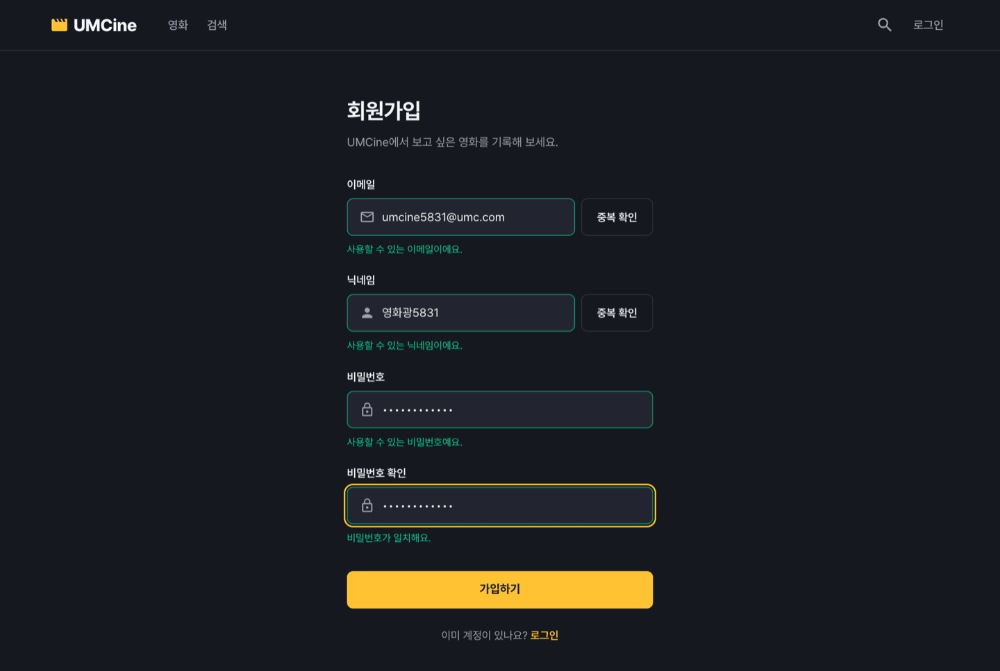 |

### 2. 로그인 API 연결하기

- **토큰 저장**: `src/stores/auth-store.ts` — Zustand `persist`로 `accessToken`만 localStorage에 저장 (`umcine-auth-store`).
- **인증 요청용 인스턴스**: `src/api/auth-api.ts` — `umcClient.extend()`로 만든 `authApi`.
  - `beforeRequest`: `useAuthStore.getState()`로 요청 직전의 최신 토큰을 `Authorization: Bearer` 헤더에 넣음
  - `afterResponse`: 401이면 토큰을 비움 → 헤더가 로그인 링크로 바뀌고, 로그인 전용 페이지는 로그인 화면으로 이동
- **로그인**: 인증이 필요 없는 요청이라 `umcClient`로 `POST /auth/login`. 성공하면 토큰 저장 → `invalidateQueries(["members", "me"])` → 홈 이동
- **헤더**: 토큰이 없으면 "로그인", 첫 조회 중이면 같은 크기의 스켈레톤, 조회 후에는 닉네임이 붙은 마이페이지 링크. 로딩 판단은 `isPending`이 아니라 `isLoading` (조회를 꺼 둔 상태에서도 `isPending`은 참이기 때문)
- **로그인 페이지 접근 제한**: `routes/login.tsx`의 `beforeLoad`에서 토큰이 있으면 `redirect({ to: "/" })`

| 로그인 입력 | 로그인 후 홈 (헤더에 닉네임) |
| --- | --- |
| 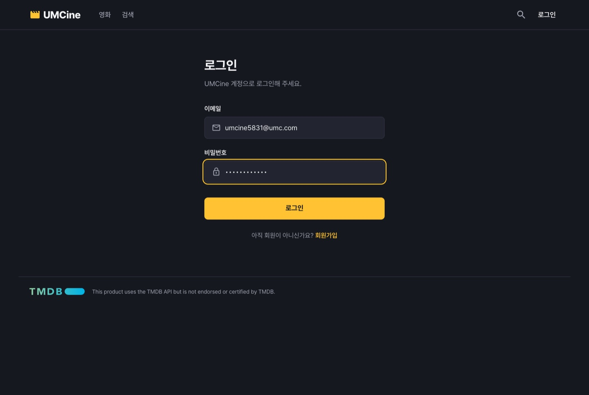 |  |

확인 결과 (puppeteer로 실제 화면을 조작하며 기록)

```
로그인 버튼 → POST /auth/login → GET /members/me, GET /favorites   (토큰 저장 후 내 정보 다시 조회)
로그인한 채로 /login 접속 → / 로 이동
localStorage "umcine-auth-store"에 accessToken 저장됨
잘못된 토큰으로 새로고침 → GET /members/me 401 → 토큰이 null로 바뀌고 헤더에 "로그인" 표시
```

### 3. 캐시를 직접 바꾸는 방법과 비교하기 (setQueryData)

`PATCH /members/me`의 응답 `result`가 내 정보 조회와 같은 형태라서, 다시 조회하지 않고 `["members", "me"]` 캐시를 응답으로 바꿨습니다.
헤더와 마이페이지가 같은 key를 써서 **추가 요청 없이** 새 닉네임이 바로 보입니다. (네트워크: `PATCH /members/me` 1번만)

```ts
// src/hooks/members/use-update-me-mutation.ts
onSuccess: (updatedMe) => {
  queryClient.setQueryData(memberQueries.me().queryKey, updatedMe);
  alert("내 정보를 수정했어요.");
  navigate({ to: "/my" });
},
```

| 닉네임 변경 + 중복 확인 | 저장 후 마이페이지 (헤더 닉네임도 즉시 변경) |
| --- | --- |
| 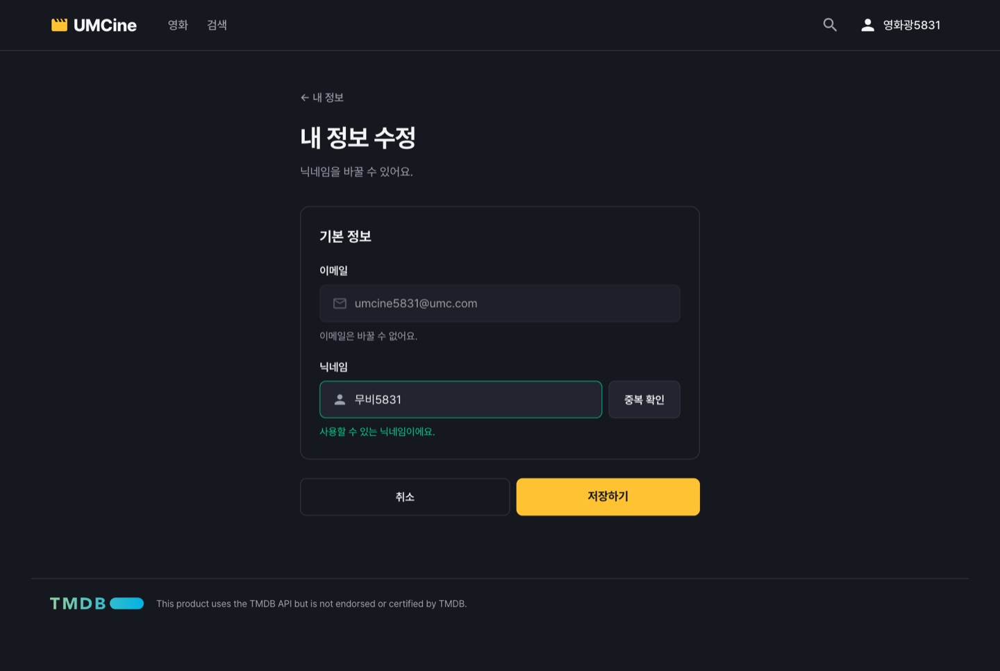 | 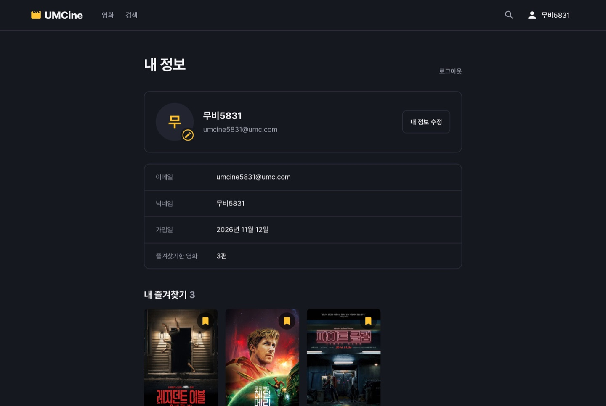 |

> 내 정보 수정 API는 닉네임만 바꿀 수 있어서, 7주차에 퍼블리싱했던 비밀번호 변경 칸은 뺐습니다.

---

## 🔥 미션

### 필수 미션 1: 로그인 전용 폴더 만들기

`(protected)`는 괄호로 감싼 **Route Group**이라 URL에 들어가지 않고(`/my`, `/my/edit`), 같은 폴더의 `route.tsx`가 두 페이지의 **공통 Layout Route**가 됩니다.

```
src/routes/
├── (protected)/
│   ├── route.tsx      ← 공통 Layout Route: beforeLoad로 접근 제한 + <Outlet />
│   └── my/
│       ├── index.tsx  ← /my
│       └── edit.tsx   ← /my/edit
├── login.tsx          ← beforeLoad: 로그인했으면 / 로
└── ...
```

```tsx
// src/routes/(protected)/route.tsx
export const Route = createFileRoute("/(protected)")({
  beforeLoad: () => {
    if (!useAuthStore.getState().accessToken) {
      alert("로그인이 필요한 페이지예요.");
      throw redirect({ to: "/login" });
    }
  },
  component: ProtectedLayout, // 토큰이 사라지면 <Navigate to="/login" />, 아니면 <Outlet />
});
```

생성된 route tree에서 `/my`, `/my/edit`의 부모가 `/(protected)`로 바뀐 것을 확인했습니다 (`getParentRoute: () => protectedRouteRoute`).

| 로그인 전 홈 | 로그인 전 `/my` 접속 → 알림 후 `/login`으로 이동 |
| --- | --- |
|  | 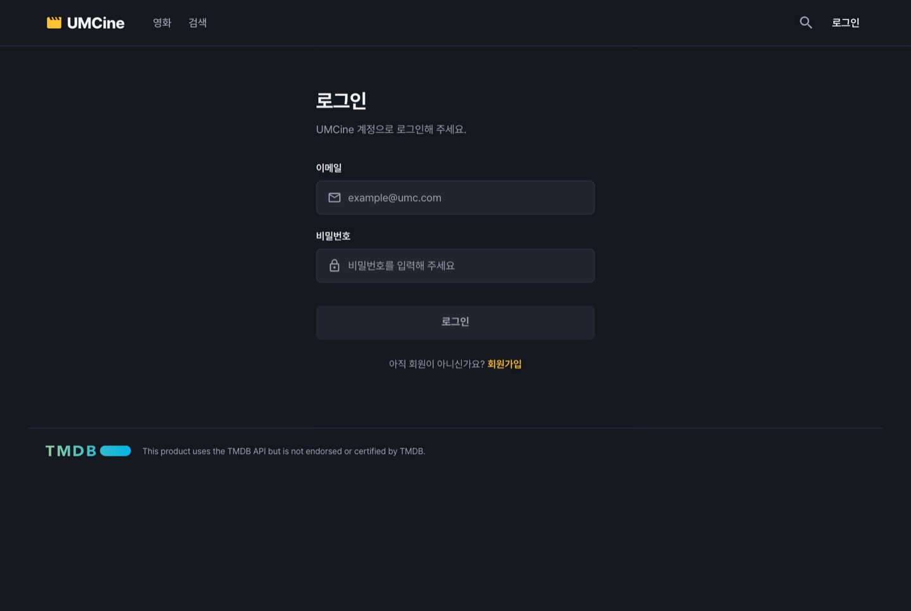 |

### 필수 미션 2: 남은 API 연결하기

| 화면 | API | 어디에 썼나 | 변경 후 캐시 처리 |
| --- | --- | --- | --- |
| 마이페이지 | `GET /favorites` | 내 즐겨찾기 목록(포스터는 TMDB 상세로), 즐겨찾기 수, **영화 카드의 즐겨찾기 표시** | - |
| 영화 상세 | `GET /favorites/{movieId}` | 상세의 즐겨찾기 버튼 상태 | - |
| 영화 상세 | `POST /favorites` | 즐겨찾기 추가 (상세, 카드) | `setQueryData` (여부 → true, 목록 맨 앞에 응답 추가) |
| 영화 상세 | `DELETE /favorites/{movieId}` | 즐겨찾기 해제 (상세, 카드, 마이페이지) | `setQueryData` (여부 → false, 목록에서 제거) |
| 영화 상세 | `GET /members/{memberId}/ratings` | 상세의 "내 평점", 마이페이지 "내가 남긴 평점" | - |
| 영화 상세 | `POST /ratings` | 평점 남기기 (별점 1~5 + 후기 500자) | `invalidateQueries` (내 평점 목록) |
| 영화 상세 | `PATCH /ratings/{ratingId}` | 평점 수정 | `invalidateQueries` |
| 영화 상세 | `DELETE /ratings/{ratingId}` | 평점 삭제 (확인창) | `invalidateQueries` |

구현하면서 판단한 점

- **memberId 얻기**: `GET /members/me` 응답에는 `memberId`가 없어서, 토큰 payload의 `sub`(회원 ID)를 Base64URL 디코딩해 `["ratings", "member", memberId]` key를 만들었습니다 (`getMemberIdFromToken`). 서명 검증은 서버가 하므로 화면용으로만 읽습니다.
- **카드마다 요청하지 않기**: 홈/검색의 영화 카드는 `GET /favorites/{movieId}`를 20번 보내는 대신, `GET /favorites` 목록 한 번을 `select`로 "이 영화가 들어 있는지"만 골라 씁니다. 상세 화면만 워크북대로 `GET /favorites/{movieId}`를 씁니다.
- **localStorage 북마크 제거**: 6주차의 Zustand 북마크(`bookmark-store`)와 7주차 예시 회원(`my-info-store`)을 서버 데이터로 대체하고 지웠습니다.
- **로그인 전 즐겨찾기 클릭**: "로그인 후 사용할 수 있어요" 알림 후 로그인 화면으로 이동합니다.
- **로그아웃**: 서버 API가 없어 토큰과 회원별 캐시(`members/me`, `favorites`, `ratings`)를 지웁니다. 로그인 전용 페이지에서 토큰을 먼저 지우면 Layout이 로그인 화면으로 보내므로, 홈으로 이동한 뒤 지웁니다.

| 영화 상세 (즐겨찾기 전) | 즐겨찾기 추가 후 (`POST /favorites` 1번) |
| --- | --- |
| 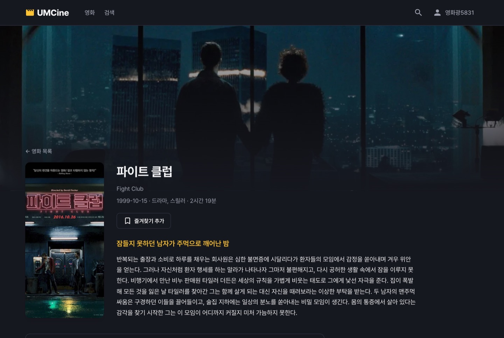 | 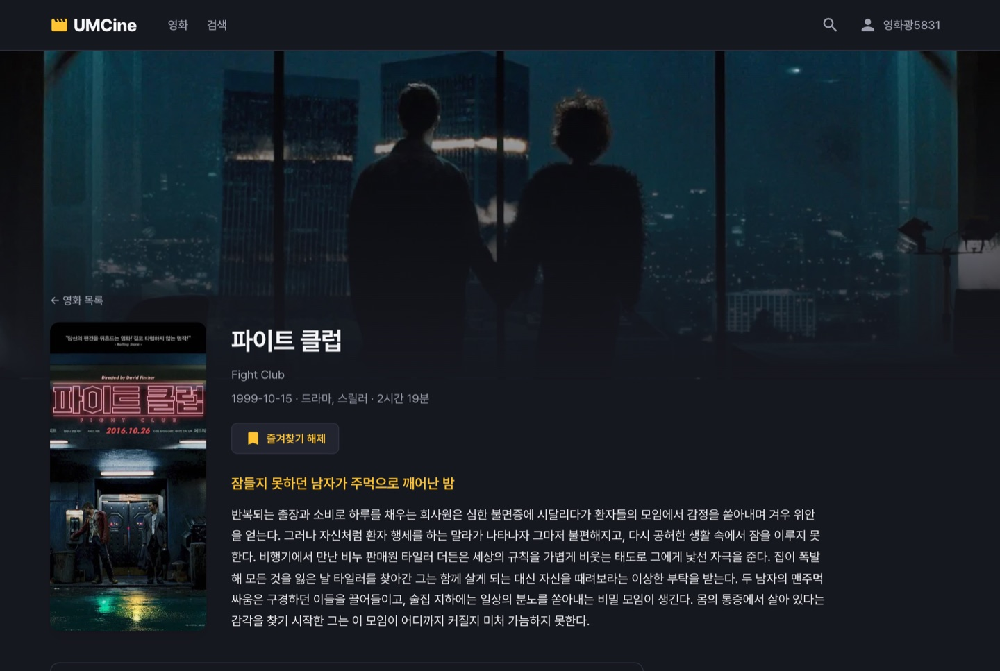 |

| 평점 입력 | 평점 등록 후 | 평점 수정 후 (수정됨 표시) |
| --- | --- | --- |
| 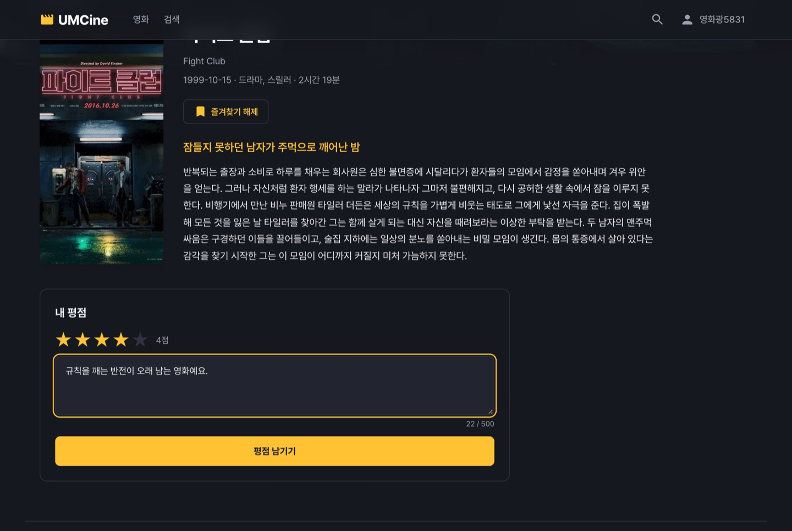 | 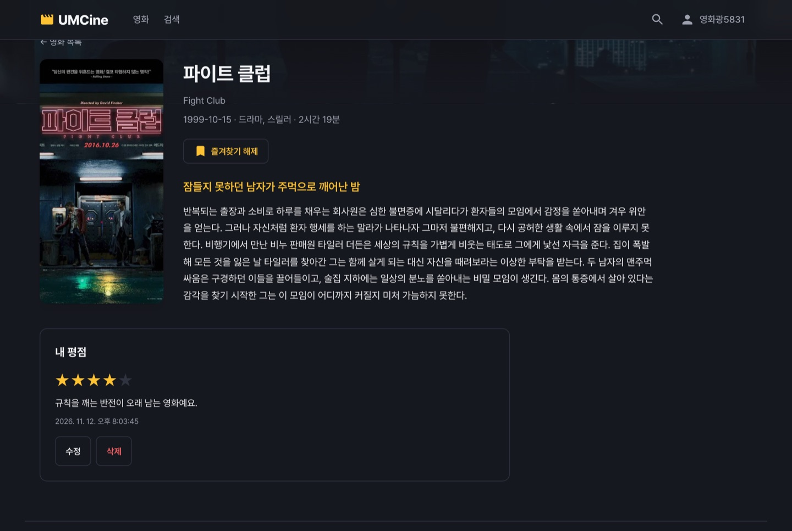 | 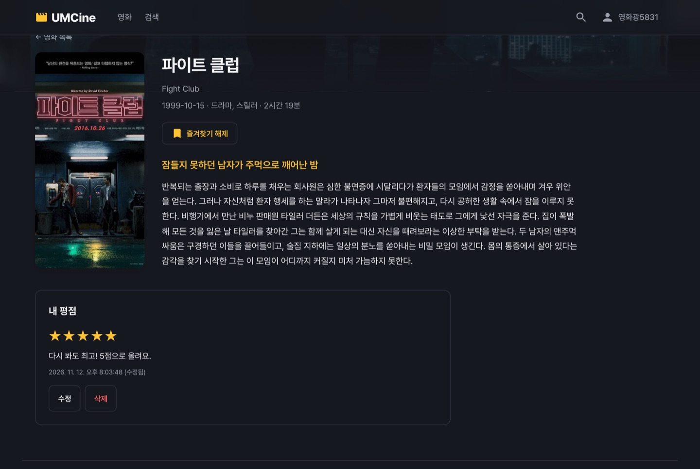 |

| 홈 카드에서 즐겨찾기 | 마이페이지 (내 정보 + 즐겨찾기 + 내 평점) |
| --- | --- |
|  | 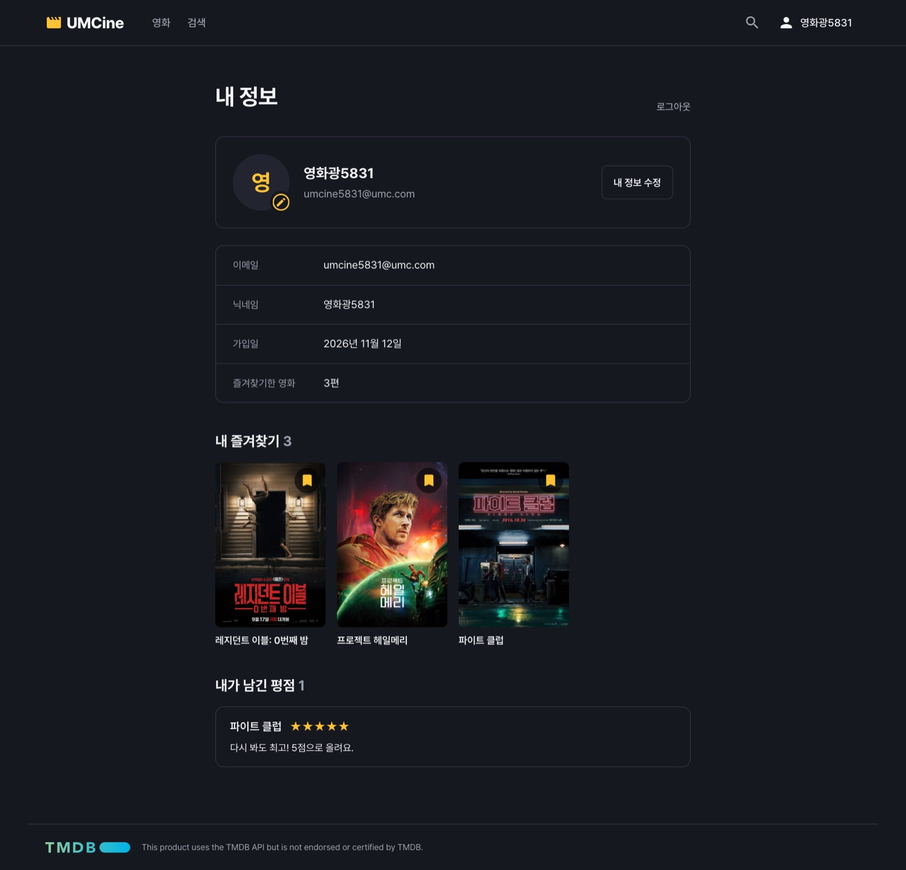 |

| 마이페이지에서 즐겨찾기 해제 (목록에서 바로 빠짐) | 평점 삭제 후 | 로그아웃 후 |
| --- | --- | --- |
| 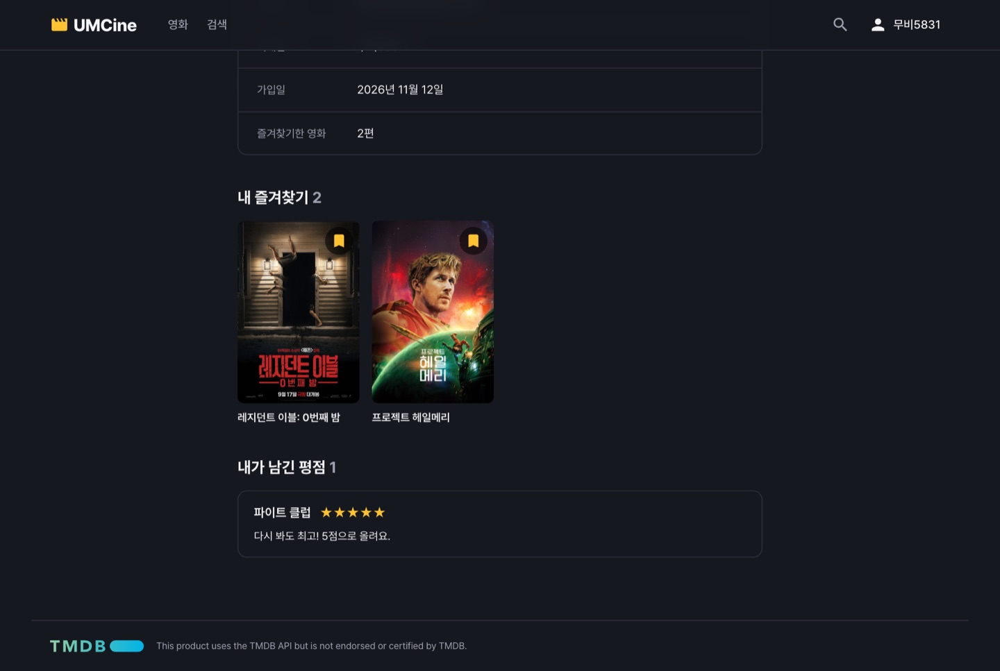 | 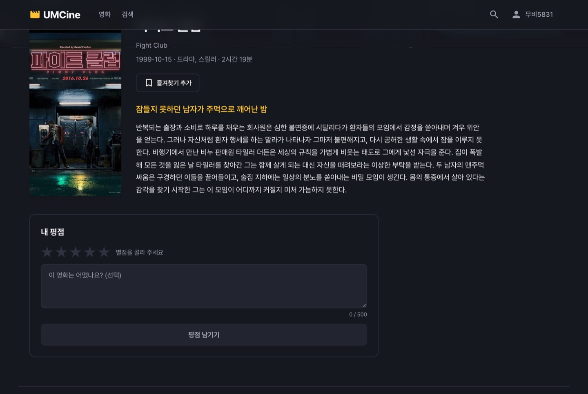 | 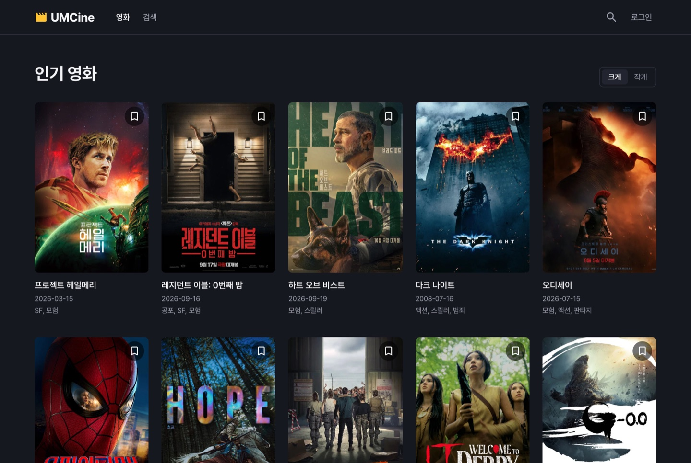 |

### 선택 미션 1: invalidateQueries vs setQueryData 비교

같은 시나리오를 실제로 실행하면서 버튼을 누른 뒤 서버로 나간 요청을 기록했습니다.

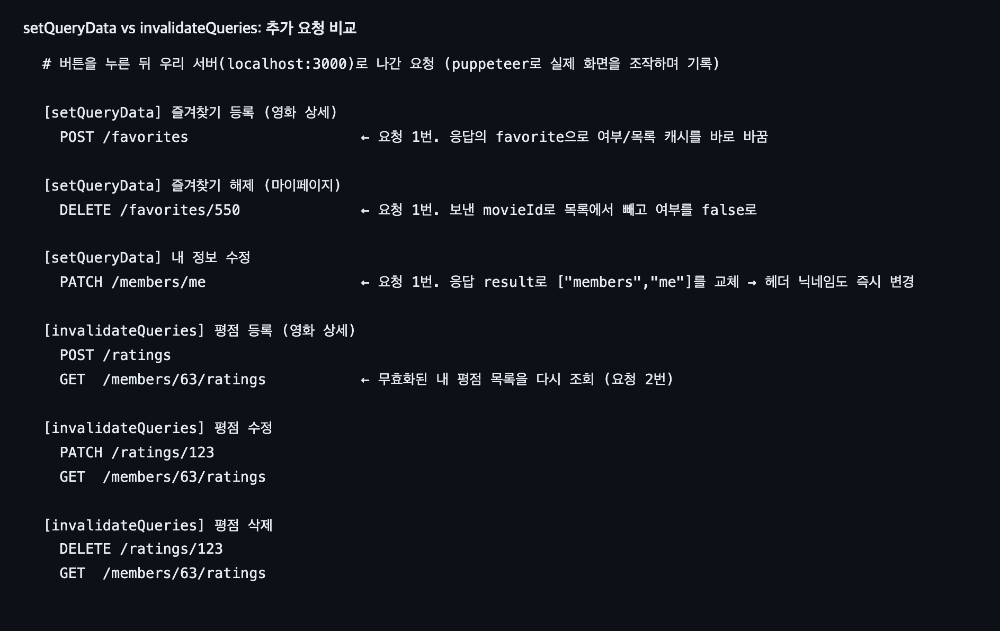

| | setQueryData | invalidateQueries |
| --- | --- | --- |
| 적용한 곳 | 내 정보 수정, 즐겨찾기 등록/해제 | 로그인 후 내 정보, 평점 등록/수정/삭제 |
| 추가 요청 | 없음 (변경 요청 1번) | 있음 (변경 요청 + 다시 조회 1번) |
| 화면 갱신 | 응답을 받자마자 즉시 | 다시 조회한 응답이 올 때까지 이전 데이터 (onSuccess에서 Promise를 돌려줘 그동안 `isPending` 유지) |
| 정확성 | 캐시를 고치는 코드가 서버 규칙(정렬, 계산값)을 똑같이 따라 해야 함 | 서버가 정렬·계산한 결과를 그대로 받으므로 어긋날 일이 없음 |

**선택 기준**

- 응답(또는 요청값)만으로 바뀐 결과를 **정확히** 알 수 있으면 `setQueryData`: 내 정보 수정은 응답 `result`가 조회 결과와 같은 형태이고, 즐겨찾기는 "있다/없다"와 목록 맨 앞 추가라 계산이 단순합니다.
- 바뀐 결과를 화면이 직접 계산하기 어렵거나 여러 화면/정렬에 영향을 주면 `invalidateQueries`: 평점 목록은 서버가 최신순으로 정렬하고 `updatedAt`도 서버가 정하므로 다시 받는 쪽이 안전합니다. 로그인은 "누구의 정보인지"가 바뀌는 상황이라 무조건 다시 조회합니다.

### 선택 미션 2: mutationOptions로 리팩터링

`queryOptions`로 query key와 요청 함수를 모았던 것처럼, `mutationOptions`로 mutation의 key와 요청 함수를 도메인별 파일에 모았습니다.
훅은 이 옵션을 펼친 뒤 화면별 처리(알림, 이동, 캐시 갱신)만 더합니다.

```ts
// src/api/favorites/favorite-mutations.ts
const favoriteMutations = {
  all: () => ["favorites"] as const,
  add: () => mutationOptions({ mutationKey: [...favoriteMutations.all(), "add"], mutationFn: addFavorite }),
  remove: () => mutationOptions({ mutationKey: [...favoriteMutations.all(), "remove"], mutationFn: removeFavorite }),
};

// src/hooks/favorites/use-favorite-mutations.ts
return useMutation({ ...favoriteMutations.add(), onSuccess: (favorite) => { /* setQueryData */ } });
```

| 파일 | 옵션 |
| --- | --- |
| `api/auth/auth-mutations.ts` | `login` |
| `api/members/member-mutations.ts` | `signup`, `updateMe` |
| `api/favorites/favorite-mutations.ts` | `add`, `remove` |
| `api/ratings/rating-mutations.ts` | `create`, `update`, `remove` |

좋아진 점: 요청 함수와 key가 한곳에 있어 화면마다 다르게 적는 실수가 없고, 같은 key로 `useIsMutating`, `useMutationState`, `queryClient.setMutationDefaults`에서 그 mutation을 가리킬 수 있습니다. 타입도 `mutationFn`에서 추론되어 훅의 `onSuccess(data, variables)`가 자동으로 맞춰집니다.

---

## 🎯 핵심 키워드 (🙋 초안 — 본인 말로 다듬어 주세요)

### 클라이언트 상태와 서버 상태

- **클라이언트 상태**: 원본이 브라우저에 있는 값. 입력 중인 폼 값(`useState`), 로그인 토큰(Zustand + localStorage), 보기 설정 등. 내가 바꾸면 그게 곧 최신값입니다.
- **서버 상태**: 원본이 서버(DB)에 있고 화면은 그 사본(캐시)을 들고 있는 값. 회원 정보, 즐겨찾기, 평점. 다른 탭이나 다른 사람이 바꿀 수 있어 "언제 받아 온 사본인지"(stale)를 관리해야 해서 TanStack Query에 맡겼습니다.
- **입력값 / 토큰 / 회원 정보는 어디에?** 입력값은 컴포넌트 `useState`, 토큰은 Zustand(persist), 회원 정보는 query 캐시 `["members", "me"]`. 토큰은 서버가 발급했지만 이 브라우저가 보관·전송하는 값이라 클라이언트 상태로 봤습니다.
- **같은 회원 정보를 store와 query 캐시에 둘 다 저장하면?** 원본이 두 개가 됩니다. 닉네임을 수정하고 캐시만 고치면 store의 닉네임은 옛 값으로 남아 헤더와 마이페이지가 서로 다른 닉네임을 보여 줄 수 있고, 로그아웃할 때 둘 다 지워야 하는 등 동기화 코드가 늘어납니다. 그래서 7주차의 `my-info-store`를 지우고 query 캐시 하나만 쓰도록 바꿨습니다.

### 캐시 일관성

- **서버에서 수정했는데 다른 화면에 이전 값이 보이는 이유**: 각 화면이 서버가 아니라 **캐시**를 보고 있기 때문입니다. 수정 요청(mutation)은 query 캐시를 자동으로 바꾸지 않아서, 무효화하거나 직접 고치지 않으면 `staleTime` 동안 옛 사본이 그대로 보입니다. key가 서로 다르면(예: 목록과 상세) 한쪽만 고쳐도 다른 쪽은 그대로입니다.
- **다시 조회 vs 직접 수정**: 위 [선택 미션 1](#선택-미션-1-invalidatequeries-vs-setquerydata-비교) 표 참고. 결과를 확실히 알면 `setQueryData`(빠름, 요청 절약), 서버가 계산·정렬하거나 영향 범위가 넓으면 `invalidateQueries`(정확, 요청 1번 더).

---

## 📢 학습 후기 (🙋 초안)

- 7주차에는 `isSubmitting` 하나만 관리해도 `try/finally`가 필요했는데, `useMutation`은 진행/성공/실패/응답을 한 번에 주니 화면 코드가 "무엇을 보여 줄지"에만 집중할 수 있었다.
- 처음에는 모든 변경 뒤에 `invalidateQueries`를 쓰면 된다고 생각했는데, 네트워크 요청을 세어 보니 내 정보 수정처럼 응답에 결과가 다 들어 있는 경우에는 요청이 한 번 더 나가는 낭비였다. 반대로 평점 목록처럼 서버가 정렬하는 데이터를 직접 고치면 정렬 규칙을 프론트에 또 구현해야 해서 다시 조회가 낫다는 기준이 생겼다.
- 영화 카드마다 즐겨찾기 여부를 물으면 요청이 20번 나간다는 걸 깨닫고, 목록 한 번을 `select`로 나눠 쓰는 방법을 알게 됐다.
- 아직 낯선 것: 요청이 실패했을 때 화면을 되돌리는 낙관적 업데이트(`onMutate`, rollback)는 심화 학습에서 더 연습해 보고 싶다.

---

## ⚡ 트러블 슈팅

### 이슈 No.1 영화 상세를 스크롤하면 포스터가 헤더를 덮음

- **이슈**: 영화 상세 화면을 내리면 포스터와 "← 영화 목록"이 고정(sticky) 헤더 위에 겹쳐 보였다. (캡처를 찍다가 발견)
- **원인**: 헤더가 `sticky top-0 z-10`이고, 상세 본문도 배경 이미지 위로 올리려고 `relative z-10`이었다. z-index가 같으면 DOM에서 뒤에 오는 본문이 위에 그려진다.
- **해결**: 헤더를 `z-20`으로 올렸다. 다시 캡처해서 겹치지 않는 것을 확인했다.
- **배운 점**: 같은 z-index끼리는 문서 순서가 쌓임 순서를 정한다. 고정 헤더처럼 항상 위에 있어야 하는 요소는 본문보다 한 단계 높게 둔다.
- **참고**: [MDN - Stacking context](https://developer.mozilla.org/docs/Web/CSS/CSS_positioned_layout/Stacking_context)

### 이슈 No.2 내 평점 목록을 조회할 memberId가 없음

- **이슈**: 영화 상세에서 내 평점을 찾으려면 `GET /members/{memberId}/ratings`가 필요한데, `GET /members/me` 응답에는 `memberId`가 없었다.
- **원인**: 7주차부터 서버는 URL이 아니라 토큰으로 회원을 식별하고, 내 정보 응답에서 `memberId`를 빼도록 설계되어 있다.
- **해결**: JWT payload의 `sub`에 회원 ID가 들어 있으므로 Base64URL을 디코딩해 읽었다(`getMemberIdFromToken`). 서명 검증은 서버 몫이라 화면에서 query key를 만드는 용도로만 쓴다.
- **배운 점**: JWT payload는 암호화가 아니라 인코딩이라 누구나 읽을 수 있다. 그래서 비밀번호 같은 값은 넣으면 안 되고, 읽은 값을 권한 판단에 쓰면 안 된다.

### 이슈 No.3 로그인 전 상태에서 헤더 로딩 표시 (워크북 예시와 같은 함정 피하기)

- **이슈**: 토큰이 없으면 `enabled: false`라 요청하지 않는데, `isPending`으로 로딩을 그리면 로그인 전에도 스켈레톤이 계속 보인다.
- **해결**: 토큰이 없으면 먼저 로그인 링크를 그리고, 실제 첫 요청 중인지는 `isLoading`(= `isPending && isFetching`)으로 확인했다. 잘못된 토큰으로 새로고침해 401 → 토큰 비움 → 로그인 링크로 바뀌는 것까지 확인했다.
- **참고**: [TanStack Query - Disabling Queries](https://tanstack.com/query/latest/docs/framework/react/guides/disabling-queries)

---

## 📝 기술 블로그 주제 (🙋 선택)

- **invalidateQueries와 setQueryData의 캐시 갱신 방식과 선택 기준**: 위 [선택 미션 1](#선택-미션-1-invalidatequeries-vs-setquerydata-비교)의 요청 비교 캡처와 표를 그대로 뼈대로 쓰면 됩니다.

---

## 🧾 커밋 기록

```
chore:    Week8 미션을 위해 7주차 UMCine 프로젝트 복사
feat:     Week8 회원가입 요청 상태를 useMutation으로 관리
feat:     Week8 로그인 API 연결, 토큰 저장과 인증 요청용 authApi, 헤더에 로그인 상태 표시
feat:     Week8 (protected) Route Group에 공통 Layout Route를 만들어 로그인 전용 페이지 접근 제한
feat:     Week8 내 정보 조회/수정 API 연결, 수정 응답으로 setQueryData 캐시 갱신과 로그아웃
feat:     Week8 즐겨찾기 API 연결 (마이페이지 목록, 영화 상세 여부 조회/등록/해제), localStorage 북마크 대체
feat:     Week8 평점 API 연결 (영화 상세 내 평점 등록/수정/삭제, 마이페이지 내 평점 목록), 변경 후 invalidateQueries
refactor: Week8 mutationOptions로 mutation의 key와 요청 함수 분리 (선택 미션)
fix:      Week8 영화 상세를 스크롤하면 포스터가 고정 헤더를 덮던 문제 수정
docs:     Week8 프론트 미션 기록과 캡처
```

캡처는 로컬 백엔드(MySQL)에 테스트 회원을 새로 만들어 puppeteer로 실제 화면을 조작하며 찍었습니다. (`pnpm build`, `pnpm lint` 통과)
