# 9주차 백엔드 미션 기록 - 함께 테스트하고 다듬기 (NestJS)

8주차까지 만든 15개 API에 새 기능을 더하지 않고, **문서는 코드가 만들고(Swagger), 확인은 코드가 하도록(테스트 코드)** 다듬었습니다.
API 명세, 오류 코드, 테스트 실행 방법 전체는 [README](../README.md)에 있습니다.

> 이 문서는 노션 "미션 기록" 토글에 옮겨 적기 쉽도록 워크북 목차 순서대로 정리했습니다.
> 🙋 표시는 **직접 해야 하는 일**(노션에 붙여 넣기, 본인 말로 다듬기, 제출)입니다.

---

## ✅ 제출 전 체크리스트

| | 할 일 | 상태 |
| --- | --- | --- |
| | 실습 1~6: Swagger, 공개/인증 API 문서화, 단위 테스트 2개, 통합 테스트 4개, 일부러 깨뜨리기 | ✅ 아래 [실습 체크리스트](#-실습-체크리스트) |
| | 실습 인증 캡처 4종 | ✅ 아래 [실습 인증](#️-실습-인증) |
| | 필수 미션: 남은 API 문서화 + 평점 단위 테스트 2개, 통합 테스트 2개 | ✅ 아래 [필수 미션](#-필수-미션-문서-채우고-평점-api-테스트하기) |
| | 선택 미션: 트랜잭션이 진짜 되돌리는지 테스트로 증명 | ✅ 아래 [선택 미션](#-선택-미션-트랜잭션이-진짜-되돌리는지-테스트로-증명하기) |
| 🙋 | 핵심 키워드 정리: 아래 초안을 **본인 말로 다듬어** 노션에 옮기기 | 초안 ✅ |
| 🙋 | 학습 후기 질문 2개 답하기: 아래 초안 참고 | 초안 ✅ |
| 🙋 | 노션 개인 미션 페이지 → 공유 → 링크 복사 → [PE 워크북 AI 피드백 시스템](https://umc.ai.kr/)에 제출 | 직접 |
| 🙋 | GitHub PR에서 CodeRabbit 리뷰 받기 (프론트와 함께 한 PR) | 직접 |
| 🙋 | (선택) 기술 블로그 / 지식in 상점 | 직접 |

---

## ▶️ 실행 방법

```bash
cp .env.example .env   # DB 정보, JWT_SECRET(32자 이상) 입력
npm install
npm run start:dev      # http://localhost:3000, Swagger: http://localhost:3000/swagger-ui

npm test               # 단위 테스트 4개 (DB 필요 없음)
npm run test:e2e       # 통합 테스트 9개 (메모리 SQLite, MySQL 필요 없음)
```

워크북 예제는 Jest(`jest.fn()`, `test/jest-e2e.json`) 기준이지만, 이 프로젝트는 처음부터 **Vitest**로 만들어져 있어서 `vi.fn()`과 `vitest.config.e2e.ts`를 그대로 썼습니다. 테스트 코드의 모양(given/when/then, `Test.createTestingModule`, supertest)은 같습니다.

---

## ✅ 실습 체크리스트

- [x] Swagger를 설치하고 브라우저에서 API 문서 화면을 열었다. → `http://localhost:3000/swagger-ui` (b00)
- [x] 토큰이 필요한 API에 자물쇠 표시가 뜨고, 공개 API에는 뜨지 않는 것을 확인했다. (b00: 로그인, 회원가입, 중복 체크, 유저별 평점 조회만 자물쇠 없음)
- [x] Swagger의 Authorize 버튼에 토큰을 넣고 즐겨찾기 등록을 성공시켰다. (b02, b03)
- [x] 같은 요청을 반복해 문서에 적어둔 409 응답이 실제로 나오는 것을 확인했다. (b04)
- [x] 가짜 Repository를 사용한 단위 테스트 2개를 작성하고 통과시켰다. → [`favorite.service.spec.ts`](../src/service/favorite.service.spec.ts) (b10)
- [x] 테스트 전용 메모리 DB를 붙여 통합 테스트 4개를 작성하고 통과시켰다. → [`favorite.e2e-spec.ts`](../test/favorite.e2e-spec.ts) (b11)
- [x] 중복 검사 코드를 일부러 지워 테스트가 실패하는 것을 확인하고 되돌렸다. (b12)

### 실습 1. Swagger 경로 옮기기

8주차 선택 미션에서 `/docs`에 붙여 둔 Swagger를 워크북과 같은 `/swagger-ui`로 옮겼습니다. 패키지는 `@nestjs/common`과 같은 메이저 버전(`@nestjs/swagger@^12`)이라 설치 충돌은 없었습니다.
Swagger 화면은 우리 컨트롤러가 아니라서 `AuthGuard`의 영향을 받지 않고, 토큰 없이 바로 열립니다. (Spring의 인터셉터처럼 예외 경로를 따로 등록할 필요가 없음)

```ts
// src/main.ts
const swaggerConfig = new DocumentBuilder()
  .setTitle("UMC 영화 평점 API")
  .setDescription("UMC 11기 백엔드 워크북에서 만든 회원/인증/평점/즐겨찾기/영화 기록 API 문서입니다.")
  .setVersion("9")
  .addBearerAuth({ type: "http", scheme: "bearer", bearerFormat: "JWT" }, BEARER_AUTH)
  .build();
SwaggerModule.setup("swagger-ui", app, () => SwaggerModule.createDocument(app, swaggerConfig));
```

### 실습 2, 3. 공개 API와 인증 API 문서화

워크북처럼 API마다 `@ApiResponse`를 길게 적는 대신, 8주차에 만든 데코레이터 3개로 줄였습니다.

| 데코레이터 | 하는 일 |
| --- | --- |
| `@ApiAuth()` | 자물쇠(`@ApiBearerAuth`) + 401 응답 3가지(`AUTH401_2/3/4`)를 한 번에 |
| `@ApiSuccess(status, code, message, result)` | `{ isSuccess: true, code, message, result }` 성공 예시 |
| `@ApiFail(status, ...errorCodes)` | `ErrorCodes`에 정의한 실패 응답을 예시로. 같은 status의 실패가 여러 개면 Swagger UI에서 골라 볼 수 있음 |

`ErrorCodes`에서 바로 예시를 만들기 때문에 서비스의 오류 메시지를 바꾸면 문서도 함께 바뀝니다. (손으로 쓴 문서가 틀어지는 문제를 실패 응답까지 막음)

```ts
// src/controller/favorite.controller.ts (실습 3)
@ApiTags("즐겨찾기")
@ApiAuth() // 이 컨트롤러의 모든 API: 자물쇠 + 401 3종
@Controller("favorites")
@UseGuards(AuthGuard)
export class FavoriteController {
  @Post()
  @ApiOperation({ summary: "즐겨찾기 등록", description: "토큰의 회원이 영화를 즐겨찾기해요. 바디에 memberId를 넣으면 400이에요." })
  @ApiSuccess(HttpStatus.CREATED, "COMMON201", "즐겨찾기를 등록했습니다.", FAVORITE_EXAMPLE)
  @ApiFail(HttpStatus.BAD_REQUEST, { code: "COMMON400", message: "영화 ID는 양수여야 합니다." })
  @ApiFail(HttpStatus.NOT_FOUND, ErrorCodes.MEMBER_NOT_FOUND)
  @ApiFail(HttpStatus.CONFLICT, ErrorCodes.FAVORITE_DUPLICATED)
  async create(@LoginMember() memberId: number, @Body() dto: CreateFavoriteDto) { ... }
}
```

요청 DTO에는 `@ApiProperty`로 설명과 예시 값을 넣었습니다. `class-validator` 규칙은 문서에 나타나지 않으므로 입력 규칙을 사람 말로 한 번 더 적었습니다.

```ts
// src/dto/create-member.dto.ts (실습 2)
@ApiProperty({ description: "로그인에 사용할 이메일 (254자 이하)", example: "challenger@umc.com", maxLength: 254 })
@MaxLength(254, { message: "이메일은 254자 이하여야 합니다." })
@IsEmail({}, { message: "올바른 이메일 형식이 아닙니다." })
email: string;
```

### 실습 4. 단위 테스트: 즐겨찾기 서비스의 판단 검증

Repository 자리에 `vi.fn()`으로 만든 가짜를 끼워 넣고 "이미 즐겨찾기한 상태"를 마음대로 설정했습니다. 우리 서비스는 `findOne`이 아니라 `exists`로 중복을 확인해서, 가짜도 `exists`를 만들었습니다.

```ts
// src/service/favorite.service.spec.ts
it("이미 즐겨찾기한 영화면 FAVORITE409_1 예외를 던지고 저장하지 않는다", async () => {
  // given: 같은 회원이 같은 영화를 이미 즐겨찾기해 둔 상황
  memberRepository.findOneBy.mockResolvedValue(member);
  favoriteRepository.exists.mockResolvedValue(true);

  // when & then: FAVORITE409_1 예외가 나고, 저장은 시도조차 하지 않는다
  const promise = favoriteService.create(1, { movieId: 550 });
  await expect(promise).rejects.toBeInstanceOf(ApiException);
  await expect(promise).rejects.toMatchObject({ error: ErrorCodes.FAVORITE_DUPLICATED });
  expect(favoriteRepository.save).not.toHaveBeenCalled();
});
```

`ApiException` 종류만 보면 다른 오류(예: `MEMBER404_1`)여도 통과하므로, `toMatchObject({ error: ErrorCodes.FAVORITE_DUPLICATED })`로 **어떤 code인지**까지 확인했습니다.

### 실습 5. 통합 테스트: 즐겨찾기 API 전체 흐름

통합 테스트마다 반복되는 조립(메모리 DB, JwtModule, 전역 파이프/필터)은 [`test/support/create-test-app.ts`](../test/support/create-test-app.ts)로 모았습니다. AppModule 전체(MySQL 연결)를 올리지 않고 확인할 컨트롤러와 서비스만 올립니다.

```ts
// test/support/create-test-app.ts
TypeOrmModule.forRoot({ type: "sqljs", autoSave: false, entities: [Member, Rating, Favorite], synchronize: true }),
...
// main.ts의 전역 설정은 테스트 앱에 자동으로 따라오지 않아서 다시 붙여요.
app.useGlobalPipes(new ValidationPipe({ whitelist: true, forbidNonWhitelisted: true, transform: true }));
app.useGlobalFilters(new GlobalExceptionFilter());
```

| 상황 | 기대 결과 | 실제 |
| --- | --- | --- |
| 토큰 없이 등록 | 401, `AUTH401_2` | ✅ |
| 정상 등록 | 201, `result.movieId: 550` | ✅ |
| 중복 등록 | 409, `FAVORITE409_1` | ✅ |
| 즐겨찾기 안 한 영화 조회 | 200, `isFavorite: false` | ✅ |

---

## ☑️ 실습 인증

**1) Swagger 문서 화면 전체 목록과, 즐겨찾기 등록 API를 펼친 화면**

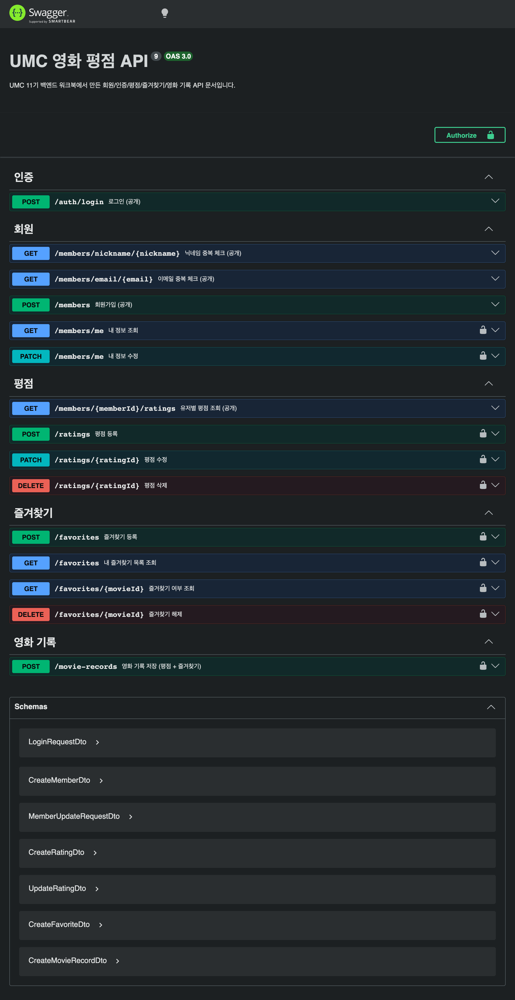

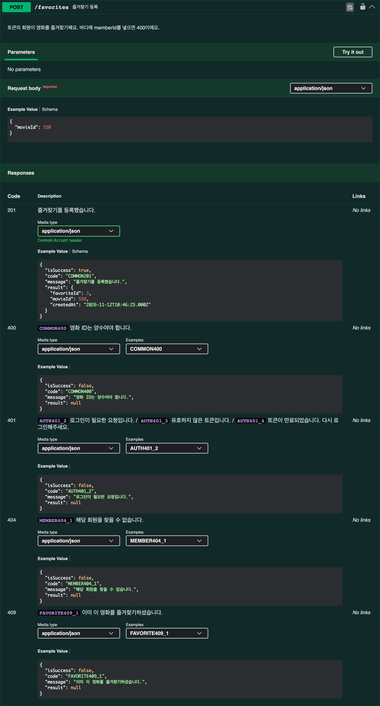

**2) Authorize 버튼으로 토큰을 넣고 POST /favorites 성공(201), 한 번 더 호출해 409**

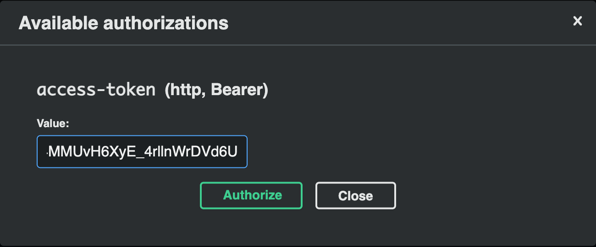

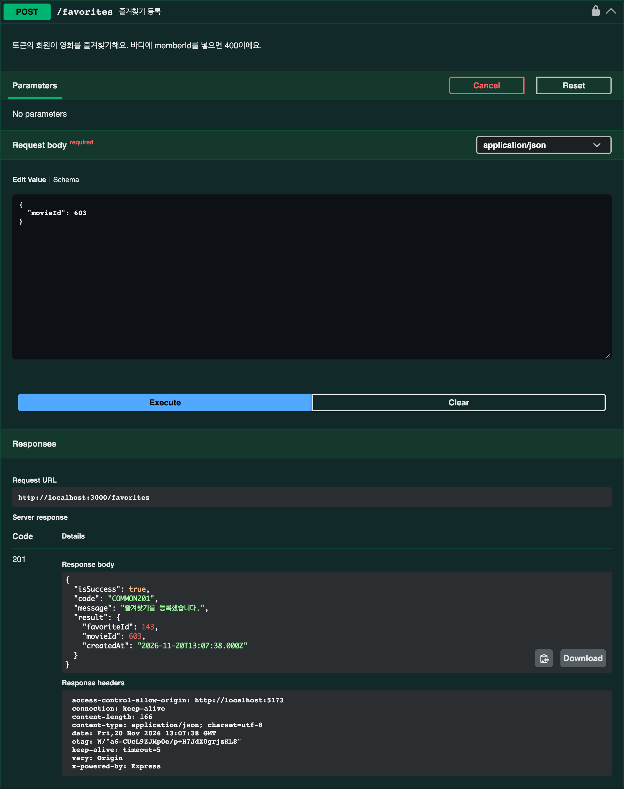

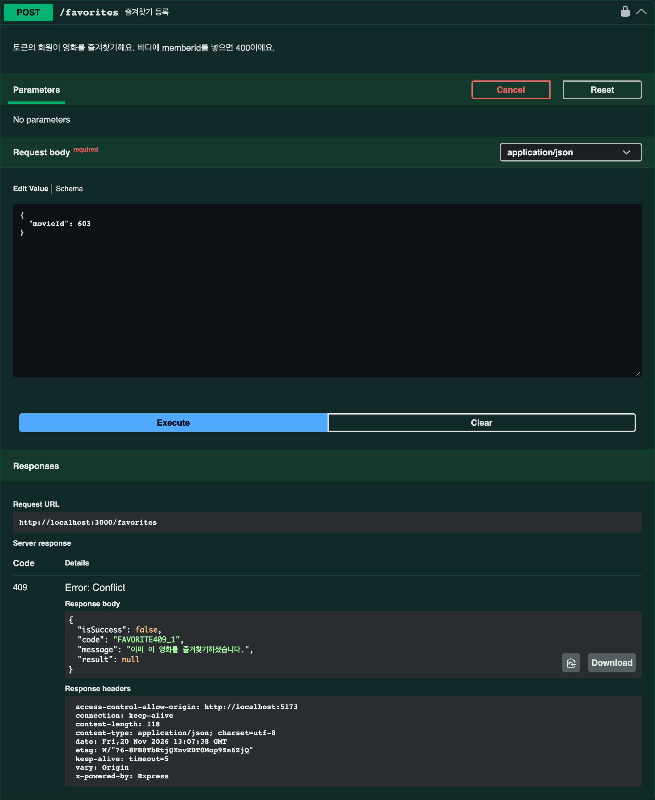

Authorize 창에서 Logout 후 같은 요청을 보내면 401 `AUTH401_2`입니다.

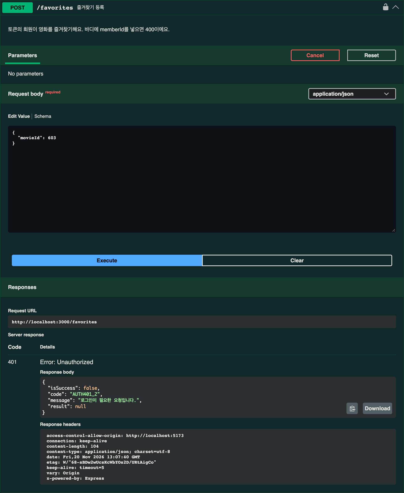

**3) 단위 테스트와 통합 테스트가 모두 통과한 실행 결과**

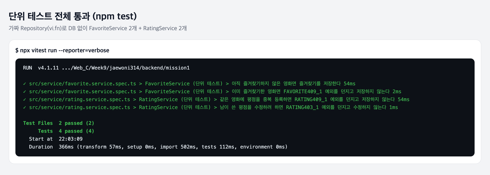

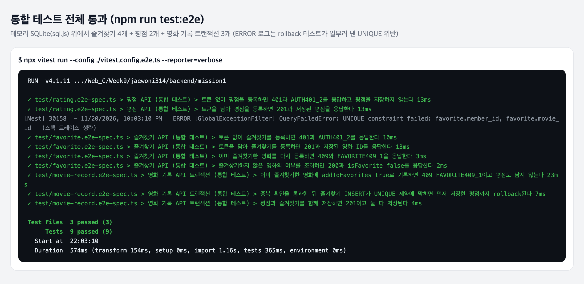

**4) 중복 검사를 지웠을 때 실패한 테스트**

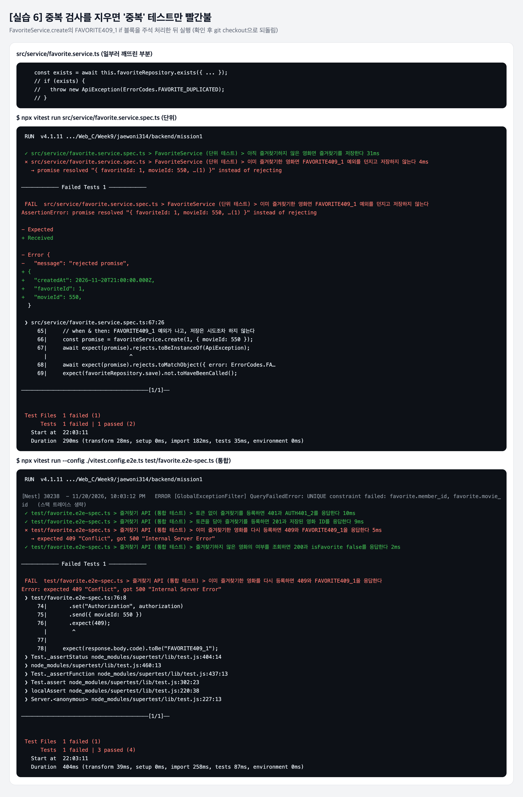

> 단위 테스트에서는 중복이어도 예외 없이 저장이 끝나서(`promise resolved ... instead of rejecting`), 통합 테스트에서는 같은 영화를 다시 등록해도 409가 아닌 응답이 와서(`expected 409, got 500`) **"중복" 테스트만** 실패했습니다. 중복이 아닌 나머지 테스트는 그대로 통과해서, 무엇이 깨졌는지 테스트 이름만 보고 알 수 있었습니다.

---

## 🔥 필수 미션: 문서 채우고 평점 API 테스트하기

### 1. 남은 API 문서화

8주차에는 즐겨찾기와 영화 기록만 자세히 적고, 회원/평점 API는 `summary` 한 줄뿐이었습니다. 9주차에 모든 API에 **한 줄 설명, 토큰 필요 여부, 요청 예시, 성공/실패 응답(status + code)** 을 채웠습니다.

| API | 토큰 | 문서에 적은 실패 응답 | 캡처 |
| --- | --- | --- | --- |
| `POST /ratings` 평점 등록 | 🔒 | 400 `COMMON400`(별점 범위, 영화 ID), 401 3종, 404 `MEMBER404_1`, 409 `RATING409_1` | b05 |
| `PATCH /ratings/{ratingId}` 평점 수정 | 🔒 | 400, 401 3종, 403 `RATING403_1`, 404 `RATING404_1` | b06 |
| `DELETE /ratings/{ratingId}` 평점 삭제 | 🔒 | 401 3종, 403 `RATING403_1`, 404 `RATING404_1` | b06b |
| `GET /members/{memberId}/ratings` 유저별 평점 조회 | 공개 | 404 `MEMBER404_1` | b06c |
| `GET /members/me` 내 정보 조회 | 🔒 | 401 3종, 404 `MEMBER404_1` | b07 |
| `PATCH /members/me` 내 정보 수정 | 🔒 | 400, 401 3종, 404 `MEMBER404_1`, 409 `MEMBER409_1` | b07b |
| `GET /favorites` 내 즐겨찾기 조회 | 🔒 | 401 3종 | b08 |
| `GET /favorites/{movieId}` 즐겨찾기 여부 조회 | 🔒 | 401 3종 (안 했어도 200 `isFavorite: false`라고 설명에 적음) | b08b |
| `DELETE /favorites/{movieId}` 즐겨찾기 해제 | 🔒 | 401 3종, 404 `FAVORITE404_1` | b08c |
| `POST /members` 회원가입 | 공개 | 400(이메일 형식, 비밀번호 규칙), 409 `MEMBER409_2`/`MEMBER409_1` | b09 |

```ts
// src/controller/rating.controller.ts
@Patch("ratings/:ratingId")
@UseGuards(AuthGuard)
@ApiAuth()
@ApiOperation({
  summary: "평점 수정",
  description: "내가 쓴 평점의 별점과 후기를 바꿔요. 후기를 빼고 보내면 후기를 지운 것으로 처리해요. 남의 평점이면 403이에요.",
})
@ApiParam(RATING_ID_PARAM)
@ApiSuccess(HttpStatus.OK, "COMMON200", "평점을 수정했습니다.", { ...RATING_EXAMPLE, score: 4, comment: "다시 보니 4점이에요." })
@ApiFail(HttpStatus.BAD_REQUEST, { code: "COMMON400", message: "별점은 1점 이상이어야 합니다." })
@ApiFail(HttpStatus.FORBIDDEN, ErrorCodes.RATING_FORBIDDEN)
@ApiFail(HttpStatus.NOT_FOUND, ErrorCodes.RATING_NOT_FOUND)
async update(...) { ... }
```

중복 체크(`{ available }`)와 유저별 평점 조회(배열)는 5주차부터 공통 응답 형식 없이 응답하고 프론트가 그 모양을 쓰고 있어서, 응답을 바꾸지 않고 **실제 모양 그대로** 문서화했습니다.

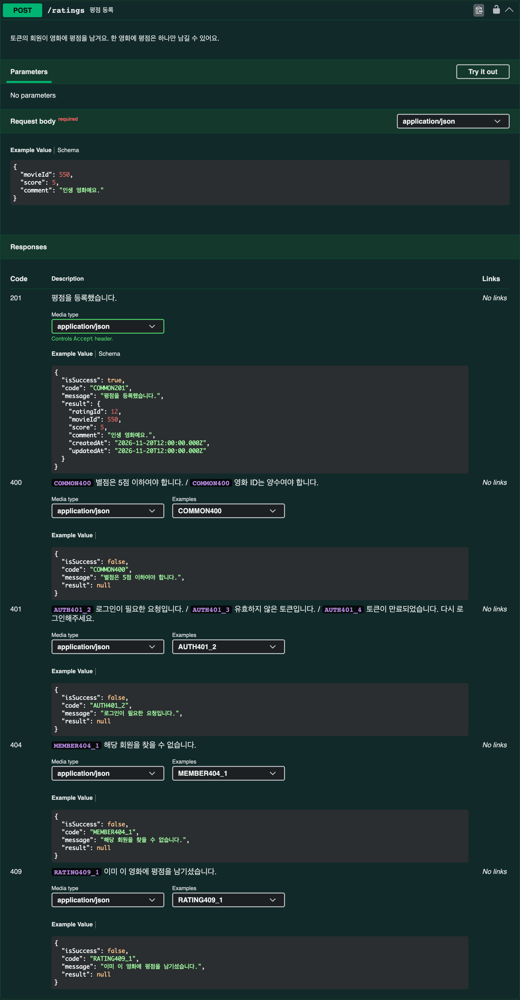

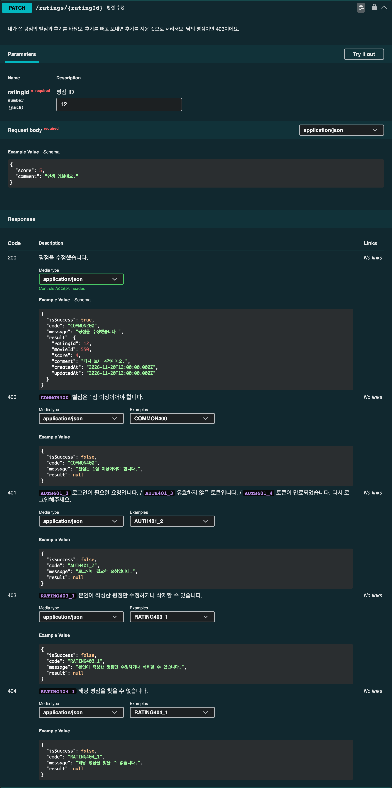

<details>
<summary>나머지 API 문서 캡처 (평점 삭제, 유저별 평점, 내 정보, 즐겨찾기, 회원가입)</summary>

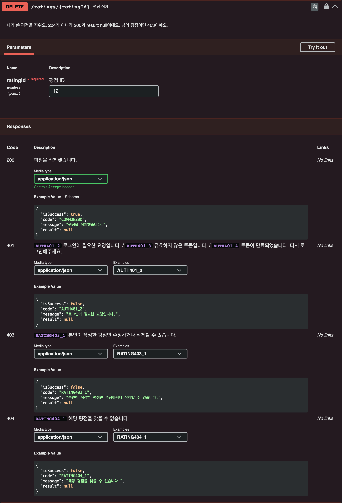
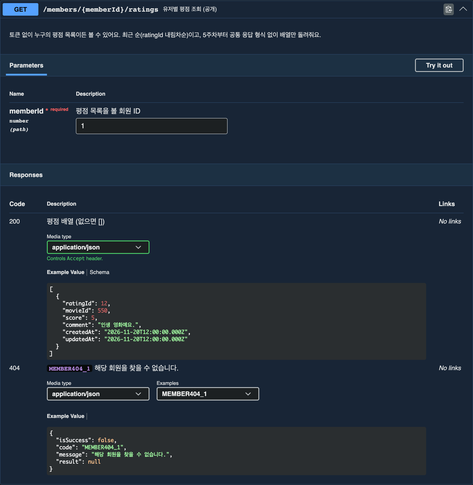
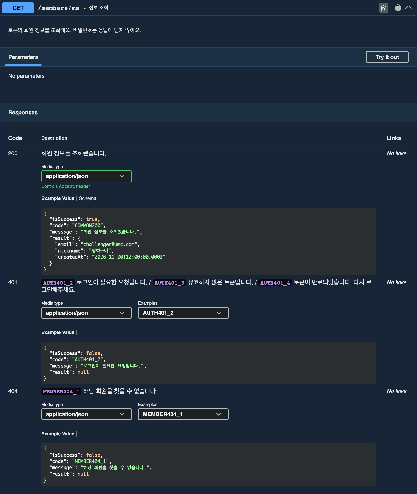
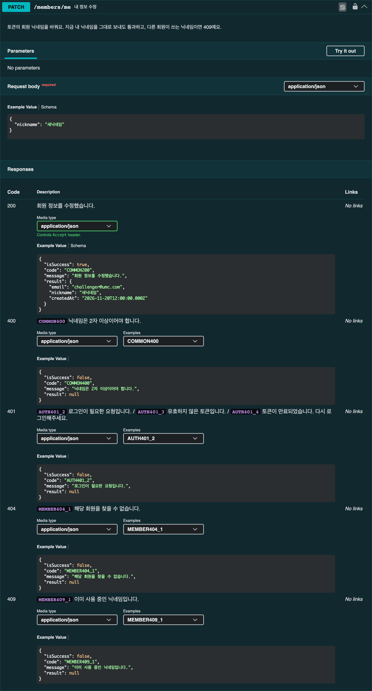
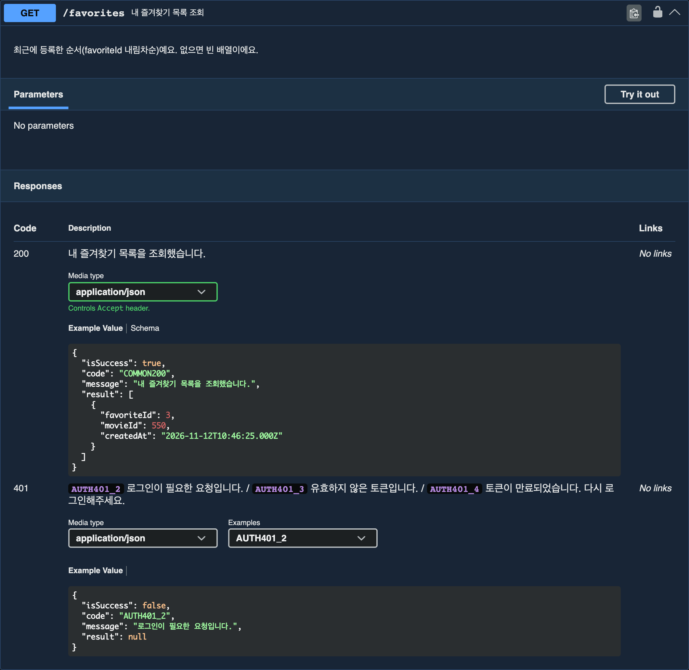
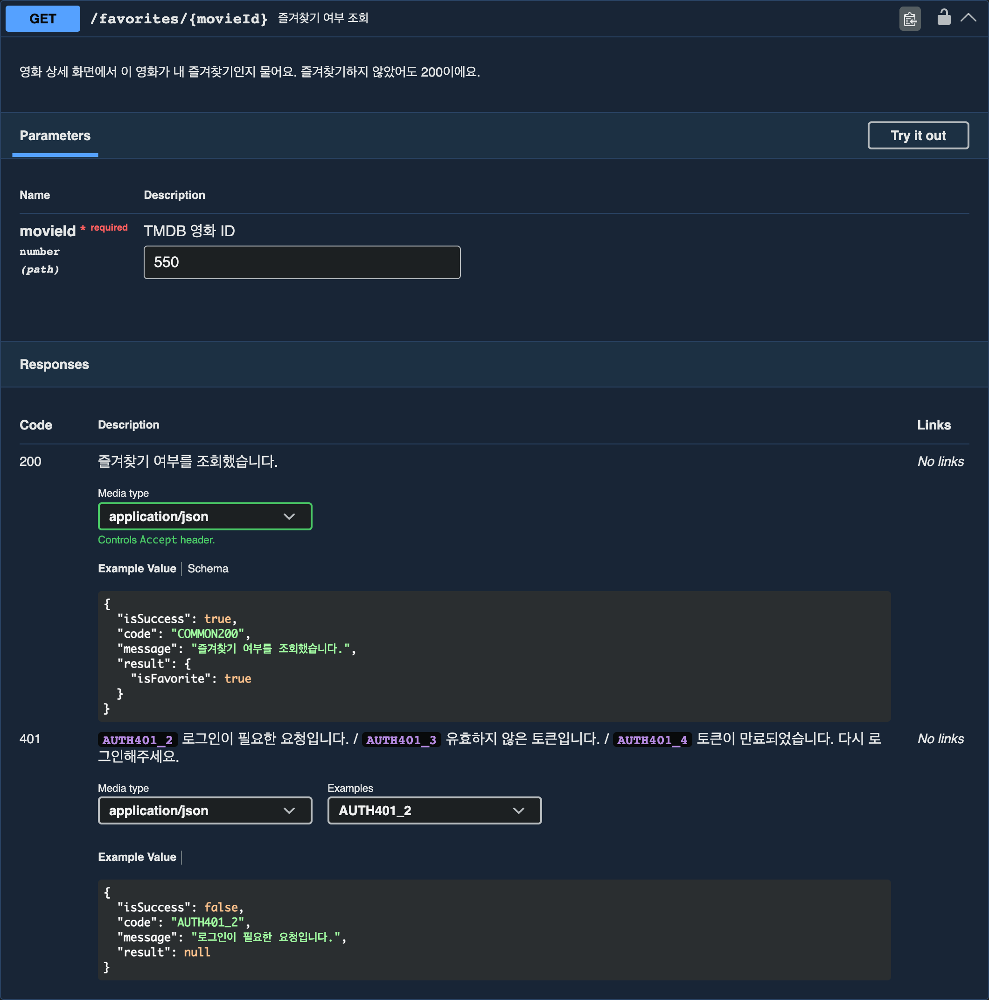
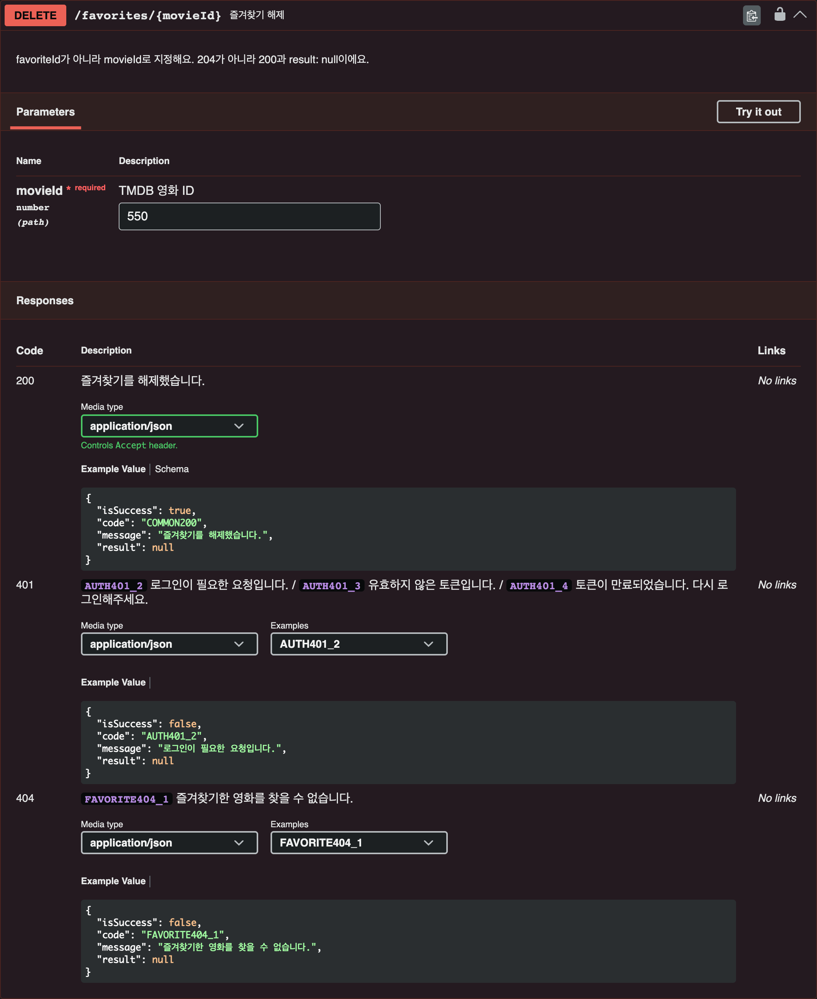
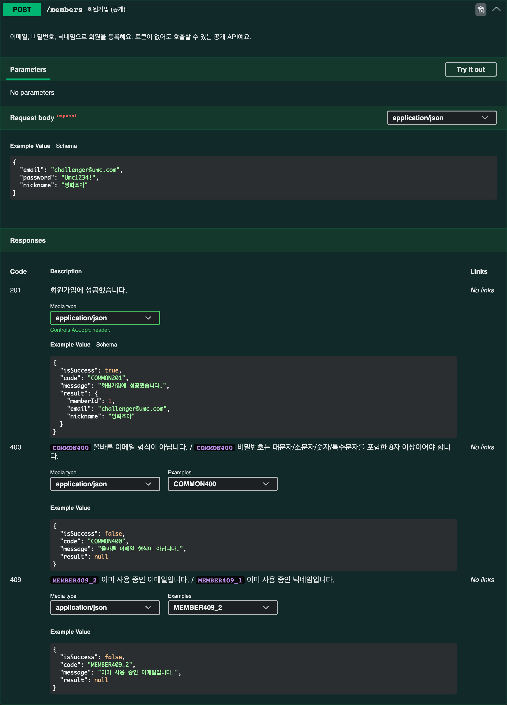

</details>

### 2. 평점 단위 테스트 2개

→ [`src/service/rating.service.spec.ts`](../src/service/rating.service.spec.ts)

```ts
it("같은 영화에 평점을 중복 등록하면 RATING409_1 예외를 던지고 저장하지 않는다", async () => {
  // given: 회원이 이미 550번 영화에 평점을 남긴 상황
  memberRepository.findOneBy.mockResolvedValue(writer);
  ratingRepository.exists.mockResolvedValue(true);

  // when: 같은 영화에 평점을 다시 등록하면
  const promise = ratingService.create(1, { movieId: 550, score: 5, comment: "또 봐도 좋아요." });

  // then: 409 RATING409_1이 나고, 저장은 시도하지 않는다
  await expect(promise).rejects.toMatchObject({ error: ErrorCodes.RATING_DUPLICATED });
  expect(ratingRepository.save).not.toHaveBeenCalled();
});

it("남이 쓴 평점을 수정하려 하면 RATING403_1 예외를 던지고 수정하지 않는다", async () => {
  // given: 10번 평점은 1번 회원이 쓴 평점인 상황
  const rating = { ratingId: 10, movieId: 550, score: 4, comment: "재밌어요.", member: writer } as Rating;
  ratingRepository.findOne.mockResolvedValue(rating);

  // when: 2번 회원이 그 평점을 수정하려 하면
  const promise = ratingService.update(otherMember.memberId, 10, { score: 1, comment: "별로예요." });

  // then: 403 RATING403_1이 나고, 원래 평점은 바뀌지 않고 저장도 시도하지 않는다
  await expect(promise).rejects.toMatchObject({ error: ErrorCodes.RATING_FORBIDDEN });
  expect(rating.score).toBe(4);
  expect(ratingRepository.save).not.toHaveBeenCalled();
});
```

403 테스트는 예외만 보지 않고 **원래 평점 객체의 score가 4 그대로인지**도 확인했습니다. 서비스가 소유자 확인보다 먼저 값을 바꾸도록 순서가 바뀌면 이 줄이 잡아냅니다.

### 3. 평점 통합 테스트 2개

→ [`test/rating.e2e-spec.ts`](../test/rating.e2e-spec.ts)

```ts
it("토큰 없이 평점을 등록하면 401과 AUTH401_2를 응답하고 평점을 저장하지 않는다", async () => {
  const response = await request(app.getHttpServer())
    .post("/ratings")
    .send({ movieId: 550, score: 5, comment: "인생 영화예요." })
    .expect(401);

  expect(response.body).toEqual({ isSuccess: false, code: "AUTH401_2", message: "로그인이 필요한 요청입니다.", result: null });
  expect(await ratingRepository.count()).toBe(0);
});

it("토큰을 담아 평점을 등록하면 201과 저장된 평점을 응답한다", async () => {
  const response = await request(app.getHttpServer())
    .post("/ratings")
    .set("Authorization", authorization)
    .send({ movieId: 550, score: 5, comment: "인생 영화예요." })
    .expect(201);

  expect(response.body.code).toBe("COMMON201");
  expect(response.body.result).toMatchObject({ movieId: 550, score: 5, comment: "인생 영화예요." });
  expect(await ratingRepository.count()).toBe(1);
});
```

### 4. 테스트 전체 통과 화면

단위 테스트 4개(즐겨찾기 2 + 평점 2), 통합 테스트 9개(즐겨찾기 4 + 평점 2 + 영화 기록 3)가 모두 통과합니다. (위 b10, b11 캡처)

---

## 🔬 선택 미션: 트랜잭션이 진짜 되돌리는지 테스트로 증명하기

→ [`test/movie-record.e2e-spec.ts`](../test/movie-record.e2e-spec.ts)

워크북 시나리오(이미 즐겨찾기한 영화에 `addToFavorites: true` → `FAVORITE409_1`, 평점 개수 그대로)를 먼저 테스트로 만들었습니다.

```ts
it("이미 즐겨찾기한 영화에 addToFavorites true로 기록하면 409 FAVORITE409_1이고 평점도 남지 않는다", async () => {
  await favoriteRepository.save(favoriteRepository.create({ member, movieId: 550 }));
  const ratingCountBefore = await ratingRepository.count();

  const response = await request(app.getHttpServer())
    .post("/movie-records")
    .set("Authorization", authorization)
    .send({ movieId: 550, score: 5, comment: "다시 보고 싶어요.", addToFavorites: true })
    .expect(409);

  expect(response.body.code).toBe("FAVORITE409_1");
  expect(await ratingRepository.count()).toBe(ratingCountBefore);
});
```

그런데 **트랜잭션을 지워도 이 테스트는 통과했습니다.** (아래 트러블 슈팅 No.1) 8주차에 평점을 저장하기 *전에* 즐겨찾기 중복을 먼저 확인하도록 만들어서, 이 시나리오는 rollback까지 가지 않고 처음부터 아무것도 저장하지 않기 때문입니다.

그래서 **평점 INSERT가 끝난 뒤에 즐겨찾기 INSERT가 실패하는** 경우(동시에 들어온 두 요청이 모두 중복 확인을 통과한 상황)를 테스트로 하나 더 만들었습니다. 즐겨찾기 중복 확인(`Repository.exists`)만 한 번 "없다"고 잘못 답하게 해서, 평점은 저장되고 즐겨찾기는 DB UNIQUE 제약에서 막히게 했습니다.

```ts
it("중복 확인을 통과한 뒤 즐겨찾기 INSERT가 UNIQUE 제약에 막히면 먼저 저장한 평점까지 rollback된다", async () => {
  // given: 이미 즐겨찾기한 영화인데, 서비스의 중복 확인은 "없다"고 잘못 판단하는 상황
  await favoriteRepository.save(favoriteRepository.create({ member, movieId: 550 }));
  const originalExists = Repository.prototype.exists;
  const existsSpy = vi.spyOn(Repository.prototype, "exists").mockImplementation(function (this, ...args) {
    if (this.metadata.target === Favorite) return Promise.resolve(false);
    return originalExists.apply(this, args);
  });

  try {
    // when: 평점 INSERT 성공 → 즐겨찾기 INSERT가 UNIQUE 제약 위반
    const response = await request(app.getHttpServer())
      .post("/movie-records")
      .set("Authorization", authorization)
      .send({ movieId: 550, score: 5, comment: "다시 보고 싶어요.", addToFavorites: true });

    // then: 요청은 실패하고, 이미 INSERT했던 평점도 되돌려져 하나도 남지 않는다
    expect(response.body.isSuccess).toBe(false);
    expect(await ratingRepository.count()).toBe(0);
    expect(await favoriteRepository.count()).toBe(1);
  } finally {
    existsSpy.mockRestore();
  }
});
```

트랜잭션을 지우는 실험(`this.dataSource.transaction(...)`을 기본 `manager`로 바로 실행)을 하면, 미리 막는 409 테스트는 통과하고 **이 테스트만 `expected 1 to be +0`으로 실패**합니다. 트랜잭션이 없으면 실패한 요청이 평점 1개를 남긴다는 것을 테스트로 증명했습니다. 확인 후 코드는 되돌렸습니다.

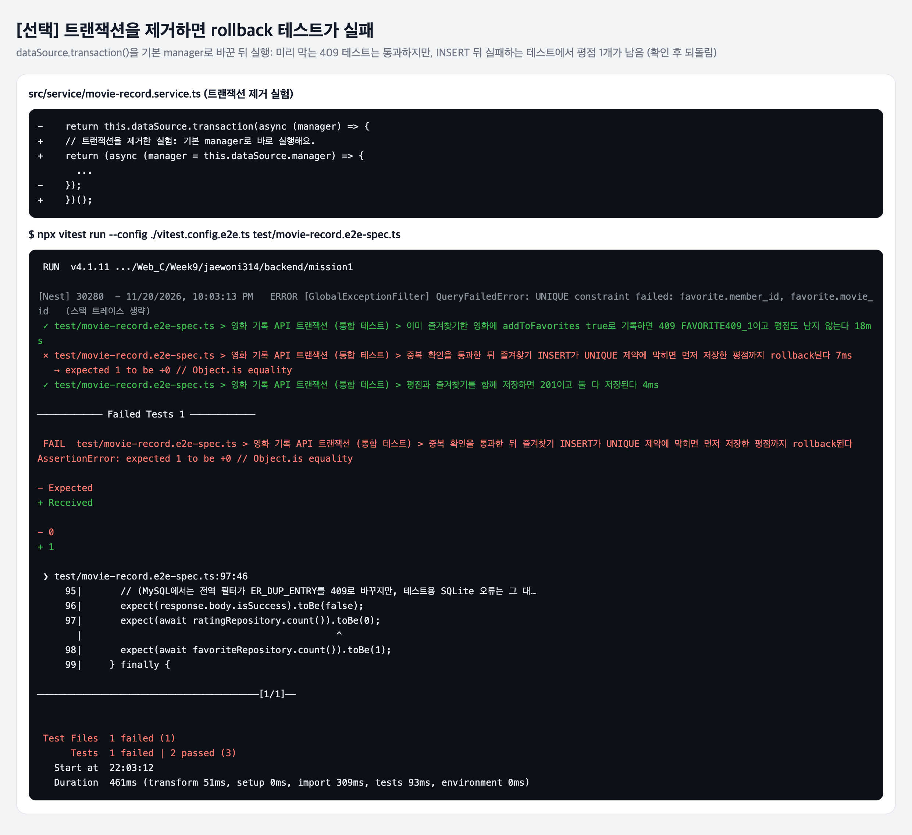

> 확인 포인트대로 "예외가 났다"(`isSuccess: false`)에서 멈추지 않고 "평점이 남지 않았다"(`count() === 0`)까지 확인했습니다. 상태 코드는 확인하지 않았는데, MySQL에서는 전역 필터가 `ER_DUP_ENTRY`를 409로 바꾸지만 테스트용 SQLite 오류는 변환 대상이 아니라 500이 오기 때문입니다.

---

## 🎯 핵심 키워드 (초안 🙋 본인 말로 다듬기)

<details>
<summary>Swagger / OpenAPI</summary>

- **OpenAPI**: API가 어떤 경로, 요청, 응답을 가지는지 적는 규격(JSON/YAML). 사람이 아니라 기계가 읽는 문서라서 클라이언트 코드 자동 생성에도 쓰입니다. 우리 서버는 `/swagger-ui-json`에서 이 JSON을 줍니다.
- **Swagger UI**: 그 OpenAPI JSON을 사람이 보기 좋게 그려 주고, "Try it out"으로 바로 요청까지 보낼 수 있는 화면입니다. (`/swagger-ui`)
- NestJS는 컨트롤러의 경로/메서드와 DTO를 읽어 문서를 만들고, 설명·예시·실패 응답은 `@ApiOperation`, `@ApiProperty`, `@ApiResponse`로 사람이 채웁니다.
- 장점: 코드가 바뀌면 문서도 같이 바뀌어서 손으로 쓴 표처럼 조용히 틀어지지 않음. 브라우저만으로 API를 시험할 수 있음.
- 주의: NestJS는 `{ isSuccess, code, message, result }`처럼 실행 중에만 존재하는 응답 모양을 타입으로 알 수 없어서 예시를 직접 적어야 하고, 그 예시는 사람이 관리하는 부분이라 틀어질 수 있습니다. 그래서 실패 응답 예시는 `ErrorCodes`에서 바로 만들도록 했습니다.

</details>

<details>
<summary>단위 테스트</summary>

- 클래스 하나(주로 Service)의 **판단**만 떼어 확인하는 테스트. 나머지(Repository, DB)는 가짜로 대체합니다.
- 이번 주 예: `FavoriteService`가 이미 즐겨찾기한 영화면 `FAVORITE409_1`을 던지고 `save`를 부르지 않는지, `RatingService`가 남의 평점 수정을 `RATING403_1`로 막는지.
- 장점: DB가 꺼져 있어도 돌고 매우 빠름(4개에 300ms 정도). 상황(이미 중복, 남의 평점)을 마음대로 만들 수 있음.
- 한계: URL 오타, Guard 누락, DTO 검증 규칙처럼 **연결**이 틀린 것은 못 잡습니다.

</details>

<details>
<summary>통합 테스트</summary>

- 진짜 HTTP 요청을 보내 Guard(인증) → ValidationPipe(검증) → Service → DB → 전역 필터(오류 응답)까지 **함께** 도는지 확인하는 테스트.
- 이번 주 예: 토큰 없이 `POST /ratings` → 401 `AUTH401_2`, 토큰 담아 → 201. 개발용 MySQL 대신 메모리 SQLite(sql.js)를 써서 데이터를 건드리지 않고, `beforeEach`에서 테이블을 비워 테스트끼리 영향을 주지 않게 했습니다.
- 장점: 실제 사용자가 겪는 흐름을 확인. 단점: 단위 테스트보다 느리고, 테스트 DB와 운영 DB가 다르면(SQLite vs MySQL) 결과가 달라질 수 있습니다. (트러블 슈팅 No.2)

</details>

<details>
<summary>Mock, Stub</summary>

- **Stub**: 정해 둔 값을 돌려주는 가짜. "이 회원은 있다고 치자"(`findOneBy.mockResolvedValue(member)`), "이미 즐겨찾기했다고 치자"(`exists.mockResolvedValue(true)`)처럼 **상황을 만드는** 역할입니다.
- **Mock**: 어떻게 불렸는지 기억했다가 검증하는 가짜. `expect(favoriteRepository.save).not.toHaveBeenCalled()`처럼 **호출 여부/횟수를 확인하는** 역할입니다.
- Vitest의 `vi.fn()`은 둘 다 할 수 있어서, 같은 가짜를 given에서는 Stub으로, then에서는 Mock으로 썼습니다.
- `vi.spyOn`은 진짜 객체의 메서드를 감싸서 일부만 바꿉니다. 선택 미션에서 `Repository.prototype.exists`를 즐겨찾기일 때만 `false`로 바꾸는 데 썼고, `mockRestore()`로 원래대로 돌려놨습니다.

</details>

<details>
<summary>given-when-then</summary>

- 테스트를 **상황 만들기(given) → 동작 실행(when) → 결과 확인(then)** 세 덩어리로 나누는 작성법.
- Postman으로 확인할 때 머릿속으로 하던 "이 상태에서 이걸 누르면 이게 나와야 해"를 그대로 코드로 옮긴 것입니다.
- 테스트 이름도 이 문장으로 지었습니다. 예: "남이 쓴 평점을 수정하려 하면(when) RATING403_1 예외를 던지고 수정하지 않는다(then)". 실패했을 때 이름만 읽어도 어떤 규칙이 깨졌는지 알 수 있습니다.

</details>

<details>
<summary>회귀 테스트</summary>

- "예전에 되던 게 지금도 되는지" 다시 확인하는 테스트. 한 번 적어 두면 `npm test` 한 번으로 전부 다시 확인됩니다.
- 실습 6에서 중복 검사를 지우자 "중복" 테스트만 빨간불이 켜졌고, 선택 미션에서 트랜잭션을 지우자 rollback 테스트가 빨간불이 켜졌습니다. 사람이 Postman으로 다시 누르기 전에 테스트가 먼저 알려 줬습니다.
- 다만 테스트는 **적어 둔 것만** 지킵니다. 워크북 시나리오만으로는 트랜잭션 제거를 못 잡았던 것처럼, 지키고 싶은 규칙이 정말 실패하는 경로를 타는지 "일부러 깨뜨려 보기"로 확인해야 합니다.

</details>

---

## 📢 학습 후기 (초안 🙋 본인 말로 다듬기)

**이번 주차 워크북을 해결해보면서 어땠는지 회고해봅시다.**
> 8주차까지 기능을 만들 때마다 Postman으로 토큰을 복사해 붙이고 하나씩 눌러 봤는데, 이번 주에 그 과정을 테스트 코드로 옮기니 `npm test` 한 번에 13개가 확인되어서 편했다. 특히 일부러 코드를 깨뜨려 봤을 때 내가 지키려던 규칙의 테스트만 정확히 빨간불이 켜지는 게 인상 깊었다. 반대로 트랜잭션을 지워도 워크북 시나리오 테스트가 통과하는 걸 보고, 테스트가 통과한다고 그 규칙을 지키고 있다는 뜻은 아니라는 것도 알게 됐다.

**핵심 키워드에 대해 완벽하게 이해했는지? 혹시 이해가 안 되는 부분은 뭐였는지?**
> 단위 테스트와 통합 테스트가 각각 무엇을 잡고 못 잡는지는 실습 6에서 직접 확인해서 이해했다. 테스트용 SQLite와 실제 MySQL의 오류 형식이 달라서 같은 상황에 409와 500이 갈리는 걸 보고, 테스트 DB를 운영 DB와 얼마나 같게 맞춰야 하는지(Testcontainers로 MySQL을 띄우는 방법 등)는 더 알아보고 싶다.

---

## ⚡ 트러블 슈팅

### ⚡ 이슈 No.1 트랜잭션을 지워도 선택 미션 테스트가 통과함

**이슈**
👉 워크북 시나리오대로 "이미 즐겨찾기한 영화에 `addToFavorites: true`로 기록하면 409이고 평점 개수가 그대로"인 테스트를 만들고, 증명하려고 `dataSource.transaction()`을 지웠는데도 테스트가 초록불이었다.

**문제**
👉 8주차 `MovieRecordService`는 쓸데없는 INSERT를 줄이려고 **평점을 저장하기 전에** 즐겨찾기 중복을 먼저 확인한다. 그래서 이 시나리오는 rollback 경로를 타지 않고 처음부터 아무것도 저장하지 않는다. 트랜잭션이 있든 없든 결과가 같으니, 이 테스트는 트랜잭션을 지켜 주지 못한다.

**해결**
👉 rollback이 실제로 필요한 경우는 "평점 INSERT가 끝난 **뒤에** 즐겨찾기 INSERT가 실패할 때"(동시 요청이 모두 중복 확인을 통과)다. `vi.spyOn(Repository.prototype, "exists")`로 즐겨찾기 중복 확인만 한 번 `false`를 돌려주게 해서 이 상황을 재현하는 테스트를 추가했다. 트랜잭션을 지우면 이 테스트가 `expected 1 to be +0`(평점 1개가 남음)으로 실패하는 것을 확인했다. (b14)

**배운 점**
👉 테스트를 만들었으면 지키려는 코드를 일부러 지워서 정말 빨간불이 켜지는지 확인해야 한다. 초록불만으로는 테스트가 그 규칙을 지키는지 알 수 없다.

**참고 레퍼런스**
- [Vitest - vi.spyOn](https://vitest.dev/api/vi.html#vi-spyon)
- [TypeORM - Transactions](https://typeorm.io/docs/advanced-topics/transactions/)

### ⚡ 이슈 No.2 중복 검사를 지웠을 때 통합 테스트가 409가 아니라 500을 받음

**이슈**
👉 실습 6에서 `FavoriteService`의 중복 검사를 주석 처리했더니 통합 테스트가 `expected 409 "Conflict", got 500 "Internal Server Error"`로 실패했다. 테스트가 실패한 건 맞지만, 개발 서버(MySQL)에서 같은 요청을 보내면 409가 나와야 한다고 생각했다.

**문제**
👉 중복 검사가 없어도 DB의 UNIQUE 제약이 INSERT를 막는다. 운영 DB(MySQL)에서는 전역 필터가 `ER_DUP_ENTRY` 오류를 제약 이름(`favorite.uk_favorite_member_movie`)으로 찾아 `FAVORITE409_1`로 바꿔 준다. 그런데 테스트 DB(sql.js, SQLite)의 오류는 `SQLITE_CONSTRAINT_UNIQUE`라서 이 변환 대상이 아니고, 그대로 500이 됐다.

**해결**
👉 운영 코드에 SQLite 전용 분기를 넣지 않고, 테스트 DB와 운영 DB가 다르다는 것을 기록으로 남겼다. 오히려 이 차이 덕분에 통합 테스트가 중복 검사 제거를 잡았다. (MySQL로 통합 테스트를 돌렸다면 필터가 409로 바꿔 줘서 통과했을 것이다.) 중복 검사 자체는 DB 종류와 상관없는 **단위 테스트**가 확실히 지켜 준다. 선택 미션 테스트도 같은 이유로 상태 코드 대신 `isSuccess: false`와 평점 개수로 확인했다.

**배운 점**
👉 메모리 DB는 빠르고 깨끗하지만 운영 DB와 오류 형식, SQL 문법이 다를 수 있다. 판단은 단위 테스트로, 연결은 통합 테스트로 나눠 지키고, 운영 DB와 같은 조건이 꼭 필요하면 Testcontainers 같은 방법으로 진짜 MySQL을 띄워야 한다.

**참고 레퍼런스**
- [TypeORM - Data Source Options (sqljs)](https://typeorm.io/docs/data-source/data-source-options/#sqljs-data-source-options)
- [MySQL - ER_DUP_ENTRY (1062)](https://dev.mysql.com/doc/mysql-errors/8.0/en/server-error-reference.html#error_er_dup_entry)

### ⚡ 이슈 No.3 같은 400 코드의 실패 예시가 Swagger에서 하나만 보임

**이슈**
👉 회원가입 문서에 400 예시를 두 개(이메일 형식, 비밀번호 규칙) 적었는데 Swagger UI의 Examples 목록에는 하나만 나왔다.

**문제**
👉 8주차에 만든 `ApiFail`은 예시 이름을 `code`로 붙인다. 검증 실패는 둘 다 `COMMON400`이라 같은 이름으로 덮어써져 마지막 예시만 남았다.

**해결**
👉 같은 `code`가 이미 나왔으면 이름 뒤에 번호를 붙이도록 `ApiFail`을 고쳤다. (`COMMON400`, `COMMON400 (2)`) 응답 JSON의 `code` 값은 그대로 `COMMON400`이다.

```ts
// src/swagger/api-docs.ts
errors.map((error, index) => [
  errors.findIndex((other) => other.code === error.code) === index ? error.code : `${error.code} (${index + 1})`,
  { value: { isSuccess: false, code: error.code, message: error.message, result: null } },
]),
```

**참고 레퍼런스**
- [NestJS - OpenAPI Operations](https://docs.nestjs.com/openapi/operations)

### ⚡ 이슈 No.4 워크북의 Jest 설정을 그대로 쓸 수 없음

**이슈**
👉 워크북은 `jest.fn()`, `test/jest-e2e.json`, `transformIgnorePatterns`로 설명하는데, 우리 프로젝트에는 `jest`가 없고 `vitest.config.ts`, `vitest.config.e2e.ts`가 있었다.

**문제**
👉 이 프로젝트는 처음부터 ESM(`"type": "module"`) + Vitest로 만들어져 있었다. Jest의 `@nestjs/jwt` ESM 변환 문제(`Cannot use import statement outside a module`)도 Vitest에서는 생기지 않는다.

**해결**
👉 `jest.fn()` → `vi.fn()`, `jest.clearAllMocks()` → `vi.clearAllMocks()`로 바꾸고, 단위는 `src/**/*.spec.ts`(`npm test`), 통합은 `test/**/*.e2e-spec.ts`(`npm run test:e2e`)로 기존 설정을 그대로 썼다. 처음에는 Vitest(esbuild 계열)가 `emitDecoratorMetadata`를 지원하지 않아 Nest의 생성자 주입이 깨질까 봐 SWC 플러그인을 설치했는데, 통합 테스트가 플러그인 없이도 통과해서 다시 제거했다.

**참고 레퍼런스**
- [NestJS - Testing](https://docs.nestjs.com/fundamentals/testing)
- [Vitest - Mock Functions](https://vitest.dev/api/mock.html)
