# 9주차 프론트엔드 미션 기록 - Next.js의 다양한 기능으로 웹 서비스 확장하기

8주차 UMCine(Vite + React + TanStack Router/Query + ky + Zustand)의 기능을 유지하면서 **Next.js 16 App Router**로 옮겼습니다.
백엔드는 같은 브랜치의 [Week9 NestJS 서버](../../../backend/mission1/README.md)(`http://localhost:3000`)를 사용합니다. 라우트 대응표와 폴더 구조는 [README](../README.md)에 있습니다.

> 이 문서는 노션 "미션 기록" 토글에 옮겨 적기 쉽도록 워크북 목차 순서대로 정리했습니다.
> 🙋 표시는 **직접 해야 하는 일**(노션에 붙여 넣기, 본인 말로 다듬기, 제출)입니다.

---

## ✅ 제출 전 체크리스트

| | 할 일 | 상태 |
| --- | --- | --- |
| 🙋 | 스터디 인증샷 (스터디 리더가 대표로 한 장) | 직접 |
| 🙋 | 학습 내용 1~5의 작은 Next.js 앱(`nextjs-example`) 실습: 이 PR에는 미션(UMCine 마이그레이션)만 들어 있어요. 같은 개념(page/layout, 동적 경로, Suspense, use client, 서버 fetch, next/image, next/font, metadata)은 미션 코드에 모두 적용했어요 | 직접 |
| | 필수 미션: TanStack Router → Next.js 마이그레이션 | ✅ 아래 [필수 미션](#-필수-미션-tanstack-router--nextjs-마이그레이션) |
| 🙋 | 핵심 키워드 정리: 아래 초안을 **본인 말로 다듬어** 노션에 옮기기 | 초안 ✅ |
| 🙋 | 학습 후기 작성: 아래 초안 참고 | 초안 ✅ |
| 🙋 | 노션 개인 미션 페이지 → 공유 → 링크 복사 → [PE 워크북 AI 피드백 시스템](https://umc.ai.kr/)에 제출 | 직접 |
| 🙋 | GitHub PR에서 CodeRabbit 리뷰 받기 (백엔드와 함께 한 PR) | 직접 |
| 🙋 | (선택) 기술 블로그 / 지식in 상점 | 직접 |

---

## ▶️ 실행 방법

```bash
# 1) 백엔드 (Week9/jaewoni314/backend/mission1)
npm install
npm run start:dev            # http://localhost:3000

# 2) 프론트 (Week9/jaewoni314/frontend/mission1)
cp .env.example .env.local   # TMDB_ACCESS_TOKEN, NEXT_PUBLIC_API_BASE_URL=http://localhost:3000
pnpm install
pnpm dev                     # http://localhost:5173
```

Next.js 개발 서버의 기본 포트는 3000이라 NestJS와 겹치고, 백엔드 CORS는 `http://localhost:5173`만 허용합니다. 그래서 `package.json`의 `dev`/`start`를 `-p 5173`으로 바꿔 8주차 Vite와 같은 주소로 띄웠습니다.

---

## 🔥 필수 미션: TanStack Router → Next.js 마이그레이션

### 1. 공식 문서와 예제 설정으로 프로젝트 만들기

`pnpm create next-app@latest mission1 --yes`로 만든 기본 설정(TypeScript, Tailwind CSS 4, ESLint, App Router, Turbopack, **Cache Components**)을 그대로 쓰고, 8주차 `src/`의 `api`, `components`, `hooks`, `stores`, `utils`, `config`, `pages`와 `public/`을 복사했습니다. 경로 별칭은 `@/*` → `./src/*`로 바꿨습니다.
[Next.js 공식 문서의 Vite 마이그레이션 가이드](https://nextjs.org/docs/app/guides/migrating/from-vite)와 설치된 `node_modules/next/dist/docs`의 가이드를 함께 보며 옮겼습니다.

### 2. TanStack Router 전용 API를 Next.js 전용 API로 모두 변경

| 주소 | 8주차 (TanStack Router) | 9주차 (Next.js App Router) |
| --- | --- | --- |
| `/` (`?page=`) | `routes/index.tsx` + `validateSearch` | `app/page.tsx` + `useSearchParams` (Suspense) |
| `/search` (`?query=`) | `routes/search.tsx` | `app/search/page.tsx` |
| `/movies/550` | `routes/movies.$movieId.tsx` | `app/movies/[movieId]/page.tsx` + `generateMetadata` |
| `/login`, `/signup`, `/members` | `routes/login.tsx` 등 | `app/login/page.tsx` 등 |
| `/my`, `/my/edit` | `routes/(protected)/route.tsx` + `beforeLoad` | `app/(protected)/layout.tsx` (Route Group) |
| 공통 헤더/푸터 | `routes/__root.tsx` + `<Outlet />` | `app/layout.tsx` + `{children}` |
| 없는 주소 | `notFoundComponent` | `app/not-found.tsx` |

| TanStack Router API | Next.js API |
| --- | --- |
| `<Link to="/movies/$movieId" params={{ movieId }}>` | `<Link href={`/movies/${movieId}`}>` |
| `useNavigate()` → `navigate({ to })` | `useRouter()` → `router.push(href)` |
| `useSearch({ from })` (+ `validateSearch`) | `useSearchParams().get("page")` + 직접 숫자 검사 |
| `useParams({ from })` | page의 `params`를 Server Component에서 `await` 후 props로 전달 |
| `<Link activeProps activeOptions>` | `usePathname()`으로 비교하는 `NavLink` |
| `beforeLoad` + `redirect()` | `ProtectedLayout`에서 토큰을 읽은 뒤 `router.replace()` |

`src/` 전체에서 `@tanstack/react-router`를 import하는 곳은 0개이고, 새 프로젝트라 의존성에도 넣지 않았습니다. (`@tanstack/react-query`, `ky`, `zustand`, `clsx`, `tailwind-merge`만 다시 설치)

```tsx
// src/app/movies/[movieId]/page.tsx (Server Component)
export default function Page({ params }: PageProps<"/movies/[movieId]">) {
  return (
    <Suspense fallback={<main ...><StatusMessage>영화 정보를 불러오는 중이에요.</StatusMessage></main>}>
      <MovieDetail params={params} />
    </Suspense>
  );
}

// params는 요청을 받아야 알 수 있는 값이라, await params가 Suspense 경계 안에서 실행되도록 컴포넌트를 나눴어요.
async function MovieDetail({ params }: Pick<PageProps<"/movies/[movieId]">, "params">) {
  const { movieId } = await params;
  // 즐겨찾기, 평점처럼 로그인 상태와 상호작용이 필요한 화면은 Client Component에 맡기고 movieId만 넘겨요.
  return <MovieDetailPage movieId={movieId} />;
}
```

```tsx
// src/screens/movies/movie-list-page.tsx ("use client")
const searchParams = useSearchParams();
const currentPage = parsePage(searchParams.get("page")); // 1 이상의 정수가 아니면 1페이지
const router = useRouter();
const pathname = usePathname();

function handlePageChange(page: number) {
  router.push(page === 1 ? pathname : `${pathname}?page=${page}`);
}
```

### 3. 기존 라이브러리 설정에서 오류가 나는 부분 수정

| 라이브러리 | 8주차 | 문제 | 9주차 |
| --- | --- | --- | --- |
| TanStack Query | `main.tsx` 모듈 최상단에서 `new QueryClient()` | Next.js 서버에서는 모듈이 여러 요청에 공유돼 사용자끼리 캐시가 섞일 수 있음. Provider는 Context라 Server Component에서 못 씀 | `QueryProvider`("use client") 안에서 `useState(createQueryClient)`로 한 번만 생성 |
| 환경 변수 | `import.meta.env.VITE_*` | Next.js에는 `import.meta.env`가 없음 | 브라우저용은 `process.env.NEXT_PUBLIC_API_BASE_URL`, TMDB 토큰은 서버 전용 `process.env.TMDB_ACCESS_TOKEN` |
| ky (TMDB) | 브라우저에서 TMDB로 직접 요청 + `VITE_TMDB_ACCESS_TOKEN` | 토큰이 브라우저 번들에 그대로 들어감 (아래 캡처) | 브라우저 → `/api/tmdb/...`(Route Handler) → 서버가 토큰을 붙여 TMDB로 |
| Zustand persist | 첫 렌더링에서 localStorage 토큰을 바로 읽음 | 서버 HTML은 항상 "로그아웃"인데 브라우저 첫 화면이 "로그인"이면 hydration 불일치 | `skipHydration: true` + `AuthHydrator`(useEffect)에서 `rehydrate()`, `hasHydrated`로 읽기 전에는 로딩 표시 |
| Tailwind CSS | `@tailwindcss/vite` | Vite 플러그인 | create-next-app 기본값 `@tailwindcss/turbopack` |
| 폴더 이름 | `src/pages` | Next.js가 Pages Router 라우트로 빌드 (트러블 슈팅 No.1) | `src/screens`로 이름 변경 |

```ts
// src/app/api/tmdb/[...path]/route.ts (Route Handler, 주석 일부 생략)
const ALLOWED_PATHS = [/^movie\/popular$/, /^movie\/\d+$/, /^search\/movie$/];

export async function GET(request: Request, { params }: RouteContext<"/api/tmdb/[...path]">) {
  const { path } = await params;
  const tmdbPath = path.join("/");
  if (!ALLOWED_PATHS.some((pattern) => pattern.test(tmdbPath))) {
    return Response.json({ status_message: "지원하지 않는 TMDB 경로예요." }, { status: 404 });
  }

  const { search } = new URL(request.url);
  const response = await fetch(`${serverEnv.tmdbApiBaseUrl}/${tmdbPath}${search}`, {
    headers: { Authorization: `Bearer ${serverEnv.tmdbAccessToken}` },
  });
  // TMDB의 상태 코드(404 등)를 그대로 돌려줘야 화면의 오류 처리와 재시도 규칙이 그대로 동작해요.
  return new Response(response.body, {
    status: response.status,
    headers: { "Content-Type": response.headers.get("Content-Type") ?? "application/json" },
  });
}
```

```ts
// src/api/tmdb-client.ts - 토큰 없이 같은 서버의 /api/tmdb/로 요청
export const tmdbClient = ky.create({ baseUrl: "/api/tmdb/", retry: 0 });
```

`TMDB_ACCESS_TOKEN`을 읽는 `config/server-env.ts`에는 `import "server-only"`를 넣어, 실수로 Client Component에서 불러오면 빌드가 실패하게 했습니다. 허용 경로 목록을 둬서 이 Route Handler가 아무 TMDB API나 대신 호출해 주는 통로가 되지 않게 했습니다.

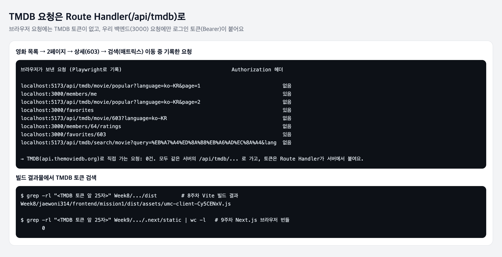

### 4. Server Component와 Client Component의 경계, 브라우저 API를 서버에서 실행하지 않기

**경계 기준**: `app/`의 `page.tsx`, `layout.tsx`는 모두 Server Component로 두고, 상태(useState, Zustand)·이벤트·TanStack Query·브라우저 API(localStorage, alert)를 쓰는 화면만 `screens/`의 Client Component("use client")로 나눴습니다. 정적인 `Footer`도 Server Component라 JS가 브라우저로 가지 않습니다.

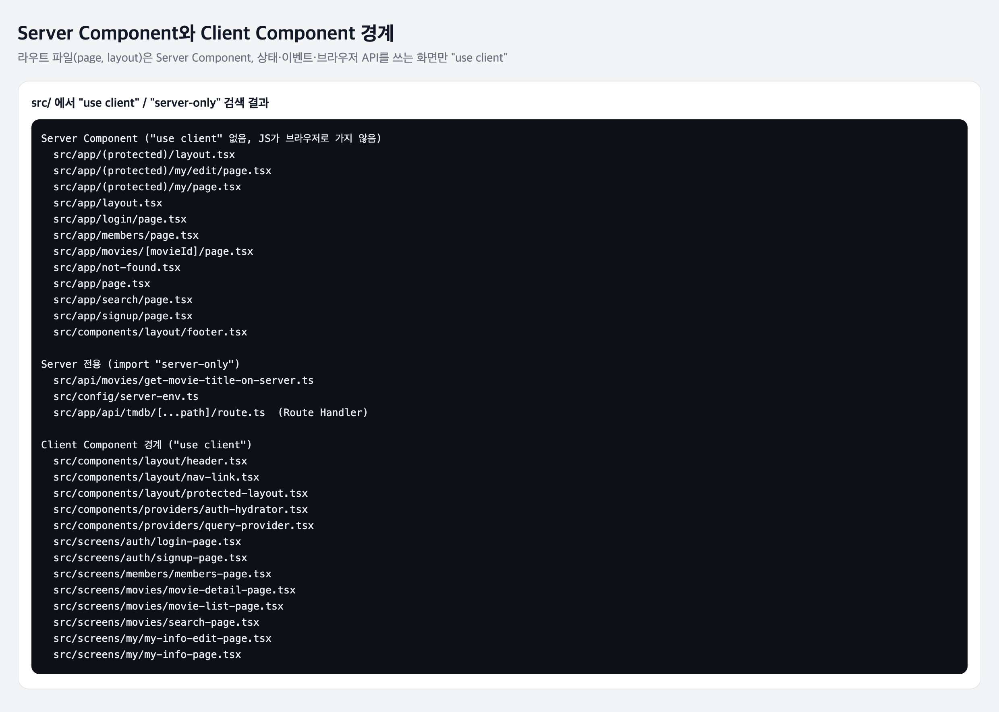

**브라우저 API를 서버에서 실행하지 않게 처리한 곳**

| 코드 | 8주차 | 서버에서 실행되면 | 9주차 처리 |
| --- | --- | --- | --- |
| 로그인 토큰 (Zustand persist + localStorage) | store를 만들 때 바로 읽음 | 서버에는 localStorage가 없고, 서버 HTML과 첫 화면이 달라짐 | `skipHydration` + `AuthHydrator`의 `useEffect`에서 `rehydrate()` |
| 카드 크기 (`readCardSize`) | `useState(readCardSize)` | 서버 렌더링 중 `localStorage is not defined` | 기본값 `"large"`로 그린 뒤 `useEffect`에서 저장값 읽기 |
| 로그인 전용 페이지 | `beforeLoad`에서 store 확인 | 서버는 토큰을 모름 | `ProtectedLayout`이 `hasHydrated` 후에 확인, 그 전엔 "확인하는 중" 표시 |
| `alert`, `confirm` | 이벤트 핸들러/onSuccess | (이벤트 안이라 서버에서 실행되지 않음) | 그대로 |

```ts
// src/stores/auth-store.ts
persist(
  (set) => ({
    accessToken: null,
    hasHydrated: false,
    signedOut: false,
    setAccessToken: (accessToken) => set({ accessToken, signedOut: false }),
    signOut: () => set({ accessToken: null, signedOut: true }),
  }),
  {
    name: "umcine-auth-store",
    storage: createJSONStorage(() => localStorage),
    // 서버 HTML(로그아웃)과 브라우저 첫 화면을 같게 맞추려고 자동 읽기를 끄고, AuthHydrator에서 직접 읽어요.
    skipHydration: true,
    partialize: (state) => ({ accessToken: state.accessToken }),
    onRehydrateStorage: () => () => useAuthStore.setState({ hasHydrated: true }),
  },
);
```

```tsx
// src/components/providers/auth-hydrator.tsx
"use client";
export function AuthHydrator() {
  useEffect(() => {
    void useAuthStore.persist.rehydrate();
  }, []);
  return null;
}
```

헤더는 `hasHydrated` 전에는 "로그인" 링크 대신 같은 크기의 로딩 표시를 보여 줘서, 로그인한 사용자에게 "로그인"이 잠깐 보였다가 닉네임으로 바뀌는 깜빡임을 막았습니다.

로그아웃은 8주차처럼 `await navigate("/")` 후 토큰을 지울 수 없어서(Next.js의 `router.push()`는 이동이 끝날 때까지 기다릴 수 없음), `signOut()`으로 "직접 로그아웃했다"는 표시를 남기고 `ProtectedLayout`이 이 경우 로그인 화면 대신 홈으로 보내도록 했습니다. `/my`에서 로그아웃하면 홈으로 이동하고 "로그아웃했어요." 알림만 뜨는 것을 확인했습니다.

### 5. 이미지, 폰트, 페이지 정보 (워크북 5단원 적용)

**next/image**: `MovieImage`를 ``에서 `next/image`의 `fill` + `sizes`로 바꾸고, `next.config.ts`의 `images.remotePatterns`에 `https://image.tmdb.org/t/p/**`만 허용했습니다. 상세의 배경과 포스터는 첫 화면에 보이므로 `preload`(Next.js 16에서 `priority` 대체)를 줬습니다.

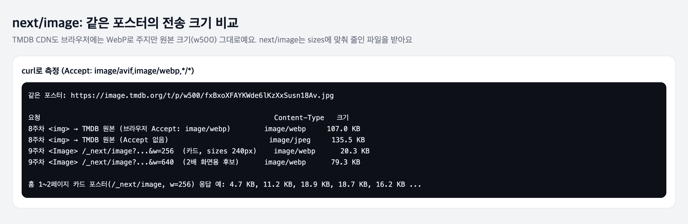

TMDB CDN도 브라우저에는 WebP로 주기 때문에 형식보다는 **크기**에서 차이가 납니다. 카드(240px)에 같은 포스터를 표시할 때 107.0KB → 20.3KB로 줄었습니다.

**next/font**: 8주차에는 CSS에서 jsDelivr CDN의 Pretendard CSS를 `@import`했습니다. Pretendard는 Google Fonts에 없어서 npm `pretendard` 패키지의 가변 폰트(woff2)를 `next/font/local`로 불러와 셀프 호스팅하고, CSS 변수(`--font-pretendard`)로 Tailwind의 `--font-sans`에 연결했습니다.

**metadata**: 루트 layout에 `title.template("%s | UMCine")`과 Open Graph 기본값을, 각 페이지에 `title`을 넣었습니다. 영화 상세는 `generateMetadata`에서 **서버가 TMDB를 조회**해 제목, 줄거리, 포스터를 `<head>`에 넣고, 이 조회 함수는 `"use cache"` + `cacheLife("hours")`로 캐시했습니다.

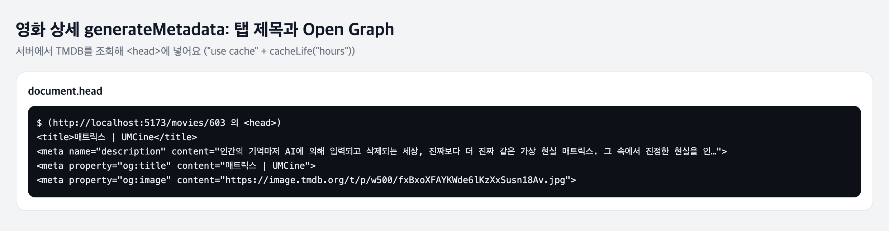

### 6. 빌드 결과로 렌더링 방식 확인

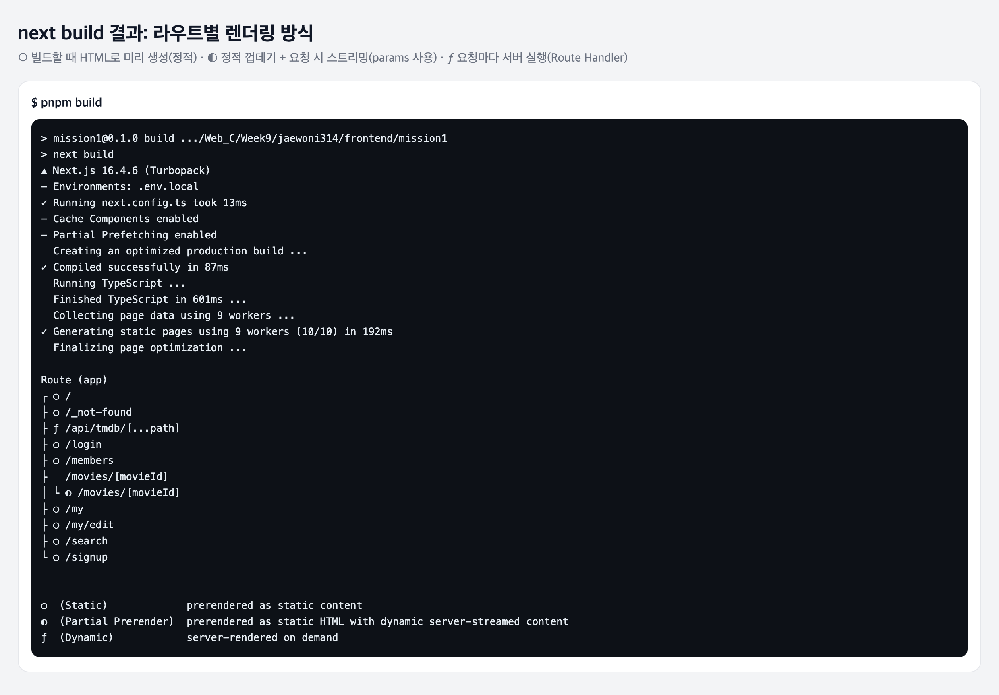

| 기호 | 라우트 | 의미 |
| --- | --- | --- |
| ○ Static | `/`, `/search`, `/login`, `/signup`, `/members`, `/my`, `/my/edit` | 빌드할 때 HTML을 미리 만들어 둠. `useSearchParams`를 쓰는 목록/검색은 Suspense fallback까지 정적 HTML이고, 그 안은 브라우저에서 그림 |
| ◐ Partial Prerender | `/movies/[movieId]` | 헤더/푸터와 Suspense fallback은 정적 껍데기, `params`를 읽는 부분과 메타데이터는 요청 시 서버에서 스트리밍 |
| ƒ Dynamic | `/api/tmdb/[...path]` | 요청마다 서버에서 실행 (Route Handler) |

### 7. 최종 확인 결과

| 확인한 것 | 결과 |
| --- | --- |
| 영화 목록, `?page=2` 이동, 카드 크기 "작게" 저장 후 새로고침 | ✅ 페이지 번호 유지, 카드 크기 유지 (f01, f03) |
| 로그인하지 않고 `/my` 접속 | ✅ "로그인이 필요한 페이지예요." 알림 후 `/login`으로 이동 (f02) |
| 로그인 | ✅ 홈으로 이동, 헤더에 닉네임 표시 |
| 영화 상세: 즐겨찾기 상태, 평점 등록 | ✅ 탭 제목 "매트릭스 \| UMCine", 즐겨찾기 해제 버튼, 별 5개 평점 저장 (f04) |
| 검색 (한글 검색어) | ✅ "매트릭스" 검색 결과 8편, 헤더의 "검색" 메뉴 선택 표시 (f05) |
| 마이페이지: 내 정보, 즐겨찾기, 내가 남긴 평점 | ✅ (f06) |
| 로그아웃 | ✅ 홈으로 이동, 토큰 삭제, 헤더가 "로그인"으로 바뀜 |
| 모바일 너비 (390px) | ✅ (f07) |
| `pnpm lint`, `pnpm build` | ✅ 오류 없음 |
| 브라우저 번들에 TMDB 토큰 | ✅ 0건 (8주차 Vite 번들에는 있었음) |

| 화면 | 캡처 |
| --- | --- |
| 홈 (로그아웃) | 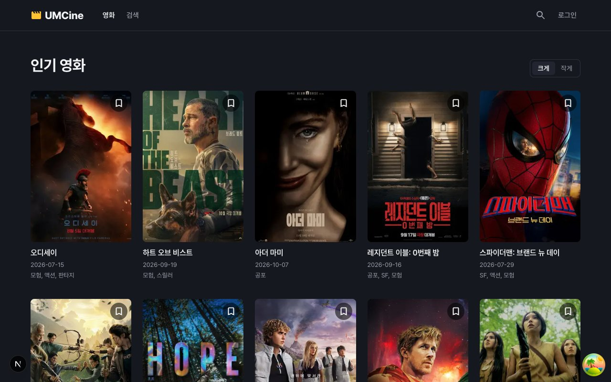 |
| 로그인 전용 페이지 → 로그인 화면 | 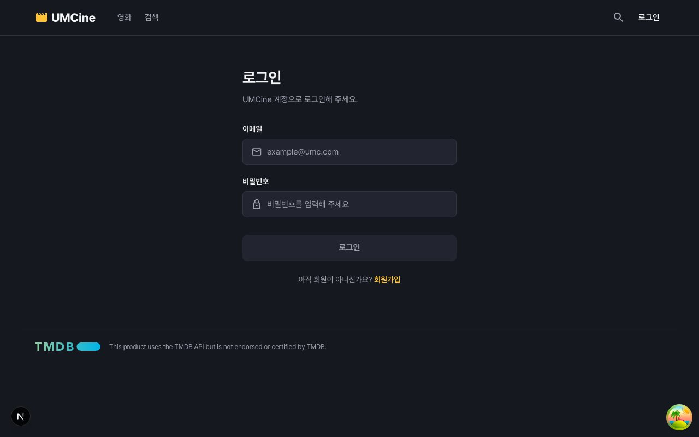 |
| 홈 2페이지 (로그인, 작은 카드) | 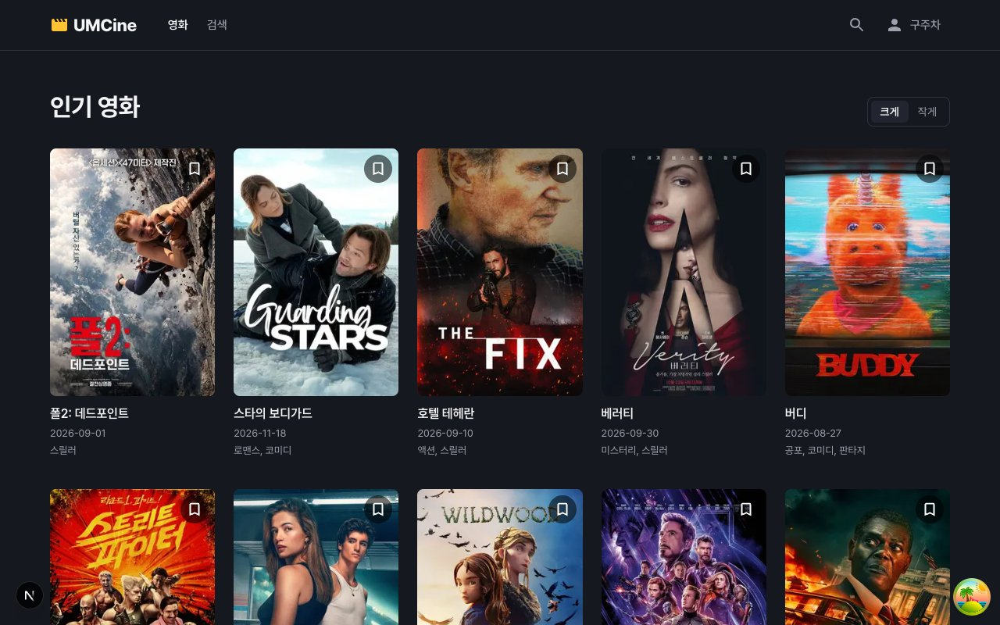 |
| 영화 상세 | 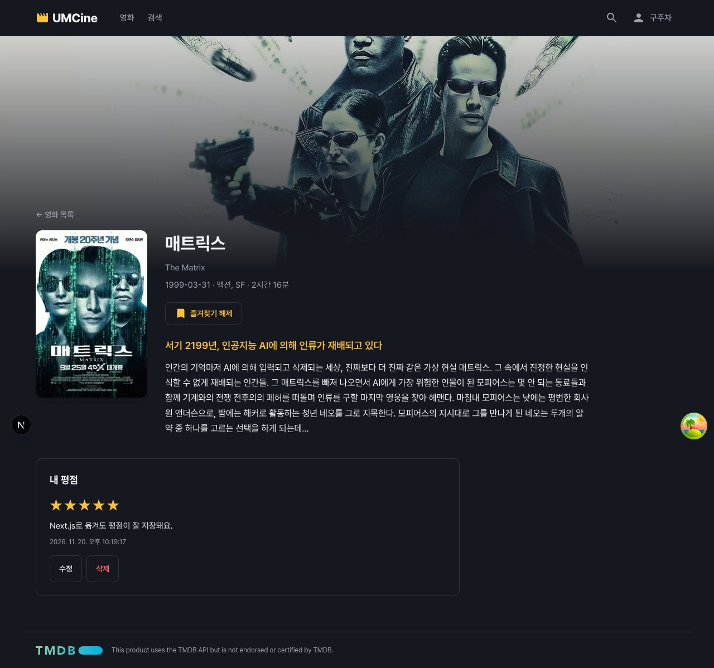 |
| 검색 | 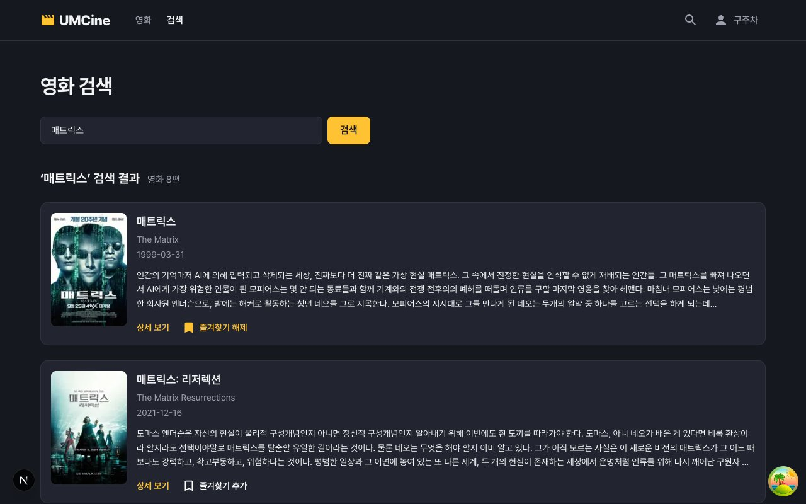 |
| 마이페이지 | 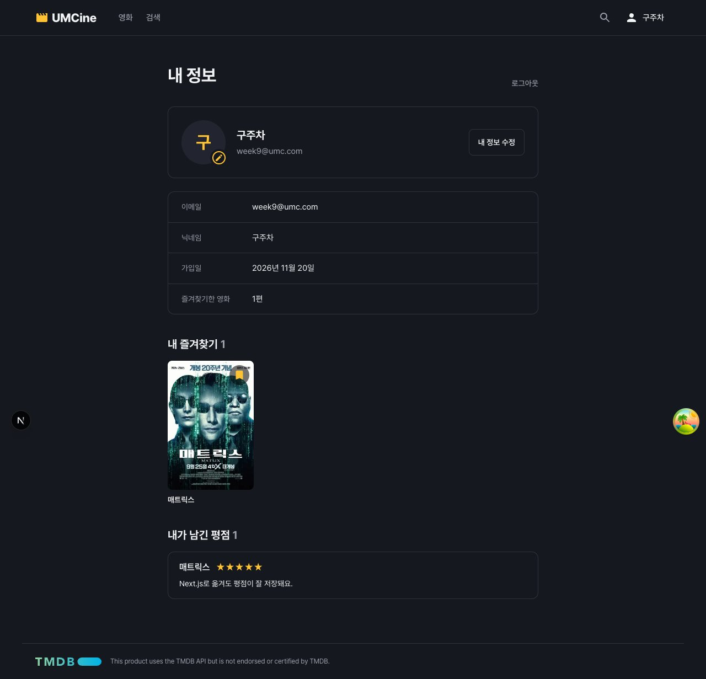 |
| 모바일 상세 | 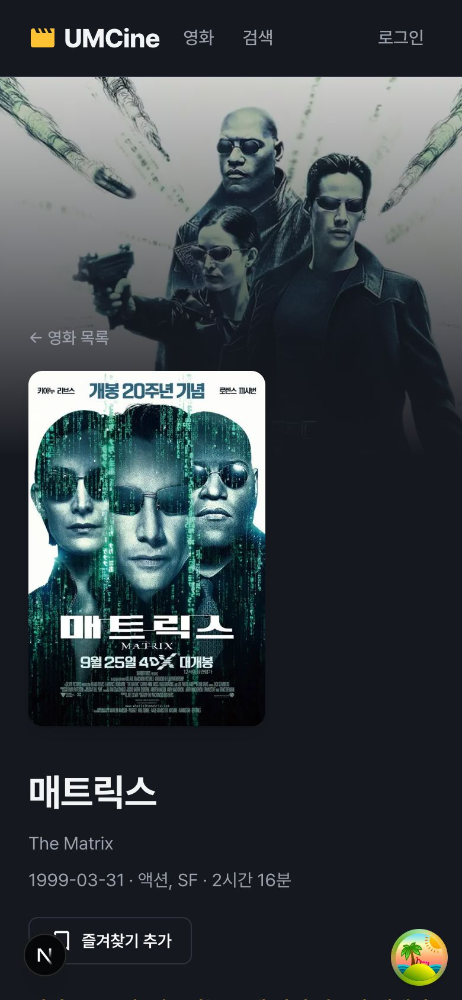 |

---

## 🎯 핵심 키워드 (초안 🙋 본인 말로 다듬기)

<details>
<summary>프레임워크의 역할 - Next.js는 TanStack Router에 더해 어떤 기능을 제공하나요?</summary>

- TanStack Router는 **브라우저 안의 라우팅**만 맡았습니다. 데이터 요청(TanStack Query), 빌드(Vite), 이미지/폰트/SEO는 각각 따로 골라 붙였습니다.
- Next.js는 라우팅에 더해 **서버**까지 함께 줍니다.
  - 파일 기반 라우팅과 layout 중첩 (`page.tsx`, `layout.tsx`, `[id]`, `(group)`)
  - Server Component와 서버 렌더링(SSR), 빌드 시 정적 생성(SSG), 부분 프리렌더(PPR)
  - 서버 API를 만드는 Route Handler (이번에 TMDB 토큰을 숨기는 데 씀)
  - `"use cache"` 같은 서버 데이터 캐시
  - `next/image`(크기·형식 최적화), `next/font`(셀프 호스팅), `metadata`(SEO, Open Graph)
- 이번 마이그레이션에서 실제로 얻은 것: TMDB 토큰이 브라우저 번들에서 사라짐, 영화마다 다른 탭 제목/공유 미리보기, 카드 포스터 전송량 약 1/5.

</details>

<details>
<summary>프레임워크의 역할 - 상황이 달라져도 Next.js가 항상 가장 좋은 선택일까요?</summary>

- **고객 대상 서비스**(검색 노출, 링크 공유 미리보기, 첫 화면 속도가 중요)에는 서버 렌더링과 metadata가 큰 장점입니다.
- **사내 서비스**(로그인 뒤에만 쓰는 관리 화면)는 검색 노출이 필요 없고 거의 모든 화면이 로그인 상태에 의존합니다. UMCine의 `/my`처럼 토큰이 브라우저에만 있으면 서버는 어차피 "확인하는 중" 화면밖에 못 그려서, Vite SPA로도 충분하고 서버 운영 부담이 없습니다.
- Next.js는 서버(Node.js)를 운영해야 하고, Server/Client 경계, hydration, Cache Components 규칙(이번 트러블 슈팅 2, 3)처럼 신경 쓸 것이 늘어납니다. 정적 호스팅만 가능한 환경이면 선택지가 줄어듭니다.
- 결론: 서버에서 얻는 이점(SEO, 비밀 값 보호, 첫 화면 속도)이 필요한지로 판단합니다.

</details>

<details>
<summary>Server Component와 Client Component - 어떤 기준으로 나누면 좋을까요?</summary>

- **Client Component가 필요한 경우**: `useState`/`useEffect` 같은 훅, `onClick` 같은 이벤트, Context(QueryClientProvider), 브라우저 API(localStorage, alert, window).
- **Server Component로 두는 경우**: 위가 필요 없는 정적인 부분(Footer), 비밀 값이나 서버 데이터를 다루는 부분(`generateMetadata`, Route Handler), 페이지 뼈대(page, layout).
- 기준은 "**상호작용이 필요한 가장 작은 단위만 Client로**"입니다. 워크북의 `AlertButton`처럼, UMCine에서도 `usePathname`이 필요한 메뉴 링크만 `NavLink`로 떼어 Suspense로 감쌌습니다.
- Server Component는 Client Component를 import할 수 있지만 반대는 안 됩니다. 그래서 라우트 파일(Server)이 화면(Client)을 불러오고, 서버에서 읽은 값(`movieId`)을 props로 넘기는 구조로 만들었습니다.

</details>

<details>
<summary>Server Component와 Client Component - "use client"를 page.tsx 최상단에 선언해도 될까요?</summary>

- 동작은 합니다. 하지만 그 페이지와 import한 모든 컴포넌트가 Client Component가 되어 JS가 모두 브라우저로 가고, 그 페이지에서 `generateMetadata`, `metadata` export, `await params`, 서버 전용 코드(`server-only`)를 쓸 수 없습니다.
- 그래서 `page.tsx`는 Server Component로 두고 `"use client"`는 `screens/`의 화면 컴포넌트에만 붙였습니다. 덕분에 영화 상세의 `page.tsx`에서 `generateMetadata`로 서버에서 TMDB를 조회할 수 있었습니다.
- Cache Components 설정에서는 `useSearchParams`, `usePathname`, `params`를 읽는 부분을 Suspense로 감싸야 나머지를 미리 렌더링할 수 있어서, 경계를 작게 나누는 것이 더 중요했습니다.

</details>

<details>
<summary>렌더링 방식 - "use client"가 붙은 Client Component는 브라우저에서만 렌더링될까요?</summary>

- 아닙니다. Client Component도 **서버(또는 빌드 시)에서 한 번 HTML로 미리 렌더링**되고, 브라우저에서 JS가 실행되며 그 HTML에 이벤트를 연결(hydration)합니다.
- 그래서 Client Component의 렌더링 중(`useState` 초기값 함수 등)에 `localStorage`를 읽으면 서버에서 오류가 나거나, 서버 HTML과 브라우저 첫 화면이 달라집니다. 이번에 카드 크기와 로그인 토큰을 `useEffect` 이후에 읽도록 바꾼 이유입니다.
- "use client"는 "브라우저에서만 실행"이 아니라 "**브라우저로도 보내서 상호작용할 수 있게 하는 경계**"라는 뜻에 가깝습니다. 정말 브라우저에서만 그려야 하면 `next/dynamic({ ssr: false })`나 React 19.3의 `use(browser())` + Suspense를 씁니다.

</details>

<details>
<summary>렌더링 방식 - SSR, SSG, ISR, ISSG</summary>

| 방식 | HTML을 만드는 시점 | 예 |
| --- | --- | --- |
| **SSG** (Static Site Generation) | 빌드할 때 한 번 | UMCine의 `/login`, `/signup` (빌드 결과 ○) |
| **SSR** (Server-Side Rendering) | 요청이 올 때마다 | Route Handler(ƒ), `params`를 읽는 상세의 스트리밍 부분 |
| **ISR** (Incremental Static Regeneration) | 빌드 때 만든 정적 페이지를 **정해진 시간이 지나면 백그라운드에서 다시 생성** | 인기 영화 목록을 1시간마다 새로 만들기 |
| **ISSG** (Incremental Static Site Generation) | ISR과 같은 개념을 부르는 다른 이름(정적 생성을 "점진적으로" 갱신). 빌드 때 없던 경로를 첫 요청 시 생성해 저장하는 것까지 포함해 말하기도 함 | 빌드 때 만들지 않은 `/movies/999`를 첫 요청에 만들고 이후엔 저장본 사용 |

- 관계: SSG ↔ SSR은 "언제 만드나"의 양 끝이고, ISR/ISSG는 SSG에 **갱신 주기**를 더해 둘 사이를 잇습니다.
- Next.js 16 + Cache Components에서는 이 구분을 페이지 단위가 아니라 **컴포넌트 단위**로 합니다. `"use cache"` + `cacheLife("hours")`가 ISR처럼 동작하고(이번 `getMovieSummaryOnServer`), 같은 페이지 안에서 정적 껍데기(○) + 요청 시 스트리밍 부분(◐)을 섞는 것이 Partial Prerendering입니다.

</details>

---

## 📢 학습 후기 (초안 🙋 본인 말로 다듬기)

> 처음에는 라우터만 바꾸면 될 줄 알았는데, 실제로는 "이 코드가 서버에서도 실행되는가"를 계속 묻게 되는 작업이었다. 8주차까지는 모든 코드가 브라우저에서만 돌아서 localStorage를 아무 데서나 읽었는데, Next.js에서는 Client Component도 서버에서 먼저 그려지기 때문에 로그인 토큰과 카드 크기를 읽는 시점을 바꿔야 했다. 반대로 서버가 생기니 TMDB 토큰을 브라우저에서 숨기고, 영화마다 탭 제목과 공유 미리보기를 넣을 수 있게 된 게 가장 크게 와닿았다. 빌드 결과의 ○/◐/ƒ 표시로 페이지마다 렌더링 방식이 다르다는 것을 눈으로 확인할 수 있어서 SSR/SSG 개념이 훨씬 구체적으로 이해됐다.

---

## ⚡ 트러블 슈팅

### ⚡ 이슈 No.1 복사한 `src/pages` 폴더가 Pages Router 라우트로 빌드됨

**이슈**
👉 8주차 `src/`를 그대로 복사하고 `pnpm build`를 하자 `Module not found: Can't resolve '@tanstack/react-router'` 오류가 17개 났다. `app/`에서는 화면 컴포넌트를 하나도 import하지 않았는데, Import trace의 시작점이 모두 `src/pages/**/*.tsx`였다.

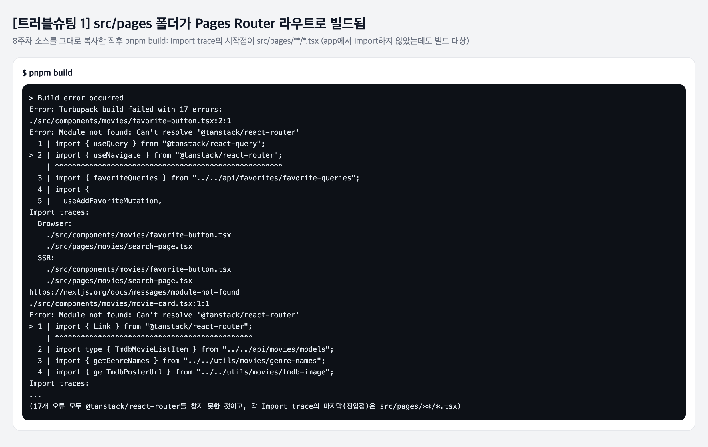

**원인**
👉 Next.js는 `pages`(또는 `src/pages`) 폴더를 **Pages Router의 라우트 폴더**로 예약해 둔다. 8주차에 화면 컴포넌트를 모아 둔 `src/pages/movies/search-page.tsx` 같은 파일이 `/movies/search-page` 페이지로 인식되어 빌드 대상이 됐다.

**해결**
👉 `git mv src/pages src/screens`로 이름만 바꿨다. 라우트는 `src/app/`에만 두고, 화면 컴포넌트는 `src/screens/`에서 import한다.

**배운 점**
👉 프레임워크는 폴더 이름에 의미를 둔다. 옮기기 전에 `app`, `pages`, `public`처럼 예약된 이름과 겹치는지 확인해야 한다.

**참고 레퍼런스**
- [Next.js - Project Structure](https://nextjs.org/docs/app/getting-started/project-structure)

### ⚡ 이슈 No.2 Header의 `usePathname()` 때문에 영화 상세 빌드가 실패

**이슈**
👉 헤더 메뉴의 선택 표시를 `usePathname()`으로 바꾸고 빌드하자 `Route "/movies/[movieId]": Next.js encountered URL data usePathname() in a Client Component outside of <Suspense>`로 실패했다.

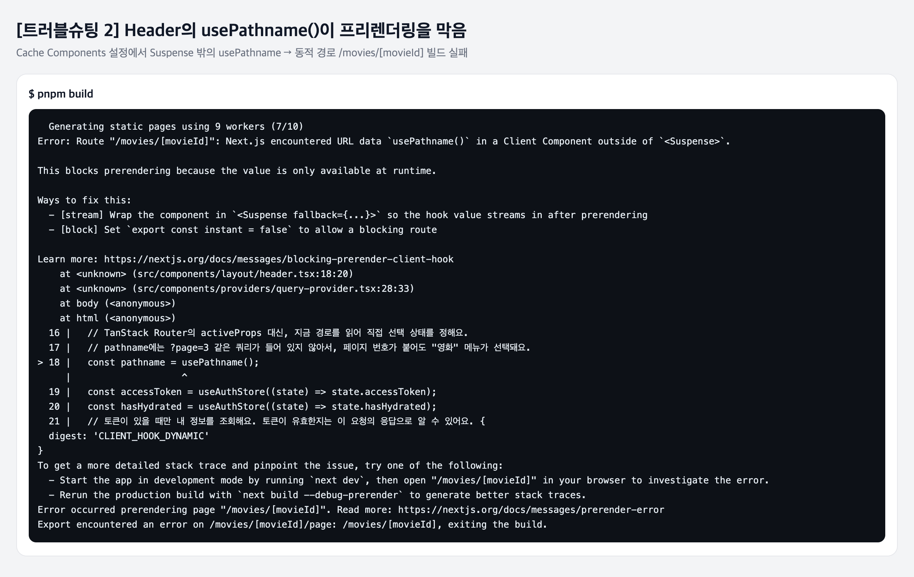

**원인**
👉 create-next-app 기본 설정은 **Cache Components**가 켜져 있다. 이 설정에서는 요청을 받아야 알 수 있는 값(`usePathname`, `useSearchParams`, `params`)을 Suspense 밖에서 읽으면, 그 위의 모든 화면을 미리 렌더링할 수 없다. Header는 루트 layout에 있어서 모든 페이지에 영향을 줬고, 그중 동적 경로인 `/movies/[movieId]`에서 오류가 드러났다.

**해결**
👉 지금 경로가 필요한 메뉴 링크만 `NavLink` 컴포넌트로 떼고, 안에서 `<Suspense fallback={선택 표시 없는 같은 링크}>`로 감쌌다. 헤더 전체는 미리 렌더링되고, 선택 표시만 나중에 채워진다. 같은 이유로 `useSearchParams`를 쓰는 목록/검색 화면과 `params`를 읽는 상세 화면도 `page.tsx`에서 Suspense로 감쌌다.

```tsx
export function NavLink(props: NavLinkProps) {
  return (
    <Suspense fallback={<Link href={props.href} className={props.className}>{props.children}</Link>}>
      <ActiveNavLink {...props} />
    </Suspense>
  );
}
```

**배운 점**
👉 Suspense 경계는 로딩 화면뿐 아니라 "어디까지 미리 만들 수 있는가"를 정하는 경계다. 요청마다 달라지는 값을 읽는 부분은 가능한 작게 떼어 감싸야 한다.

**참고 레퍼런스**
- [Next.js - useSearchParams (Prerendering)](https://nextjs.org/docs/app/api-reference/functions/use-search-params#prerendering)
- [Next.js - blocking-prerender-client-hook](https://nextjs.org/docs/messages/blocking-prerender-client-hook)

### ⚡ 이슈 No.3 `/my` 접속 시 "dropped segment" 콘솔 오류

**이슈**
👉 개발 서버에서 `/my`에 들어가면 화면은 정상인데 브라우저 콘솔에 `Could not validate that a segment in your UI has instant navigation. ... Dropped segment: src/app/(protected)/my/page.tsx`가 찍혔다.

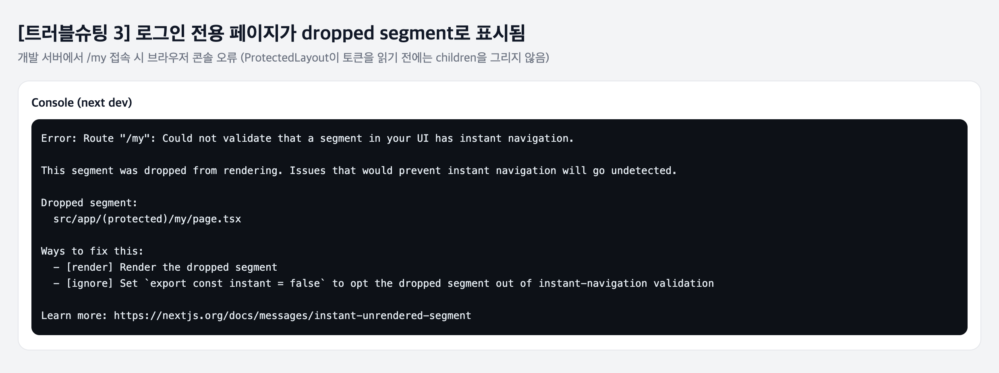

**원인**
👉 로그인 토큰은 브라우저의 localStorage에만 있어서, `ProtectedLayout`은 토큰을 읽기 전(서버 렌더링 포함)에는 하위 페이지 대신 "로그인 상태를 확인하는 중"만 그린다. Cache Components는 개발 중에 각 페이지가 즉시 이동(instant navigation) 가능한지 검사하는데, 페이지가 아예 그려지지 않아(dropped) 검사할 수 없다고 알려 준 것이다.

**해결**
👉 이 페이지들은 일부러 로그인 확인을 기다리는 곳이라, 오류 메시지가 안내한 대로 `/my`, `/my/edit`의 `page.tsx`에 `export const instant = false`를 넣어 검사에서 뺐다. 처음에는 `(protected)/layout.tsx`에만 넣었는데 **오류가 그대로** 남았고, 오류가 지목한 page 쪽에 넣어야 사라지는 것을 새 탭에서 각각 확인했다. (layout에만 둔 경우 오류 있음, page에만 둔 경우 오류 없음)

**배운 점**
👉 오류 메시지가 지목한 "segment"가 정확히 어느 파일인지 확인하고 그 파일에 설정해야 한다. 또 토큰을 쿠키에 두면 서버가 로그인 여부를 알 수 있어 이런 대기 화면 자체를 없앨 수 있다는 것도 알게 됐다. (다음 개선 과제)

**참고 레퍼런스**
- [Next.js - instant (Route Segment Config)](https://nextjs.org/docs/app/api-reference/file-conventions/route-segment-config/instant)

### ⚡ 이슈 No.4 `next/image`로 바꾼 뒤 상세 포스터가 세로로 늘어남

**이슈**
👉 영화 상세의 포스터를 `next/image`로 바꾸자 포스터 영역이 200×300px(2:3)이 아니라 200×369px로 늘어나 아래가 비어 보였다. (브라우저에서 `getBoundingClientRect()`로 확인)

**원인**
👉 `next/image`의 `fill`은 부모 요소를 채우므로 `MovieImage`가 `<div className="relative ...">`로 감싸서 렌더링하게 바꿨다. 이 div가 `flex-row` 컨테이너의 자식이 되면서 기본값 `align-items: stretch` 때문에 옆의 줄거리 영역 높이만큼 늘어났다. 8주차의 ``에서는 같은 클래스에서 문제가 없었다.

**해결**
👉 포스터에 `self-start`를 더해 늘어나지 않게 했다. 다시 측정해 높이 300px을 확인했다. 같은 이유로 카드의 `<Link>`(inline `<a>`)에도 `block size-full`을 줘서 이미지 영역이 카드 높이를 채우게 했다.

**참고 레퍼런스**
- [Next.js - Image Component (fill)](https://nextjs.org/docs/app/api-reference/components/image#fill)
